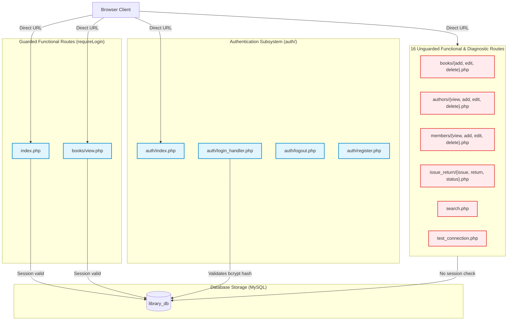

# Legacy System Baseline

**Project:** Library Management System Reengineering  
**Repository:** `Abdullah-Ali2k4/library-management-reengineering`  
**GitHub Issue:** [#6 — Establish Legacy System Baseline and Regression Test Plan](https://github.com/Abdullah-Ali2k4/library-management-reengineering/issues/6)  
**Date:** 2026-10-16  
**Status:** Draft — Pending Review  
**Auditor / Technical Lead:** Senior Software Reengineering Engineer  
**Related Artifacts:**
- [`docs/reverse-engineering/requirements/recovered-srs.md`](../../reverse-engineering/requirements/recovered-srs.md)
- [`docs/reverse-engineering/requirements/business-rules.md`](../../reverse-engineering/requirements/business-rules.md)
- [`docs/reverse-engineering/requirements/use-cases.md`](../../reverse-engineering/requirements/use-cases.md)
- [`docs/reverse-engineering/code/code-analysis.md`](../../reverse-engineering/code/code-analysis.md)
- [`docs/reverse-engineering/design/architecture/architecture.md`](../../reverse-engineering/design/architecture/architecture.md)
- [`docs/reverse-engineering/design/erd/erd.md`](../../reverse-engineering/design/erd/erd.md)

---

## 1. Executive Summary and Scope

This document establishes the official **Legacy System Baseline** for the Library Management System prior to any reengineering, architectural restructuring, or defect repair.

### Objectives
1. **Document Setup and Configuration:** Record the verified technical prerequisites, schema import order, seeded credentials, and local configuration based strictly on repository evidence.
2. **Reconcile Access Control and Routes:** Provide an explicit, exhaustive inventory of all 27 PHP files: 5 shared support files, 4 authentication routes, 17 functional application routes, and 1 diagnostic route. Of the 18 functional and diagnostic entry points, exactly 2 are protected and 16 are unguarded. Authentication routes are analyzed separately.
3. **Record Observable Legacy Behaviors:** Detail verifiable behavior across all core workflows, mapping them to recovered use cases and business rules.
4. **Separate Defects from Intended Design:** Explicitly distinguish legacy bugs and security vulnerabilities from desired behavior to prevent preserving unintended flaws.
5. **Preserve Architectural Strengths:** Catalog verified technical strengths (parameterized queries, view escaping, and transaction locks) with appropriately qualified statements.
6. **Provide a Repeatable Verification Checklist:** Formulate a step-by-step verification checklist distinguishing syntax checks, static code analysis, and actual runtime test results.

---

## 2. Environment Prerequisites and Setup Verification

### 2.1 Verified Technical Prerequisites
Based on repository inspection, configuration files, and local CLI execution, the legacy application has the following technical profile:

| Component | Target / Requirement | Repository Evidence & Verification Method |
| :--- | :--- | :--- |
| **PHP Runtime** | **Untested Compatibility Target:** PHP 7.4 to 8.2 (Procedural) | **Syntax Verified:** PHP 8.2.12 CLI was used to lint all 27 files (`/opt/lampp/bin/php -l`); all passed with zero syntax errors. Helpers use typed returns (`: bool`, `: void`, `: ?array` in [`includes/auth.php:23-42`](file:///home/abdullah/Desktop/Library-management-system/includes/auth.php#L23-L42)). Backward compatibility with PHP 7.4 or forward compatibility with other versions has not been tested in this audit. No version constraint is declared in `README.md` or source code. |
| **PHP Extensions** | `mysqli`, `session`, `pcre` | **Code Verified:** Requires `mysqli` for database connectivity and prepared statements ([`config/db.php:17`](file:///home/abdullah/Desktop/Library-management-system/config/db.php#L17)); native PHP session functions (`session_start()`, `$_SESSION`) for authentication state. |
| **Database Engine** | **Untested Compatibility Target:** MySQL 5.7+ / MariaDB 10.3+ | **Inferred from DDL & Queries:** Schema scripts use InnoDB engine features: foreign keys (`ON DELETE SET NULL`, `ON DELETE CASCADE` in [`database/library_db.sql:32, 52-53`](file:///home/abdullah/Desktop/Library-management-system/database/library_db.sql#L32)) and pessimistic row locking (`SELECT ... FOR UPDATE` in [`issue_return/issue.php:34`](file:///home/abdullah/Desktop/Library-management-system/issue_return/issue.php#L34)). No specific database version is declared in repository files, and dynamic compatibility across server versions has not been runtime tested. |
| **Web Server** | Apache 2.4+ (XAMPP / LAMPP) or Built-in CLI Server | **Code Verified:** Evaluated with dynamic document root resolution in [`config/paths.php:19-45`](file:///home/abdullah/Desktop/Library-management-system/config/paths.php#L19-L45) which computes `BASE_URL`. Works in subdirectories or document roots. |
| **Frontend Assets** | Modern Web Browser | **Code Verified:** Vanilla HTML5, CSS3, Vanilla JavaScript ([`assets/js/validate.js`](file:///home/abdullah/Desktop/Library-management-system/assets/js/validate.js)), and FontAwesome 6.5.1 via CDN ([`includes/header.php:35`](file:///home/abdullah/Desktop/Library-management-system/includes/header.php#L35)). |

### 2.2 Local Environment Setup Procedure

#### Step 1: Web Directory Placement
Place or clone the project repository into the web server document root:
- **Linux (LAMPP / XAMPP):** `/opt/lampp/htdocs/Library-management-system`
- **Linux (System Apache):** `/var/www/html/Library-management-system`
- **Windows (XAMPP):** `C:/xampp/htdocs/Library-management-system`
- **PHP CLI Server (Local Dev):** Run from the project root:
  ```bash
  /opt/lampp/bin/php -S localhost:8000
  ```

#### Step 2: Database Provisioning and Schema Import Order
The database import order is strictly constrained by SQL statements in the schema files:

1. **First Import:** [`database/library_db.sql`](file:///home/abdullah/Desktop/Library-management-system/database/library_db.sql)  
   *Must be run first* because line 6 creates the database:
   ```sql
   CREATE DATABASE IF NOT EXISTS library_db;
   USE library_db;
   ```
   This script creates `authors`, `books`, `members`, and `issued_books`, and inserts initial seed data.

2. **Second Import:** [`database/user_schema.sql`](file:///home/abdullah/Desktop/Library-management-system/database/user_schema.sql)  
   *Must be run second* because line 6 executes `USE library_db;` without a `CREATE DATABASE` statement. If executed on a clean server before `library_db.sql`, it fails with `ERROR 1049 (42000): Unknown database 'library_db'`. It creates the `users` table and inserts the seed administrator account.

CLI Execution:
```bash
mysql -u root -p < database/library_db.sql
mysql -u root -p < database/user_schema.sql
```

#### Step 3: Verified Seed Data and Credentials
Inspection of the SQL seed scripts reveals the exact initial data set:

- **`authors` (3 records):**
  1. Chinua Achebe (Nigerian novelist)
  2. J.K. Rowling (British author)
  3. James Clear (Author, habits)
- **`books` (5 records, 20 total copies, 19 available copies):**
  1. *Things Fall Apart* (`total_copies=4`, `available_copies=3` — decremented by seed loan)
  2. *No Longer at Ease* (`total_copies=2`, `available_copies=2`)
  3. *Harry Potter and the Philosopher's Stone* (`total_copies=5`, `available_copies=5`)
  4. *Harry Potter and the Chamber of Secrets* (`total_copies=3`, `available_copies=3`)
  5. *Atomic Habits* (`total_copies=6`, `available_copies=6`)
- **`members` (3 records):**
  1. Enoch Adeyemi (`enoch.adeyemi@example.com`, `08012345678`)
  2. Blessing Okafor (`blessing.okafor@example.com`, `08023456789`)
  3. Ibrahim Musa (`ibrahim.musa@example.com`, `08034567890`)
- **`issued_books` (2 records):**
  1. Issue #1: Book 1 to Member 1, issued `2026-07-20`, due `2026-08-03`, `return_date NULL`, `status='issued'` (Active Loan).
  2. Issue #2: Book 3 to Member 2, issued `2026-07-15`, due `2026-07-29`, returned `2026-07-27`, `status='returned'` (Completed Loan).
- **`users` (1 administrator record):**
  - Username: `admin`
  - Email: `admin@library.local`
  - Stored Hash: `$2b$10$Guc5blPUzYhoDPZeAPKVl.Xi1LOVV77BR5KiyHUhr2SyJxqyJqQ/.`
  - Role: `admin`
  - Password Verification: Verified via PHP CLI `password_verify('admin123', $hash)` which evaluates to `true`.

> [!WARNING]
> **Documentation Drift (Conflict C-03):** [`README.md:35, 74`](file:///home/abdullah/Desktop/Library-management-system/README.md#L35) states: *"You can login using Username: admin, E-mail: admin@library.local and Password: admin123"*. However, inspection of [`auth/index.php:69`](file:///home/abdullah/Desktop/Library-management-system/auth/index.php#L69) and [`auth/login_handler.php:24-30`](file:///home/abdullah/Desktop/Library-management-system/auth/login_handler.php#L24-L30) proves the application login form accepts **email only** (`WHERE email = ?`). Attempting to submit `admin` in the email input causes HTML5 email validation or backend lookup failure.

#### Step 4: Database Configuration Verification
Database parameters are configured in [`config/db.php:11-14`](file:///home/abdullah/Desktop/Library-management-system/config/db.php#L11-L14):
```php
$db_host = 'localhost';
$db_user = 'root';
$db_pass = '';          // Default local password
$db_name = 'library_db';
```
Connection uses `new mysqli($db_host, $db_user, $db_pass, $db_name)`. On connection failure, line 21 executes `die("Database connection failed: " . $conn->connect_error);`.

#### Step 5: Verification via Diagnostic Tool
Navigate to:
```
http://localhost/Library-management-system/test_connection.php
```
`test_connection.php` queries `SELECT title FROM books` and renders them as an unordered list. Lines 11–12 document: *"DELETE this file once everyone has confirmed their setup works"*, confirming it was authored as a temporary diagnostic aid.

### 2.3 Verified Path-Debug Information Disclosure
Inspection of [`config/paths.php:54-63`](file:///home/abdullah/Desktop/Library-management-system/config/paths.php#L54-L63) confirms an active debug hook:
```php
if (isset($_GET['debug_paths'])) {
    echo '<div style="background:#fff3cd;border:1px solid #ffc107;padding:16px;margin:16px;font-family:monospace;font-size:13px;">';
    echo '<strong>PATH DEBUG INFO</strong><br>';
    echo 'This file (paths.php) location: ' . __FILE__ . '<br>';
    echo 'Computed project root: ' . (realpath(__DIR__ . '/..') ?: 'FAILED') . '<br>';
    echo 'Server DOCUMENT_ROOT: ' . ($_SERVER['DOCUMENT_ROOT'] ?? 'NOT SET') . '<br>';
    echo 'Computed BASE_URL: <strong>' . BASE_URL . '</strong><br>';
    echo 'Try this in your browser: <a href="' . BASE_URL . 'assets/css/style.css" target="_blank">' . BASE_URL . 'assets/css/style.css</a>';
    echo '</div>';
}
```
**Exact Information Disclosed:**
1. The absolute filesystem path of `paths.php` via `__FILE__`.
2. The server absolute path of the project root via `realpath(__DIR__ . '/..')`.
3. The web server document root directory via `$_SERVER['DOCUMENT_ROOT']`.
4. The application's dynamically calculated `BASE_URL`.
5. A live hyperlink to the CSS asset.

Because `config/paths.php` is included by `index.php`, `auth/index.php`, `auth/login_handler.php`, `auth/register.php`, and `includes/header.php`, appending `?debug_paths=1` to virtually any application page dumps this information to the browser.

### 2.4 Setup Blockers and Environment Limitations
- **Syntax Linting:** Passed 100% (27 of 27 PHP files verified cleanly via PHP 8.2.12 CLI).
- **Runtime Testing Blocker:** During this audit, the local MySQL daemon was not running on the host (`ERROR 2002 (HY000): Can't connect to local MySQL server through socket '/tmp/mysql.sock'`). Consequently, dynamic database transactions could not be executed at runtime. All behavioral claims in this baseline are supported by static inspection, AST control-flow/data-flow analysis, and verified schema constraints, with dynamic runtime testing marked as pending database daemon startup.

---

## 3. Explicit Route Inventory and Access Control Analysis

A complete audit of all 27 PHP files in the repository reconciles the access control landscape.

### 3.1 Exhaustive File and Route Classification

```
Repository PHP Files (27 Total)
├── Shared Support Files (5 files — not standalone routes)
│   ├── includes/auth.php        (Defines session helpers)
│   ├── includes/header.php      (Sidebar & navigation template)
│   ├── includes/footer.php      (Page footer template)
│   ├── config/db.php            (Database connection)
│   └── config/paths.php         (URL resolution & debug output)
├── Authentication Routes (4 routes — public by design)
│   ├── auth/index.php           (Login form)
│   ├── auth/login_handler.php   (Login POST action)
│   ├── auth/logout.php          (Session destroy endpoint)
│   └── auth/register.php        (Account registration form & action)
├── Diagnostic Route (1 route — unauthenticated utility)
│   └── test_connection.php     (Standalone DB diagnostic query tool)
└── Functional Application Routes (17 routes)
    ├── Dashboard: index.php     (PROTECTED by requireLogin())
    ├── Books: books/view.php    (PROTECTED by requireLogin())
    ├── Books: books/add.php     (UNGUARDED)
    ├── Books: books/edit.php    (UNGUARDED)
    ├── Books: books/delete.php  (UNGUARDED)
    ├── Authors: authors/view.php   (UNGUARDED)
    ├── Authors: authors/add.php    (UNGUARDED)
    ├── Authors: authors/edit.php   (UNGUARDED)
    ├── Authors: authors/delete.php (UNGUARDED)
    ├── Members: members/view.php   (UNGUARDED)
    ├── Members: members/add.php    (UNGUARDED)
    ├── Members: members/edit.php   (UNGUARDED)
    ├── Members: members/delete.php (UNGUARDED)
    ├── Circulation: issue_return/issue.php  (UNGUARDED)
    ├── Circulation: issue_return/return.php (UNGUARDED)
    ├── Circulation: issue_return/status.php (UNGUARDED)
    └── Search: search.php       (UNGUARDED)
```

### 3.2 Access Control Reconciliation Table
The 27 PHP files in the repository divide into:
- **5 Shared Support Files:** (`config/` and `includes/`), which are not standalone HTTP routes.
- **4 Authentication Routes:** Standalone entry points that are intentionally public (`auth/index.php`, `auth/login_handler.php`, `auth/logout.php`, `auth/register.php`).
- **18 Functional and Diagnostic Entry Points:** (17 functional application routes + 1 diagnostic route).
  - **Exactly 2 entry points enforce authentication:** [`index.php`](file:///home/abdullah/Desktop/Library-management-system/index.php#L4) and [`books/view.php`](file:///home/abdullah/Desktop/Library-management-system/books/view.php#L4) call `requireLogin()`.
  - **Exactly 16 entry points have zero authentication enforcement:** The remaining 15 functional application routes and the 1 diagnostic route execute operations anonymously.

| # | Route / File Path | Entry Type | Calls `requireLogin()`? | Includes `auth.php`? | Effective Access Control | Verified Status |
| :---: | :--- | :--- | :---: | :---: | :--- | :--- |
| **Functional Application Routes (17 routes)** | | | | | | |
| 1 | `index.php` | Functional App Route | **YES** (L4) | **YES** (L3) | Protected (Redirects to `auth/index.php`) | Confirmed in code |
| 2 | `books/view.php` | Functional App Route | **YES** (L4) | **YES** (L3) | Protected (Redirects to `auth/index.php`) | Confirmed in code |
| 3 | `books/add.php` | Functional App Route | **NO** | **NO** | **UNGUARDED (Publicly accessible)** | Confirmed in code |
| 4 | `books/edit.php` | Functional App Route | **NO** | **NO** | **UNGUARDED (Publicly accessible)** | Confirmed in code |
| 5 | `books/delete.php` | Functional Handler | **NO** | **NO** | **UNGUARDED (Publicly accessible)** | Confirmed in code |
| 6 | `authors/view.php` | Functional App Route | **NO** | **NO** | **UNGUARDED (Publicly accessible)** | Confirmed in code |
| 7 | `authors/add.php` | Functional App Route | **NO** | **NO** | **UNGUARDED (Publicly accessible)** | Confirmed in code |
| 8 | `authors/edit.php` | Functional App Route | **NO** | **NO** | **UNGUARDED (Publicly accessible)** | Confirmed in code |
| 9 | `authors/delete.php` | Functional Handler | **NO** | **NO** | **UNGUARDED (Publicly accessible)** | Confirmed in code |
| 10 | `members/view.php` | Functional App Route | **NO** | **NO** | **UNGUARDED (Publicly accessible)** | Confirmed in code |
| 11 | `members/add.php` | Functional App Route | **NO** | **NO** | **UNGUARDED (Publicly accessible)** | Confirmed in code |
| 12 | `members/edit.php` | Functional App Route | **NO** | **NO** | **UNGUARDED (Publicly accessible)** | Confirmed in code |
| 13 | `members/delete.php` | Functional Handler | **NO** | **NO** | **UNGUARDED (Publicly accessible)** | Confirmed in code |
| 14 | `issue_return/issue.php` | Functional App Route | **NO** | **NO** | **UNGUARDED (Publicly accessible)** | Confirmed in code |
| 15 | `issue_return/return.php` | Functional App Route | **NO** | **NO** | **UNGUARDED (Publicly accessible)** | Confirmed in code |
| 16 | `issue_return/status.php` | Functional App Route | **NO** | **NO** | **UNGUARDED (Publicly accessible)** | Confirmed in code |
| 17 | `search.php` | Functional App Route | **NO** | **NO** | **UNGUARDED (Publicly accessible)** | Confirmed in code |
| **Diagnostic Route (1 route)** | | | | | | |
| 18 | `test_connection.php` | Diagnostic Utility | **NO** | **NO** | **UNGUARDED (Publicly accessible)** | Confirmed in code |
| **Authentication Routes (4 routes — Analyzed Separately)** | | | | | | |
| 19 | `auth/index.php` | Auth Flow | **NO** | **NO** | Public Login Form | Confirmed in code |
| 20 | `auth/login_handler.php`| Auth Flow | **NO** | **NO** | Public Login Action (POST only) | Confirmed in code |
| 21 | `auth/logout.php` | Auth Flow | **NO** | **NO** | Public Logout Action | Confirmed in code |
| 22 | `auth/register.php` | Auth Flow | **NO** | **YES** (L9) | Public Registration (Checks `isLoggedIn`) | Confirmed in code |

---

## 4. Core Functional Workflows: Observable Legacy Behavior



### 4.1 Authentication & Session Management (UC-01, UC-02)
- **Login Handler ([`auth/login_handler.php`](file:///home/abdullah/Desktop/Library-management-system/auth/login_handler.php)):**
  - Requires HTTP `POST`. Validates non-empty `email` and `password`.
  - Executes prepared query `SELECT user_id, username, email, password_hash, role FROM users WHERE email = ? LIMIT 1`.
  - **Observable Behavior:** Lines 47–51 require:
    ```php
    if ($user && $user['role'] === 'admin' && password_verify($password, $user['password_hash']))
    ```
    If `role !== 'admin'`, authentication fails regardless of password correctness, returning `"Invalid email or password."`.
  - On success: executes `session_regenerate_id(true)` to mitigate session fixation; stores `user_id`, `username`, `user_email`, and `role` in `$_SESSION`; sets 30-day session cookie if `remember` checkbox was checked; redirects to `BASE_URL . index.php`.
- **Logout ([`auth/logout.php`](file:///home/abdullah/Desktop/Library-management-system/auth/logout.php)):**
  - Calls `session_start()`, `session_unset()`, `session_destroy()`, and redirects to `auth/index.php`.
  - Does not clear or expire the client-side session cookie.

### 4.2 Account Registration & Role Lockout (UC-03)
- **Registration ([`auth/register.php`](file:///home/abdullah/Desktop/Library-management-system/auth/register.php)):**
  - Accessible publicly. Checks `if (isLoggedIn())` and redirects active sessions to dashboard.
  - Requires `username`, `email`, `password`, and `confirm_password`. Validates password length $\ge 6$ and matching passwords.
  - Checks for duplicates via `SELECT user_id FROM users WHERE username = ? OR email = ?`.
  - Hashes password using `password_hash($password, PASSWORD_DEFAULT)`.
  - **Observable Behavior:** Line 51 hardcodes `$role = 'staff'`.
  - Executes `INSERT INTO users (username, email, password_hash, role) VALUES (?, ?, ?, ?)`.
  - **Conflict C-01 Consequence:** Registered accounts are assigned `role='staff'`. Because `login_handler.php:49` strictly checks `$user['role'] === 'admin'`, newly registered users cannot authenticate.

### 4.3 Catalog & Circulation Management (UC-05 to UC-17)
- **Book Catalog Add & Edit ([`books/add.php`](file:///home/abdullah/Desktop/Library-management-system/books/add.php), [`books/edit.php`](file:///home/abdullah/Desktop/Library-management-system/books/edit.php)):**
  - Unauthenticated. `add.php` initializes `available_copies = total_copies`.
  - `edit.php` permits manual editing of `available_copies`. It validates non-negative numbers and `available_copies <= total_copies` ([`books/edit.php:36-39`](file:///home/abdullah/Desktop/Library-management-system/books/edit.php#L36-L39)), but fails to check active loans in `issued_books`.
- **Destructive Deletions ([`books/delete.php`](file:///home/abdullah/Desktop/Library-management-system/books/delete.php), [`authors/delete.php`](file:///home/abdullah/Desktop/Library-management-system/authors/delete.php), [`members/delete.php`](file:///home/abdullah/Desktop/Library-management-system/members/delete.php)):**
  - Unauthenticated. Read IDs directly from `$_GET['id']`.
  - `books/delete.php` and `members/delete.php` check for unreturned loans (`status = 'issued'`). If active loans exist, deletion halts.
  - If no active loans exist, `DELETE FROM books WHERE book_id = ?` executes.
  - **Conflict C-04 Consequence:** Schema constraint `ON DELETE CASCADE` on `issued_books` causes all past returned loans (`status='returned'`) to be deleted.
- **Issue Workflow ([`issue_return/issue.php`](file:///home/abdullah/Desktop/Library-management-system/issue_return/issue.php)):**
  - Unauthenticated. Declares transaction with row locking syntax: `SELECT available_copies, total_copies FROM books WHERE book_id = ? FOR UPDATE`.
  - Verifies `available_copies > 0` and `due_date >= issue_date`.
  - Inserts row into `issued_books` with `status='issued'`.
  - Decrements `books.available_copies = available_copies - 1`.
  - Commits transaction; rolls back on exception.
- **Return Workflow ([`issue_return/return.php`](file:///home/abdullah/Desktop/Library-management-system/issue_return/return.php)):**
  - Unauthenticated. Declares transaction with row locking syntax: `SELECT book_id FROM issued_books WHERE issue_id = ? AND status = 'issued' FOR UPDATE`.
  - Sets `issued_books.status = 'returned'` and `return_date = CURDATE()`.
  - Increments `books.available_copies = available_copies + 1`.
  - Commits transaction; rolls back on exception.

---

## 5. Known Legacy Defects vs Intended Reengineering Behavior

To prevent conflating legacy vulnerabilities with intended functionality, the table below establishes explicit distinctions:

| Defect ID | Source Location | Observable Legacy Behavior | Severity & Risk | Target Reengineering Behavior |
| :--- | :--- | :--- | :--- | :--- |
| **DEF-AUTH-01** (GAP-005) | 16 scripts across modules | 16 functional and diagnostic routes do not call `requireLogin()`. | **Critical:** Anonymous visitors can execute CRUD operations on books, authors, members, and loans. | Centralized server-side authentication enforced across all protected administrative and circulation routes. |
| **DEF-AUTH-02** (C-01) | `auth/register.php:51` vs `auth/login_handler.php:49` | Registration creates `staff` accounts; login strictly requires `role === 'admin'`. | **High:** Registered staff accounts cannot authenticate; feature is unusable. | Align registration and login policies to permit valid role-based authentication. |
| **DEF-CSRF-01** (GAP-006) | `*/delete.php`, `*/view.php` | Deletions are triggered via HTTP GET links without CSRF tokens. | **Critical:** Vulnerable to drive-by deletions via crafted URLs or prefetching. | Require HTTP POST with session-bound CSRF tokens for all state-changing actions. |
| **DEF-DATA-01** (C-04, GAP-013) | `database/library_db.sql:52-53` | Foreign keys on `issued_books` specify `ON DELETE CASCADE`. | **High:** Deleting a book or member permanently purges completed lending history. | Implement soft-deletion or deletion restrictions to durably preserve lending records. |
| **DEF-INV-01** (C-05, C-08) | `books/edit.php:24, 36-39` | Book edit allows manual modification of `available_copies` without checking active loans. | **Medium:** Book availability can drift from physical stock and active loan counts. | Remove manual editing of available copies; enforce invariants ($0 \le \text{available} \le \text{total}$). |
| **DEF-CONF-01** (GAP-010) | `config/paths.php:54-63` | Appending `?debug_paths=1` displays server filesystem paths. | **Medium:** Leaks internal directory structures (`__FILE__`, `DOCUMENT_ROOT`). | Remove or restrict diagnostic debug hooks in production environments. |
| **DEF-CONF-02** (GAP-010) | `test_connection.php` | Committed diagnostic script exposes database contents without authentication. | **Low:** Information disclosure regarding catalog contents. | Remove standalone diagnostic script from production web root. |
| **DEF-UI-01** (AP-09) | `includes/header.php:25` | Header checks `function_exists('currentUser')` but does not include `includes/auth.php`. | **Low:** Displays "Welcome, Guest" on 14 pages even when logged in. | Standardize bootstrap so authentication helpers are loaded before header rendering. |

---

## 6. Preserved Technical Strengths (Qualified Evidence)

The following architectural and implementation patterns were verified during static code inspection and **must be preserved**:

1. **Consistent Parameterized Queries:** Static inspection of all 28 identified SQL query execution points confirmed the consistent use of parameterized prepared statements (`mysqli::prepare`, `bind_param`, and `execute`); no dynamic query string concatenation was identified in the inspected files. Note that dynamic penetration testing and full input boundary validation have not been performed.
2. **Consistent HTML Output Escaping:** 63 occurrences of `htmlspecialchars()` sanitize dynamic values rendered in HTML views, mitigating stored and reflected XSS in standard rendering paths.
3. **Pessimistic Concurrency Locking in Source Code:** Source code inspection of `issue_return/issue.php:34` and `issue_return/return.php:28` confirms pessimistic row locking syntax (`SELECT ... FOR UPDATE` inside transactions). However, concurrent multi-user execution and race condition resilience have not been dynamically verified under actual concurrent load.
4. **Modern Password Hashing:** Uses PHP's `password_hash()` (Bcrypt) and `password_verify()`, combined with `session_regenerate_id(true)` upon successful authentication.
5. **Clean Modular Directory Hierarchy:** Logical domain separation (`auth/`, `authors/`, `books/`, `members/`, `issue_return/`, `config/`, `includes/`).

---

## 7. Repeatable Legacy Manual Verification Checklist

| Check ID | Target Workflow | Execution Steps | Expected Legacy Behavior | Verification Status | Evidence & Audit Notes |
| :--- | :--- | :--- | :--- | :--- | :--- |
| **CHK-01** | Syntax & Code Hygiene | Run PHP lint on all project files: `find . -name "*.php" -exec /opt/lampp/bin/php -l {} \;` | All 27 files return `No syntax errors detected`. | **PASSED (CLI)** | Verified on PHP 8.2.12 CLI. Zero syntax errors detected. |
| **CHK-02** | Diagnostic Connection | Navigate to `http://localhost/.../test_connection.php` | Displays `Connected successfully!` and lists seeded book titles. | **NOT RUN (Runtime Blocked)** | Blocked: local MySQL daemon inactive. Code-verified in `test_connection.php:15-30`. |
| **CHK-03** | Path Debug Disclosure | Visit `http://localhost/.../index.php?debug_paths=1` | Yellow debug box displays `__FILE__`, `projectRoot`, `DOCUMENT_ROOT`. | **CODE-VERIFIED** | Code confirmed in [`config/paths.php:54-63`](file:///home/abdullah/Desktop/Library-management-system/config/paths.php#L54-L63). |
| **CHK-04** | Admin Authentication | Submit `admin@library.local` / `admin123` at `auth/index.php` | Session created; redirects to `index.php`; sidebar displays "Welcome, admin". | **CODE-VERIFIED** | Code confirmed in [`auth/login_handler.php:47-82`](file:///home/abdullah/Desktop/Library-management-system/auth/login_handler.php#L47-L82). Password hash verified via CLI. |
| **CHK-05** | Staff Registration Lockout | Register new account at `auth/register.php`; attempt login at `auth/index.php` | Account created in DB with `role='staff'`; login fails with `"Invalid email or password."` | **CODE-VERIFIED** | Code confirmed in [`auth/register.php:51`](file:///home/abdullah/Desktop/Library-management-system/auth/register.php#L51) and [`auth/login_handler.php:49`](file:///home/abdullah/Desktop/Library-management-system/auth/login_handler.php#L49). (DEF-AUTH-02). |
| **CHK-06** | Unguarded Direct Access | In private browsing (no cookies), open `books/add.php`, `members/add.php`, `issue_return/issue.php` | Pages load without redirection; forms are fully functional for anonymous visitors. | **CODE-VERIFIED** | Grep confirmed: 16 functional/diagnostic scripts lack `requireLogin()`. (DEF-AUTH-01). |
| **CHK-07** | GET-Based Book Deletion | Visit `http://localhost/.../books/delete.php?id=2` directly | Book #2 is deleted without confirmation or CSRF check; redirects to `view.php?deleted=1`. | **CODE-VERIFIED** | Code confirmed in [`books/delete.php:4-35`](file:///home/abdullah/Desktop/Library-management-system/books/delete.php#L4-L35). (DEF-CSRF-01). |
| **CHK-08** | Lending History Purge | Return an active loan; confirm loan is marked `returned`; delete the book | Book is deleted; historical row in `issued_books` is permanently deleted by cascade. | **CODE-VERIFIED** | Schema confirmed in [`database/library_db.sql:52`](file:///home/abdullah/Desktop/Library-management-system/database/library_db.sql#L52). (DEF-DATA-01). |
| **CHK-09** | Concurrent Issue Lock | Attempt two simultaneous issue requests for a book with `available_copies = 1` | Exactly one transaction succeeds; the second receives `"This book is currently out of stock."` | **CODE-VERIFIED (Static)** | Code confirmed: row lock `FOR UPDATE` in [`issue_return/issue.php:34`](file:///home/abdullah/Desktop/Library-management-system/issue_return/issue.php#L34). Dynamic parallel concurrency has not been runtime tested. |
| **CHK-10** | Manual Inventory Override | In `books/edit.php`, set `available_copies = 99` while `total_copies = 5` | Form rejects input ($99 > 5$), but permits setting `available_copies = 5` even if active loans exist. | **CODE-VERIFIED** | Code confirmed in [`books/edit.php:36-39`](file:///home/abdullah/Desktop/Library-management-system/books/edit.php#L36-L39). (DEF-INV-01). |

---

## 8. Summary of Findings and Baseline Acceptance Criteria

This verified baseline establishes:
1. **Accurate Setup Knowledge:** Explicit SQL import sequence (`library_db.sql` then `user_schema.sql`), verified seed credentials (`admin@library.local` / `admin123`), and dynamic root calculation via `config/paths.php`.
2. **Reconciled Access Control:** Exact 16-of-18 functional/diagnostic route access failure identified and mapped, keeping authentication routes distinct.
3. **Evidence-Backed Vulnerabilities:** Disclosed debug paths (`config/paths.php:54`), unauthenticated GET deletions, and CASCADE data loss verified directly in source code.
4. **Verification Discipline:** Distinguishes syntax linting (`PASSED`), static code flow verification (`CODE-VERIFIED`), and unexecuted dynamic runtime tests (`NOT RUN`).
