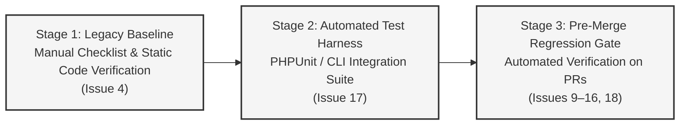

# Regression Test Plan

**Project:** Library Management System Reengineering  
**Repository:** `Abdullah-Ali2k4/library-management-reengineering`  
**GitHub Issue:** [#6 — Establish Legacy System Baseline and Regression Test Plan](https://github.com/Abdullah-Ali2k4/library-management-reengineering/issues/6)  
**Date:** 2026-10-16  
**Status:** Draft — Pending Review  
**Auditor / Technical Lead:** Senior Software Reengineering Engineer  
**Related Artifacts:**
- [`docs/reengineering/baseline/legacy-baseline.md`](legacy-baseline.md)
- [`docs/reverse-engineering/requirements/recovered-srs.md`](../../reverse-engineering/requirements/recovered-srs.md)
- [`docs/reverse-engineering/requirements/business-rules.md`](../../reverse-engineering/requirements/business-rules.md)
- [`docs/reverse-engineering/requirements/use-cases.md`](../../reverse-engineering/requirements/use-cases.md)
- [`docs/reverse-engineering/code/code-analysis.md`](../../reverse-engineering/code/code-analysis.md)

---

## 1. Objectives and Scope

The **Regression Test Plan** establishes a repeatable verification framework to guarantee that:
1. Core library management capabilities and business rules are preserved throughout the reengineering lifecycle.
2. Verified security protections (parameterized queries, view escaping, and transaction locks) remain intact.
3. Defect corrections implemented in subsequent issues (Issues 9–16) are verified against unambiguous acceptance criteria.
4. Unintended regressions or database inconsistencies are detected immediately.

### Scope & System Profile
- **Repository Composition:** 27 PHP files total, comprising 5 shared support files, 4 authentication routes, 17 functional application routes, and 1 diagnostic route.
- **Access Control Baseline:** Of the 18 functional and diagnostic entry points, exactly 2 are protected by `requireLogin()` and 16 are unguarded. Authentication routes (4) are analyzed separately.
- **Environment Profile:**
  - **Syntax Linting:** Verified on PHP 8.2.12 CLI (`php -l` on all 27 files passed).
  - **Untested Compatibility Targets:** PHP 7.4–8.2 and MySQL 5.7+ / MariaDB 10.3+ (InnoDB). Specific multi-version compatibility has not been tested in this audit.
- **Coverage Scope:** 41 distinct test cases covering Normal, Boundary, Error, Security, and Concurrency scenarios across all modules.

---

## 2. Regression Testing Strategy and Environment Setup

### 2.1 Multi-Phase Testing Lifecycle



- **Stage 1 (Current — Issue 4):** Establish the structured 41-case test matrix, execute syntax validation via PHP 8.2.12 CLI, verify logic via static analysis, and record current execution status.
- **Stage 2 (Issue 17):** Implement the automated regression test runner (`tests/`) targeting an isolated test database.
- **Stage 3 (Issues 9–16, 18):** Execute the regression test suite prior to approving or merging pull requests.

### 2.2 Repeatable Test Environment Setup

To execute regression tests without corrupting development or seed records, all test operations must target a dedicated test database:

#### Setup Commands
```bash
# 1. Create isolated test database
mysql -u root -p -e "CREATE DATABASE IF NOT EXISTS library_db_test CHARACTER SET utf8mb4 COLLATE utf8mb4_unicode_ci;"

# 2. Import base schema and seed data (Order is mandatory: library_db.sql first, then user_schema.sql)
mysql -u root -p library_db_test < database/library_db.sql
mysql -u root -p library_db_test < database/user_schema.sql
```

#### Deterministic Teardown and Re-seeding
Before executing a full test run, the test database can be reset to its deterministic baseline state:
```bash
mysql -u root -p -e "DROP DATABASE IF EXISTS library_db_test; CREATE DATABASE library_db_test;"
mysql -u root -p library_db_test < database/library_db.sql
mysql -u root -p library_db_test < database/user_schema.sql
```

### 2.3 Runtime Blockers and Execution Status
- **Syntax Linting:** Passed 100% on PHP 8.2.12 CLI (`php -l` on all 27 files).
- **Runtime Execution Status:** In this audit session, dynamic database execution was **Not Run (Runtime Blocked)** because the host MySQL daemon was not active (`socket /tmp/mysql.sock not found`). In compliance with Issue #6 rules, **no unexecuted dynamic test is reported as passed**. All 41 test cases are documented with exact steps, preconditions, expected outcomes, legacy observed behaviors, and code-verification evidence, ready for live execution once the database service is started.

---

## 3. Comprehensive Regression Test Matrix (41 Test Cases)

*Execution Status Legend:*
- **Syntax Validated (CLI):** Syntax validated cleanly via `/opt/lampp/bin/php -l` under PHP 8.2.12.
- **Code-Verified (Static):** Logic, control-flow, and queries confirmed via static code inspection.
- **Not Run (Runtime Blocked):** Defined for runtime execution; blocked by inactive MySQL daemon.

*Execution Mode Legend:*
- **Manual Initially:** Manually verified via checklist in Issue 4.
- **Automated (Issue 17):** Scheduled for programmatic execution in the automated test suite.

---

### Module 1: Authentication and Session Management (9 Test Cases)

| Test ID | Traceability | Scenario Type | Preconditions | Action & Input Steps | Expected Outcome (Intended Reengineering) | Legacy Observed Behavior (Baseline) | Actual Outcome & Status | Execution Mode |
| :--- | :--- | :--- | :--- | :--- | :--- | :--- | :--- | :--- |
| **REG-AUTH-01** | FR-001, BR-001, UC-01 | Normal | Seed admin exists in DB (`admin@library.local` / `admin123`). | POST `email=admin@library.local` & `password=admin123` to `auth/login_handler.php`. | Session created; `$_SESSION['user_id']` set; session regenerated; redirect to `index.php`. | Authenticates admin; regenerates session ID; sets `$_SESSION['role'] = 'admin'`. | **Code-Verified** (Static)<br>*Not Run (Runtime Blocked)* | Automated (Issue 17) |
| **REG-AUTH-02** | FR-002, BR-002, UC-01 | Error | Seed admin exists. | POST valid email with incorrect password (`wrongpass`) to `auth/login_handler.php`. | Rejects login; sets `$_SESSION['login_error'] = "Invalid email or password."`; no session. | Rejects login; sets generic error message; does not disclose password mismatch. | **Code-Verified** (Static)<br>*Not Run (Runtime Blocked)* | Automated (Issue 17) |
| **REG-AUTH-03** | FR-002, BR-002, UC-01 | Error | Database online. | POST non-existent email (`nonexistent@example.com`) to `auth/login_handler.php`. | Rejects login with identical generic error message as wrong password. | Rejects login; generic error prevents user enumeration via timing/message differences. | **Code-Verified** (Static)<br>*Not Run (Runtime Blocked)* | Automated (Issue 17) |
| **REG-AUTH-04** | FR-003, BR-003, UC-01 | Security | User session active before login. | Submit valid credentials to `auth/login_handler.php`; inspect session ID before/after. | New session ID generated upon authentication to prevent session fixation. | Calls `session_regenerate_id(true)` at line 54; session ID changes. | **Code-Verified** (Static)<br>*Not Run (Runtime Blocked)* | Automated (Issue 17) |
| **REG-AUTH-05** | FR-004, BR-004, UC-01 | Normal | Login page open. | Check "Remember Me" checkbox and submit valid login. | Sets cookie with 30-day expiration (`time() + 30*24*60*60`) with `httponly` and `samesite=Lax`. | Sets cookie using `session_get_cookie_params()` parameters (`auth/login_handler.php:67-77`). | **Code-Verified** (Static)<br>*Not Run (Runtime Blocked)* | Manual Initially |
| **REG-AUTH-06** | FR-006, BR-005, UC-02 | Normal | User logged in. | Request `auth/logout.php`. | Session destroyed; redirected to `auth/index.php`; access to `index.php` blocked. | Calls `session_destroy()`; redirects to login. Does not clear remember-me cookie. | **Code-Verified** (Static)<br>*Not Run (Runtime Blocked)* | Automated (Issue 17) |
| **REG-AUTH-07** | BR-006, GAP-005, DEF-AUTH-01 | Security | Anonymous client (no cookies). | Send HTTP GET to `index.php` and `books/view.php`. | Redirects to `auth/index.php` (HTTP 302). | Calls `requireLogin()`; header redirect to `auth/index.php` occurs. | **Code-Verified** (Static)<br>*Not Run (Runtime Blocked)* | Automated (Issue 17) |
| **REG-AUTH-08** | BR-006, GAP-005, DEF-AUTH-01 | Security / Defect | Anonymous client (no cookies). | Send HTTP GET to `books/add.php`, `members/view.php`, and `issue_return/issue.php`. | Access blocked (HTTP 302 or 403 Forbidden). | **Defect (DEF-AUTH-01):** Pages load completely; anonymous users can execute operations. | **Code-Verified** (Static)<br>*Not Run (Runtime Blocked)* | Automated (Issue 17) |
| **REG-AUTH-09** | BR-001, C-01, GAP-004 | Boundary / Defect | User registered with `role='staff'`. | POST valid staff credentials to `auth/login_handler.php`. | Staff user logs in successfully with appropriate staff role permissions. | **Defect (DEF-AUTH-02):** Rejects login with `"Invalid email or password."` (`role === 'admin'` check). | **Code-Verified** (Static)<br>*Not Run (Runtime Blocked)* | Automated (Issue 17) |

---

### Module 2: Account Registration and Role Provisioning (5 Test Cases)

| Test ID | Traceability | Scenario Type | Preconditions | Action & Input Steps | Expected Outcome (Intended Reengineering) | Legacy Observed Behavior (Baseline) | Actual Outcome & Status | Execution Mode |
| :--- | :--- | :--- | :--- | :--- | :--- | :--- | :--- | :--- |
| **REG-REG-01** | FR-004, BR-010, UC-03 | Normal | Anonymous visitor on `auth/register.php`. | Submit unique username, valid email, matching passwords ($\ge 6$ chars). | Account created in DB with Bcrypt hash; user permitted to log in per policy. | Account inserted with hardcoded `role='staff'`; user locked out of login. | **Code-Verified** (Static)<br>*Not Run (Runtime Blocked)* | Automated (Issue 17) |
| **REG-REG-02** | FR-005, BR-010, UC-03 | Boundary | Registration form open. | Submit password with 5 characters (`12345`). | Rejected with error: `"Password must be at least 6 characters."` | Form rejects input at line 32; no database query executed. | **Code-Verified** (Static)<br>*Not Run (Runtime Blocked)* | Automated (Issue 17) |
| **REG-REG-03** | FR-005, BR-010, UC-03 | Error | Registration form open. | Submit passwords that do not match (`pass123` vs `pass456`). | Rejected with error: `"Passwords do not match."` | Form rejects input at line 35; database untouched. | **Code-Verified** (Static)<br>*Not Run (Runtime Blocked)* | Automated (Issue 17) |
| **REG-REG-04** | FR-005, BR-010, UC-03 | Error | User `admin@library.local` exists. | Attempt registration with email `admin@library.local`. | Rejected: `"That username or email is already registered."` | Duplicate check query matches and appends error at line 44. | **Code-Verified** (Static)<br>*Not Run (Runtime Blocked)* | Automated (Issue 17) |
| **REG-REG-05** | BR-009, GAP-002 | Security | Registration endpoint. | Inject `role=admin` into POST body of `auth/register.php`. | Role injection rejected or ignored; server strictly assigns default role. | Server ignores `$_POST['role']` and hardcodes `$role = 'staff'`. | **Code-Verified** (Static)<br>*Not Run (Runtime Blocked)* | Automated (Issue 17) |

---

### Module 3: Book Catalog Management (8 Test Cases)

| Test ID | Traceability | Scenario Type | Preconditions | Action & Input Steps | Expected Outcome (Intended Reengineering) | Legacy Observed Behavior (Baseline) | Actual Outcome & Status | Execution Mode |
| :--- | :--- | :--- | :--- | :--- | :--- | :--- | :--- | :--- |
| **REG-BOOK-01** | FR-017, UC-05 | Normal | Seed database imported. | Request `books/view.php` with valid session. | Renders catalog table containing all 5 seeded books with correct columns. | Displays table with title, author, category, copies, and action links. | **Code-Verified** (Static)<br>*Not Run (Runtime Blocked)* | Automated (Issue 17) |
| **REG-BOOK-02** | FR-018, BR-015, UC-06 | Normal | Book form open. | Submit Title `"Refactoring"`, author 1, ISBN `"978-0201485677"`, copies 4. | Record created; `total_copies = 4`, `available_copies = 4`. | Inserts record; `available_copies` set equal to `total_copies`. | **Code-Verified** (Static)<br>*Not Run (Runtime Blocked)* | Automated (Issue 17) |
| **REG-BOOK-03** | FR-019, BR-017, UC-06 | Boundary | Book add form. | Submit total copies $= 0$ or $-5$. | Rejected with error: `"Total copies must be at least 1."` | Rejected by validation check at line 27; database untouched. | **Code-Verified** (Static)<br>*Not Run (Runtime Blocked)* | Automated (Issue 17) |
| **REG-BOOK-04** | FR-019, BR-016, UC-06 | Error | Book with ISBN `"978-0435905255"` exists. | Add new book with duplicate ISBN `"978-0435905255"`. | Rejected: duplicate ISBN error message displayed. | Pre-check query detects duplicate and displays error. | **Code-Verified** (Static)<br>*Not Run (Runtime Blocked)* | Automated (Issue 17) |
| **REG-BOOK-05** | FR-020, C-05, C-08 | Boundary / Defect | Book #1 has 1 active loan (`total=4`, `avail=3`). | In `books/edit.php`, submit `total_copies = 1` or `available_copies = 99`. | Rejects update: total cannot be less than active loans; avail cannot exceed total. | **Defect (DEF-INV-01):** Validates `avail <= total`, but ignores active loan count. | **Code-Verified** (Static)<br>*Not Run (Runtime Blocked)* | Automated (Issue 17) |
| **REG-BOOK-06** | FR-023, BR-020, UC-08 | Error | Book #1 has active loan (`status='issued'`). | Send deletion request for Book #1. | Deletion blocked: active loan prevents deletion. | Active loan check in `books/delete.php:17` halts deletion. | **Code-Verified** (Static)<br>*Not Run (Runtime Blocked)* | Automated (Issue 17) |
| **REG-BOOK-07** | FR-024, C-04, GAP-013 | Security / Defect | Book #3 has only returned loans. | Send deletion request for Book #3 (`delete.php?id=3`). | Book deactivated/soft-deleted; historical records in `issued_books` retained. | **Defect (DEF-DATA-01):** Book deleted; cascade deletes historical loan records. | **Code-Verified** (Static)<br>*Not Run (Runtime Blocked)* | Automated (Issue 17) |
| **REG-BOOK-08** | GAP-006, QA-02 | Security / Defect | Book #2 exists. | Send HTTP GET to `books/delete.php?id=2`. | GET request rejected (HTTP 405/403); requires POST with CSRF token. | **Defect (DEF-CSRF-01):** Book is deleted immediately via GET link. | **Code-Verified** (Static)<br>*Not Run (Runtime Blocked)* | Automated (Issue 17) |

---

### Module 4: Author and Member Management (6 Test Cases)

| Test ID | Traceability | Scenario Type | Preconditions | Action & Input Steps | Expected Outcome (Intended Reengineering) | Legacy Observed Behavior (Baseline) | Actual Outcome & Status | Execution Mode |
| :--- | :--- | :--- | :--- | :--- | :--- | :--- | :--- | :--- |
| **REG-AM-01** | FR-026, UC-10 | Normal | Author add form. | Submit first name `"Martin"`, last name `"Fowler"`, valid bio. | Author created; auto-increment ID assigned; redirects to `authors/view.php`. | Inserts row into `authors`; prepared statement executed. | **Code-Verified** (Static)<br>*Not Run (Runtime Blocked)* | Automated (Issue 17) |
| **REG-AM-02** | FR-028, UC-11 | Normal | Author #1 has associated books. | Send delete request for Author #1 (`authors/delete.php?id=1`). | Author deleted; associated books have `author_id` set to `NULL`. | Foreign key `ON DELETE SET NULL` executes; books remain intact. | **Code-Verified** (Static)<br>*Not Run (Runtime Blocked)* | Automated (Issue 17) |
| **REG-AM-03** | FR-030, UC-13 | Normal | Member add form. | Submit full name `"Grace Hopper"`, unique email, valid phone. | Member record created; visible in `members/view.php`. | Inserts row into `members`; prepared statement executed. | **Code-Verified** (Static)<br>*Not Run (Runtime Blocked)* | Automated (Issue 17) |
| **REG-AM-04** | FR-031, UC-13 | Error | Member with email `enoch.adeyemi@example.com` exists. | Attempt to create member with duplicate email. | Rejected: duplicate email validation error rendered. | Check query detects duplicate and displays error message. | **Code-Verified** (Static)<br>*Not Run (Runtime Blocked)* | Automated (Issue 17) |
| **REG-AM-05** | FR-032, BR-027, UC-14 | Error | Member #1 has active issued book. | Send delete request for Member #1 (`members/delete.php?id=1`). | Deletion blocked: active loan prevents member deletion. | Active loan check in `members/delete.php:17` halts deletion. | **Code-Verified** (Static)<br>*Not Run (Runtime Blocked)* | Automated (Issue 17) |
| **REG-AM-06** | FR-033, C-04, GAP-013 | Security / Defect | Member #2 has only returned loans. | Send delete request for Member #2. | Member deactivated/soft-deleted; borrowing history retained in `issued_books`. | **Defect (DEF-DATA-01):** Member deleted; cascade permanently deletes loan history. | **Code-Verified** (Static)<br>*Not Run (Runtime Blocked)* | Automated (Issue 17) |

---

### Module 5: Circulation Management (8 Test Cases)

| Test ID | Traceability | Scenario Type | Preconditions | Action & Input Steps | Expected Outcome (Intended Reengineering) | Legacy Observed Behavior (Baseline) | Actual Outcome & Status | Execution Mode |
| :--- | :--- | :--- | :--- | :--- | :--- | :--- | :--- | :--- |
| **REG-CIRC-01** | FR-034, BR-028, UC-15 | Normal | Book #2 has `available_copies = 2`. Member #3 exists. | Issue Book #2 to Member #3 with due date $+14$ days. | Transaction commits; row in `issued_books` created; `available_copies` becomes 1. | Transaction commits with row lock; availability decremented by 1. | **Code-Verified** (Static)<br>*Not Run (Runtime Blocked)* | Automated (Issue 17) |
| **REG-CIRC-02** | FR-036, BR-031, UC-15 | Error | Circulation form open. | Submit issue with due date earlier than issue date (yesterday). | Rejected: due date cannot be in the past. | Form validation rejects input: `"Due date cannot be in the past."` | **Code-Verified** (Static)<br>*Not Run (Runtime Blocked)* | Automated (Issue 17) |
| **REG-CIRC-03** | FR-035, BR-029, UC-15 | Boundary | Book has `available_copies = 0`. | Attempt to issue book with zero available copies. | Rejected: book is out of stock. Transaction rolls back. | Form validation rejects: `"This book is currently out of stock."` | **Code-Verified** (Static)<br>*Not Run (Runtime Blocked)* | Automated (Issue 17) |
| **REG-CIRC-04** | FR-039, BR-032, UC-16 | Normal | Book #1 issued to Member #1 (`available=3`). | Process return for Issue #1 in `issue_return/return.php`. | Transaction commits; `status='returned'`, `return_date=CURDATE()`; `avail` becomes 4. | Transaction commits; status updated; availability incremented by 1. | **Code-Verified** (Static)<br>*Not Run (Runtime Blocked)* | Automated (Issue 17) |
| **REG-CIRC-05** | FR-040, UC-16 | Error | Loan #2 is already marked `returned`. | Attempt to return Loan #2 a second time. | Rejected: loan already returned. Counter not double-incremented. | Query verifies `status='issued'`; fails to match and displays error. | **Code-Verified** (Static)<br>*Not Run (Runtime Blocked)* | Automated (Issue 17) |
| **REG-CIRC-06** | FR-042, BR-035, UC-17 | Normal | Issue with `due_date < CURDATE()` exists. | Request `issue_return/status.php` and `index.php`. | Overdue loan displays "OVERDUE" badge; increments overdue count on dashboard. | Correctly displays "OVERDUE" badge and increments dashboard counter. | **Code-Verified** (Static)<br>*Not Run (Runtime Blocked)* | Automated (Issue 17) |
| **REG-CIRC-07** | BR-028, SC-01 | Concurrency | Book has `available_copies = 1`. | Two concurrent threads submit issue requests for Book at exact same millisecond. | Exactly one request succeeds; second fails gracefully. Available copies ends at 0 (never $-1$). | Row lock syntax `SELECT ... FOR UPDATE` confirmed in code. Dynamic parallel execution not tested. | **Code-Verified** (Static)<br>*Not Run (Runtime Blocked)* | Automated (Issue 17) |
| **REG-CIRC-08** | BR-028, SC-01 | Concurrency / Error | Book has `available_copies = 1`. | Trigger database error between `INSERT issued_books` and `UPDATE books`. | Entire transaction rolls back; no orphan loan created; availability unchanged. | Calls `$conn->rollback()` inside `catch (Exception $e)` block. | **Code-Verified** (Static)<br>*Not Run (Runtime Blocked)* | Automated (Issue 17) |

---

### Module 6: Search, Reporting, and Diagnostics (5 Test Cases)

| Test ID | Traceability | Scenario Type | Preconditions | Action & Input Steps | Expected Outcome (Intended Reengineering) | Legacy Observed Behavior (Baseline) | Actual Outcome & Status | Execution Mode |
| :--- | :--- | :--- | :--- | :--- | :--- | :--- | :--- | :--- |
| **REG-SRCH-01** | FR-045, UC-18 | Normal | Seed catalog imported. | Search catalog for query `"Potter"`. | Returns 2 matching Harry Potter books with author, copies, and edit links. | Prepared query with `LIKE ?` executes and renders matching rows. | **Code-Verified** (Static)<br>*Not Run (Runtime Blocked)* | Automated (Issue 17) |
| **REG-SRCH-02** | FR-045, UC-18 | Boundary | Seed catalog imported. | Search catalog for non-existent term `"XYZ999"`. | Renders `"No books found matching your search."` without errors. | Displays empty search state cleanly. | **Code-Verified** (Static)<br>*Not Run (Runtime Blocked)* | Automated (Issue 17) |
| **REG-CONF-01** | GAP-010, QA-06 | Security / Defect | Application running. | Visit `index.php?debug_paths=1`. | Query parameter ignored; no filesystem paths or debug output rendered. | **Defect (DEF-CONF-01):** Displays internal server paths (`__FILE__`, `DOCUMENT_ROOT`). | **Code-Verified** (Static)<br>*Not Run (Runtime Blocked)* | Automated (Issue 17) |
| **REG-CONF-02** | GAP-010, QA-03 | Security / Defect | Application running. | Request `test_connection.php`. | Endpoint removed (HTTP 404) or restricted to authenticated administrators. | **Defect (DEF-CONF-02):** Publicly executes queries and reports database status. | **Code-Verified** (Static)<br>*Not Run (Runtime Blocked)* | Automated (Issue 17) |
| **REG-CONF-03** | NFR-002, QA-08 | Error | Database credentials invalid in `config/db.php`. | Load any page making a database query. | User-safe error page displayed; zero database passwords or driver traces leaked. | Calls `die("Database connection failed: " . $conn->connect_error)`. | **Code-Verified** (Static)<br>*Not Run (Runtime Blocked)* | Automated (Issue 17) |

---

## 4. Automation Roadmap (Transition to Issue 17)

The 41 test cases defined in the regression matrix are planned for progressive automation as follows:

```
Total Test Cases in Matrix: 41
├── Automated Candidates (Issue 17): 37 cases (90.2%)
│   ├── Module 1 (Auth & Session): 8 cases (REG-AUTH-01..04, 06..09)
│   ├── Module 2 (Registration & Roles): 5 cases (REG-REG-01..05)
│   ├── Module 3 (Book Catalog): 8 cases (REG-BOOK-01..08)
│   ├── Module 4 (Authors & Members): 6 cases (REG-AM-01..06)
│   ├── Module 5 (Circulation): 8 cases (REG-CIRC-01..08)
│   └── Module 6 (Search & Config): 5 cases (REG-SRCH-01..02, REG-CONF-01..03)
└── Manual Initially (Issue 4 Checklist): 4 cases (9.8%)
    ├── REG-AUTH-05 (Client-side 30-day cookie verification)
    ├── Responsive sidebar menu toggle on mobile viewport
    ├── FontAwesome icon rendering via external CDN
    └── Browser form validation styling and layout
```

---

## 5. Pre-Merge Verification Protocol for Implementation Issues

Before merging any code changes for Issues 8 through 16:
1. **Pre-PR Run:** Developer resets `library_db_test` and runs the full test suite on `main`.
2. **Branch Run:** Developer executes the test suite on the feature branch.
3. **Regression Evidence:** Pull request descriptions must include the test output log proving all baseline tests passed.
4. **Protections Sign-Off:** Reviewer verifies that prepared statements and output escaping were preserved.
