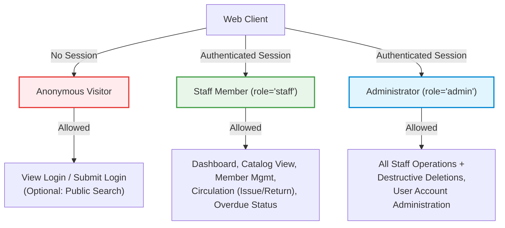
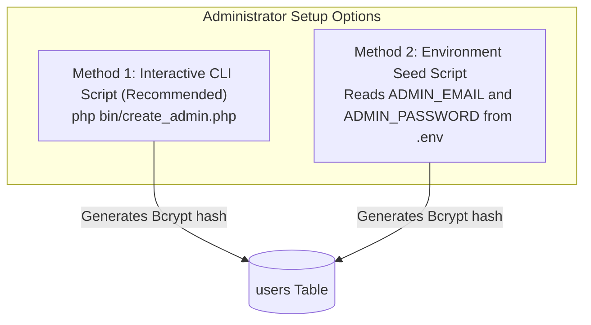

# Authentication, Authorization, and Registration Policy

**Project:** Library Management System Reengineering  
**Repository:** `Abdullah-Ali2k4/library-management-reengineering`  
**GitHub Issue:** [#7 — Define Authentication, Authorization, and Registration Policy](https://github.com/Abdullah-Ali2k4/library-management-reengineering/issues/7) (Issue 5 in Project Backlog)  
**Date:** 2026-10-16  
**Status:** Draft — Proposal for Team Review  
**Auditor / Technical Lead:** Senior Software Reengineering Engineer  
**Related Artifacts:**
- [`docs/reengineering/baseline/legacy-baseline.md`](../baseline/legacy-baseline.md)
- [`docs/reengineering/baseline/regression-test-plan.md`](../baseline/regression-test-plan.md)
- [`docs/reverse-engineering/requirements/recovered-srs.md`](../../reverse-engineering/requirements/recovered-srs.md)
- [`docs/reverse-engineering/requirements/business-rules.md`](../../reverse-engineering/requirements/business-rules.md)
- [`docs/reverse-engineering/requirements/use-cases.md`](../../reverse-engineering/requirements/use-cases.md)
- [`docs/reverse-engineering/design/architecture/architecture.md`](../../reverse-engineering/design/architecture/architecture.md)

---

## 1. Executive Summary & Purpose

This design document establishes the authoritative **Authentication, Authorization, and Registration Policy** for the reengineered Library Management System.

### 1.1 Problem Statement
The legacy application baseline revealed several critical access control and identity deficiencies:
1. **Unprotected Functional Routes (DEF-AUTH-01 / GAP-005):** Out of 18 functional and diagnostic entry points, only 2 (`index.php` and `books/view.php`) enforce authentication via `requireLogin()`. The remaining 16 entry points execute CRUD operations and circulation transactions anonymously.
2. **Registration and Login Inconsistency (DEF-AUTH-02 / Conflict C-01):** [`auth/register.php:51`](file:///home/abdullah/Desktop/Library-management-system/auth/register.php#L51) hardcodes newly registered accounts to `role='staff'`, but [`auth/login_handler.php:49`](file:///home/abdullah/Desktop/Library-management-system/auth/login_handler.php#L49) requires `$user['role'] === 'admin'`. Newly registered staff users can never authenticate.
3. **Vestigial Authorization Code (DEF-AUTH-03 / GAP-003):** The helper `requireRole()` exists in [`includes/auth.php:34-40`](file:///home/abdullah/Desktop/Library-management-system/includes/auth.php#L34-L40), but is called nowhere in the application. Role-based access control (RBAC) is entirely absent in practice.
4. **Unsafe Drive-By Deletions (DEF-CSRF-01 / GAP-006):** Book, author, and member deletions are triggered via unauthenticated HTTP GET requests without CSRF protection.
5. **Committed Default Credentials (Conflict C-02 / C-03):** Default administrator credentials (`admin@library.local` / `admin123`) are committed in the repository seed script, with no in-app password-change functionality.

### 1.2 Policy Goals
This document defines an achievable, pragmatic security architecture tailored for a university software reengineering project. It resolves legacy defects while preserving the system's verified technical strengths (parameterized prepared statements, HTML view escaping, and transaction locks).

---

## 2. Roles, Responsibilities, and Permission Matrix

### 2.1 Actor and Role Definitions

The reengineered system recognizes three distinct user actors:



1. **Anonymous Visitor (`unauthenticated`):**
   - **Allowed Actions:** View login form (`auth/index.php`), submit credentials (`auth/login_handler.php`), and access public registration if enabled by policy.
   - **Restricted From:** All internal dashboards, catalog mutations, member records, borrowing workflows, and diagnostic tools.
2. **Staff Member (`role = 'staff'`):**
   - **Responsibilities:** Day-to-day front-desk circulation and library operations.
   - **Allowed Actions:**
     - Access dashboard metrics and overdue alerts.
     - View catalog, search catalog, and add/edit books and authors.
     - Register, view, and edit library members (patrons).
     - Issue and return books (circulation desk).
   - **Restricted From:**
     - Deleting books, authors, or members (destructive operations).
     - User account provisioning or role modifications.
3. **Administrator (`role = 'admin'`):**
   - **Responsibilities:** Full library management, operational oversight, and administrative governance.
   - **Allowed Actions:**
     - All permissions assigned to Staff.
     - Destructive operations (deleting books, authors, and members).
     - Creating, viewing, and modifying user accounts and role assignments.
     - Running system diagnostics and administrative tools.

---

### 2.2 Role-Permission Matrix

The table below explicitly maps every functional operation and entry point to permitted roles:

| Module / Area | Operation / Action | Route / Script | HTTP Method | Anonymous | Staff (`staff`) | Admin (`admin`) | Protection Requirement |
| :--- | :--- | :--- | :---: | :---: | :---: | :---: | :--- |
| **Authentication** | View Login Page | `auth/index.php` | GET | Allowed | Redirect to Dashboard | Redirect to Dashboard | Public |
| | Authenticate User | `auth/login_handler.php` | POST | Allowed | Prohibited (Active) | Prohibited (Active) | Public (POST only) |
| | Terminate Session | `auth/logout.php` | GET / POST | Prohibited | Allowed | Allowed | `requireLogin()` |
| | View Registration Form | `auth/register.php` | GET | Proposal* | Prohibited (Active) | Prohibited (Active) | See §5 Policy Decision |
| | Submit Registration | `auth/register.php` | POST | Proposal* | Prohibited (Active) | Prohibited (Active) | See §5 Policy Decision |
| **Dashboard** | View Dashboard & Counters | `index.php` | GET | Prohibited | Allowed | Allowed | `requireLogin()` |
| **Book Catalog** | View Catalog Table | `books/view.php` | GET | Prohibited | Allowed | Allowed | `requireLogin()` |
| | View Add Book Form | `books/add.php` | GET | Prohibited | Allowed | Allowed | `requireLogin()` |
| | Submit Add Book | `books/add.php` | POST | Prohibited | Allowed | Allowed | `requireLogin()` + CSRF |
| | View Edit Book Form | `books/edit.php` | GET | Prohibited | Allowed | Allowed | `requireLogin()` |
| | Submit Edit Book | `books/edit.php` | POST | Prohibited | Allowed | Allowed | `requireLogin()` + CSRF |
| | Delete Book | `books/delete.php` | POST | Prohibited | **PROHIBITED (403)** | Allowed | `requireRole('admin')` + CSRF |
| **Authors** | View Authors List | `authors/view.php` | GET | Prohibited | Allowed | Allowed | `requireLogin()` |
| | View Add Author Form | `authors/add.php` | GET | Prohibited | Allowed | Allowed | `requireLogin()` |
| | Submit Add Author | `authors/add.php` | POST | Prohibited | Allowed | Allowed | `requireLogin()` + CSRF |
| | View Edit Author Form | `authors/edit.php` | GET | Prohibited | Allowed | Allowed | `requireLogin()` |
| | Submit Edit Author | `authors/edit.php` | POST | Prohibited | Allowed | Allowed | `requireLogin()` + CSRF |
| | Delete Author | `authors/delete.php` | POST | Prohibited | **PROHIBITED (403)** | Allowed | `requireRole('admin')` + CSRF |
| **Members** | View Members Directory | `members/view.php` | GET | Prohibited | Allowed | Allowed | `requireLogin()` |
| | View Add Member Form | `members/add.php` | GET | Prohibited | Allowed | Allowed | `requireLogin()` |
| | Submit Add Member | `members/add.php` | POST | Prohibited | Allowed | Allowed | `requireLogin()` + CSRF |
| | View Edit Member Form | `members/edit.php` | GET | Prohibited | Allowed | Allowed | `requireLogin()` |
| | Submit Edit Member | `members/edit.php` | POST | Prohibited | Allowed | Allowed | `requireLogin()` + CSRF |
| | Delete Member | `members/delete.php` | POST | Prohibited | **PROHIBITED (403)** | Allowed | `requireRole('admin')` + CSRF |
| **Circulation** | View Issue Form | `issue_return/issue.php` | GET | Prohibited | Allowed | Allowed | `requireLogin()` |
| | Submit Book Checkout | `issue_return/issue.php` | POST | Prohibited | Allowed | Allowed | `requireLogin()` + CSRF |
| | View Return Form | `issue_return/return.php` | GET | Prohibited | Allowed | Allowed | `requireLogin()` |
| | Submit Book Return | `issue_return/return.php` | POST | Prohibited | Allowed | Allowed | `requireLogin()` + CSRF |
| | View Circulation Status | `issue_return/status.php` | GET | Prohibited | Allowed | Allowed | `requireLogin()` |
| **Search** | Query Catalog Records | `search.php` | GET | Prohibited | Allowed | Allowed | `requireLogin()` |
| **Diagnostics** | Connection Test Script | `test_connection.php` | GET | Prohibited | **PROHIBITED (403)** | Prohibited (Remove*) | Proposal: Remove script |

*\*Notes on proposals:* Registration policy proposals are detailed in §5. Decommissioning `test_connection.php` is detailed in §7.

---

## 3. Authentication Architecture & Session Management

### 3.1 Credential Identity & Verification
1. **Primary Login Identity:**
   - **Legacy Inconsistency (Conflict C-03):** [`README.md:35, 74`](file:///home/abdullah/Desktop/Library-management-system/README.md#L35) documented `Username: admin`, but [`auth/login_handler.php:24-30`](file:///home/abdullah/Desktop/Library-management-system/auth/login_handler.php#L24-L30) executes `SELECT ... WHERE email = ?`.
   - **Proposed Policy:** Standardize authentication identity on **Email address** (`email`).
   - The login form input must be explicitly labeled `"Email Address"` (`type="email"`), and documentation must be updated accordingly.
2. **Password Verification:**
   - Passwords must be verified strictly using PHP's native `password_verify($password, $user['password_hash'])`.
   - Hashes must continue to be generated using `password_hash($password, PASSWORD_DEFAULT)` (Bcrypt, cost 10+).
3. **Generic Failure Messaging (BR-002):**
   - On failed authentication (unknown email or incorrect password), return the uniform error:
     ```
     "Invalid email or password."
     ```
   - Rationale: Prevents account harvesting and username/email enumeration.

### 3.2 Role-Enabled Login Resolution (Fixing Conflict C-01)
To eliminate the legacy defect where staff members were locked out of the application:
1. The login check in [`auth/login_handler.php`](file:///home/abdullah/Desktop/Library-management-system/auth/login_handler.php) must be modified to permit **both `admin` and `staff`**:
   ```php
   // Existing legacy code (DEF-AUTH-02):
   // if ($user && $user['role'] === 'admin' && password_verify($password, $user['password_hash']))

   // Proposed reengineered check:
   if (
       $user &&
       in_array($user['role'], ['admin', 'staff'], true) &&
       password_verify($password, $user['password_hash'])
   ) { ... }
   ```
2. Populate the authenticated session array:
   ```php
   $_SESSION['user_id']    = $user['user_id'];
   $_SESSION['username']   = $user['username'];
   $_SESSION['user_email']  = $user['email'];
   $_SESSION['role']       = $user['role'];
   ```

### 3.3 Session Lifecycle & Security Controls
1. **Session Regeneration (Mitigating Session Fixation):**
   - Maintain the verified practice in [`auth/login_handler.php:54`](file:///home/abdullah/Desktop/Library-management-system/auth/login_handler.php#L54) of executing `session_regenerate_id(true)` immediately upon successful credential validation.
2. **Session Cookie Security Attributes:**
   - Configure session cookies via `php.ini` or `session_set_cookie_params()` before `session_start()`:
     - `httponly = true` (blocks JavaScript access via `document.cookie`).
     - `samesite = 'Lax'` (mitigates CSRF on top-level navigations).
     - `secure = true` (enforced when HTTPS is available; optional in local HTTP development).
3. **Remember-Me Handling:**
   - If the "Remember Me" checkbox is selected, extend the session cookie expiration to 30 days (`time() + (30 * 24 * 60 * 60)`).
4. **Complete Session Termination (Logout):**
   - In [`auth/logout.php`](file:///home/abdullah/Desktop/Library-management-system/auth/logout.php):
     ```php
     session_start();
     $_SESSION = [];
     if (ini_get("session.use_cookies")) {
         $params = session_get_cookie_params();
         setcookie(
             session_name(),
             '',
             time() - 42000,
             $params["path"],
             $params["domain"],
             $params["secure"],
             $params["httponly"]
         );
     }
     session_destroy();
     header("Location: " . BASE_URL . "auth/index.php");
     exit;
     ```

---

## 4. Authorization Enforcement & Access-Denied Handling

### 4.1 Reusable Access-Control Helpers
The application will utilize two standardized, centralized helper functions in [`includes/auth.php`](file:///home/abdullah/Desktop/Library-management-system/includes/auth.php):

```php
/**
 * Enforce that the user is authenticated.
 * Redirects unauthenticated visitors to login.
 */
function requireLogin(): void {
    if (!isLoggedIn()) {
        header("Location: " . BASE_URL . "auth/index.php");
        exit;
    }
}

/**
 * Enforce that the authenticated user possesses a specific role.
 * Responds with HTTP 403 Forbidden if unauthorized.
 */
function requireRole(string $requiredRole): void {
    requireLogin();
    if (($_SESSION['role'] ?? '') !== $requiredRole) {
        http_response_code(403);
        include __DIR__ . '/../includes/header.php';
        echo '<div class="error" style="margin:24px;padding:16px;">';
        echo '<h3><i class="fa-solid fa-ban"></i> Access Denied</h3>';
        echo '<p>You do not have permission to access this resource. Administrator privileges are required.</p>';
        echo '<p><a href="' . BASE_URL . 'index.php" class="btn btn-primary">Return to Dashboard</a></p>';
        echo '</div>';
        include __DIR__ . '/../includes/footer.php';
        exit;
    }
}
```

### 4.2 Uniform Entry-Point Guarding
To eliminate the 16 unprotected routes identified in baseline §3:
1. **Every functional application script** must load the bootstrap helper and invoke `requireLogin()` as its first operational instruction before parsing request parameters or executing database queries.
2. **Every administrator-only handler** (e.g. `books/delete.php`, `authors/delete.php`, `members/delete.php`) must invoke `requireRole('admin')`.
3. **UI Element Visibility Alignment:** Navigation links to deletion endpoints or administrative tools in [`includes/header.php`](file:///home/abdullah/Desktop/Library-management-system/includes/header.php) and list views must be conditionally rendered based on `$_SESSION['role'] === 'admin'`, ensuring the interface matches server-side permission rules.

---

## 5. Account Registration Policy

### 5.1 Analysis of Project Context
In a formal enterprise library system, public self-registration is rarely permitted for operational staff. However, in a university software reengineering project evaluated across team members and grading examiners, account provisioning must remain straightforward and reproducible.

### 5.2 Registration Policy Proposals for Team Approval

The policy defines two options for student team and instructor alignment:

#### Proposal A: Public Self-Registration with Default Staff Role (Recommended for Project Feasibility)
- **Concept:** Retain the public self-registration interface at [`auth/register.php`](file:///home/abdullah/Desktop/Library-management-system/auth/register.php) for ease of demonstration and evaluation.
- **Role Assignment:** All self-registered users are strictly assigned `role = 'staff'`.
- **Privilege Escalation Prevention:**
  - The backend script explicitly sets `$role = 'staff'`.
  - Any submitted `$_POST['role']` parameter is strictly discarded.
  - No HTML input or hidden field for `role` is included in the registration form.
  - Role promotion to `admin` cannot be performed via self-service; it requires direct database administration or administrator delegation.
- **Login Unification:** Registered staff accounts can immediately log in via `auth/index.php` with staff permissions.

#### Proposal B: Administrator-Only User Provisioning (Strict Security Target)
- **Concept:** Disable public registration entirely.
- **Workflow:** Decommission `auth/register.php` (or redirect it to `auth/index.php`). Implement user provisioning within an admin-only interface (`users/add.php`), accessible only to users with `role = 'admin'`.
- **Trade-off:** Stronger theoretical security, but requires implementing a new user-management CRUD module outside the immediate backlog scope.

> [!NOTE]
> **Technical Lead Recommendation:** Adopt **Proposal A** for Phase 1 reengineering (Issues 9 and 10), as it resolves Conflict C-01 with minimal disruption to the existing UI workflows, satisfies student project grading requirements, and prevents privilege escalation. Proposal B can be deferred as a future enhancement.

---

## 6. Secure Initial Administrator Provisioning

### 6.1 Vulnerability of the Legacy Setup
In the legacy baseline ([`database/user_schema.sql:26-32`](file:///home/abdullah/Desktop/Library-management-system/database/user_schema.sql#L26-L32)), the application provides an initial administrator by committing a plaintext password and known hash directly into Git:
- Username: `admin`
- Email: `admin@library.local`
- Password: `admin123`

This creates a severe vulnerability if deployed or demonstrated on shared networks, and causes documentation drift (Conflict C-02) because the SQL file tells the user to "change this password after login", yet no password change interface exists in the application.

### 6.2 Proposed Secure Administrator Setup Process

For the reengineered system, two practical provisioning approaches are specified:



#### Method 1: Interactive CLI Provisioning Script (Recommended)
Introduce a lightweight, zero-dependency CLI script located at `bin/create_admin.php` (outside the web root):
1. **Execution:** Run from the terminal:
   ```bash
   php bin/create_admin.php
   ```
2. **Behavior:**
   - Prompts the developer/evaluator interactively for an administrator username, email, and password.
   - Validates email syntax and enforces a minimum password length ($\ge 8$ characters).
   - Generates a fresh hash via `password_hash($password, PASSWORD_DEFAULT)`.
   - Inserts the account directly into the `users` table with `role = 'admin'`.
3. **Benefits:** Credentials are never committed to version control; passwords are user-selected at setup time.

#### Method 2: Safe Development Fallback for Automated Testing
For automated test runners (Issue 17) or single-click evaluation:
- Keep a baseline database seed script with non-default development credentials configured via local environment files (`.env` or local configuration).
- If the default `admin@library.local` seed is retained for academic grading, the application must display a prominent, dismissible warning banner on the dashboard reminding evaluators that default credentials are in use.

---

## 7. CSRF and Request Safety Policy

### 7.1 Elimination of GET-Based Mutations (Fixing GAP-006)
- **Strict Rule:** HTTP GET requests must be strictly read-only (idempotent with respect to database state). Under no circumstances may an HTTP GET query string alter or delete records.
- **Conversion of Deletion Workflows:**
  - All deletion links (`books/delete.php?id=...`, `authors/delete.php?id=...`, `members/delete.php?id=...`) must be replaced with inline HTML POST forms:
    ```html
    <form method="POST" action="<?php echo BASE_URL; ?>books/delete.php" style="display:inline;" onsubmit="return confirm('Are you sure you want to delete this book?');">
        <input type="hidden" name="id" value="<?php echo (int)$book['book_id']; ?>">
        <input type="hidden" name="csrf_token" value="<?php echo htmlspecialchars($_SESSION['csrf_token']); ?>">
        <button type="submit" class="btn btn-danger btn-sm"><i class="fa-solid fa-trash"></i> Delete</button>
    </form>
    ```

### 7.2 CSRF Token Implementation Standard
1. **Token Generation:**
   - Upon session start or initialization, generate a cryptographically strong 32-byte pseudo-random token if one does not already exist:
     ```php
     if (empty($_SESSION['csrf_token'])) {
         $_SESSION['csrf_token'] = bin2hex(random_bytes(32));
     }
     ```
2. **Token Validation on State-Changing Endpoints:**
   - On every state-changing POST request (Create, Update, Delete, Issue, Return), validate the token:
     ```php
     if ($_SERVER['REQUEST_METHOD'] === 'POST') {
         $submittedToken = $_POST['csrf_token'] ?? '';
         if (!hash_equals($_SESSION['csrf_token'] ?? '', $submittedToken)) {
             http_response_code(403);
             die("CSRF validation failed: Invalid or missing security token.");
         }
     }
     ```
   - Uses `hash_equals()` to prevent timing attacks.

---

## 8. Alignment with Legacy Baseline & Defect Resolution

The table below maps how the policies defined in this document directly remediate the cataloged baseline defects:

| Defect / Finding ID | Baseline Reference | Legacy Vulnerability / Inconsistency | Policy Resolution Defined in this Document | Target Implementation Issue |
| :--- | :--- | :--- | :--- | :---: |
| **DEF-AUTH-01** (GAP-005) | Baseline §5 | 16 of 18 functional routes lack authentication checks. | Every functional route must invoke `requireLogin()` before handling requests (§4.2). | Issue 9 (GH #12) |
| **DEF-AUTH-02** (C-01) | Baseline §5 | Registration assigns `staff`, but login strictly allows `admin`. | Login handler updated to admit both `admin` and `staff` (§3.2). | Issue 10 (GH #13) |
| **DEF-AUTH-03** (GAP-003) | Baseline §5 | `requireRole()` is defined but never called. | `requireRole('admin')` enforced on all destructive deletion endpoints (§2.2, §4.1). | Issue 9 (GH #12) |
| **DEF-CSRF-01** (GAP-006) | Baseline §5 | Deletions executed via HTTP GET without CSRF protection. | Convert all deletions to HTTP POST with session-bound CSRF token validation (§7). | Issue 11 (GH #14) |
| **DEF-CONF-01** (GAP-010) | Baseline §5 | `?debug_paths=1` leaks absolute server filesystem paths. | Remove or disable debug switch in configuration (§1.1). | Issue 12 (GH #15) |
| **DEF-CONF-02** (GAP-010) | Baseline §5 | `test_connection.php` exposes catalog without authentication. | Remove script from production web root or restrict via `requireRole('admin')` (§2.2). | Issue 12 (GH #15) |
| **DEF-UI-01** (AP-09) | Baseline §5 | Header shows "Welcome, Guest" due to missing `auth.php` load. | Standardize bootstrap loading so `currentUser()` is always defined for header (§4.2). | Issue 15 (GH #18) |

---

## 9. Unresolved Policy Decisions Requiring Team / Instructor Sign-Off

The following decisions represent design choices that require consensus before implementation commences:

1. **Adoption of Registration Proposal A vs Proposal B (§5.2):**
   - *Question:* Should the team maintain public self-registration with default `staff` role (Proposal A), or decommission public registration in favor of an administrator-only provisioning model (Proposal B)?
   - *Recommendation:* Approve Proposal A for immediate student project implementation.
2. **Catalog Search Visibility (Public vs Authenticated) (§2.2):**
   - *Question:* Should `search.php` remain open to anonymous visitors as an online catalog search (OPAC), or be restricted behind `requireLogin()`?
   - *Current Policy:* Placed behind `requireLogin()` to prevent information disclosure; can be opened publicly if stakeholder requests a public catalog.
3. **Password Change Workflow:**
   - *Question:* Should a password update form be introduced into `auth/` or `profile/` to address Conflict C-02?
   - *Recommendation:* If scope permits, add a minimal `auth/change_password.php` for authenticated users; otherwise, document the limitation clearly in Issue 20.
