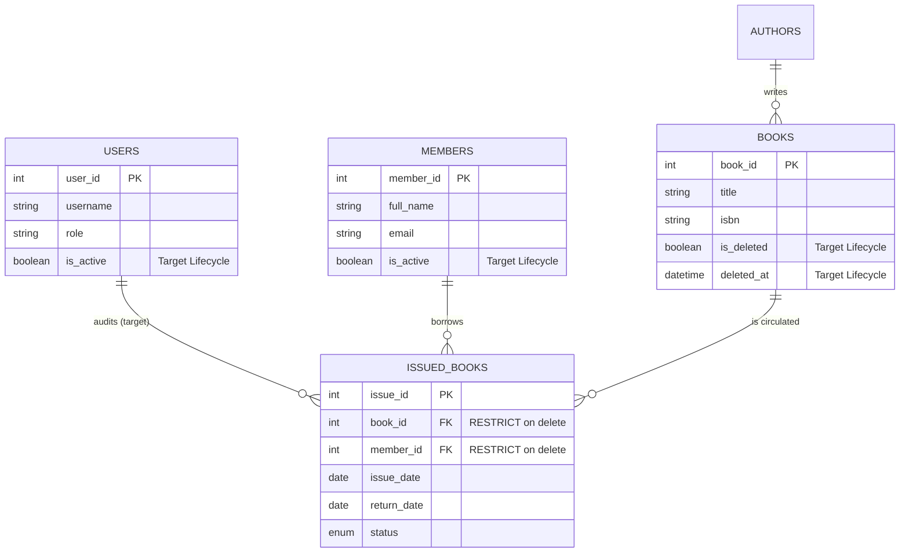
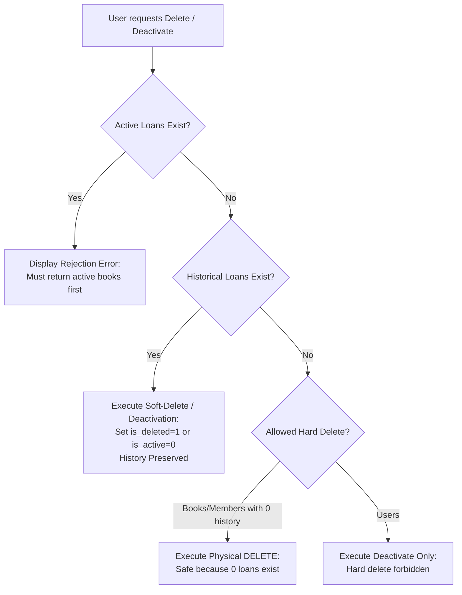

# Lending-History Retention and Deletion Policies

**Project:** Library Management System Reengineering  
**Repository:** `Abdullah-Ali2k4/library-management-reengineering`  
**GitHub Issue:** [#10 — Define Lending-History Retention and Deletion Policies](https://github.com/Abdullah-Ali2k4/library-management-reengineering/issues/10) (Project Issue #7)  
**Date:** 2026-10-16  
**Status:** Draft — Proposal for Team Review  
**Auditor / Technical Lead:** Senior Software Reengineering Engineer  
**Related Artifacts:**
- [`docs/reengineering/baseline/legacy-baseline.md`](../baseline/legacy-baseline.md)
- [`docs/reengineering/baseline/regression-test-plan.md`](../baseline/regression-test-plan.md)
- [`docs/reverse-engineering/requirements/recovered-srs.md`](../../reverse-engineering/requirements/recovered-srs.md)
- [`docs/reverse-engineering/requirements/business-rules.md`](../../reverse-engineering/requirements/business-rules.md)
- [`docs/reverse-engineering/code/code-analysis.md`](../../reverse-engineering/code/code-analysis.md)
- [`docs/reengineering/design/inventory-consistency.md`](inventory-consistency.md)

---

## 1. Executive Summary and Problem Statement

### 1.1 Legacy Vulnerability: Silent Deletion of Lending Records (QA-11, C-04, CR-03)
In the legacy implementation, deleting an entity causes silent, permanent destruction of circulation history due to a mismatch between application-level guards and relational foreign-key cascades:
1. **Application Guards Protect Only Active Loans:**
   - In [`books/delete.php:11-25`](file:///home/abdullah/Desktop/Library-management-system/books/delete.php#L11-L25), the script counts `issued_books WHERE book_id = ? AND status = 'issued'`.
   - In [`members/delete.php:11-25`](file:///home/abdullah/Desktop/Library-management-system/members/delete.php#L11-L25), the script counts `issued_books WHERE member_id = ? AND status = 'issued'`.
   - If `active_count > 0`, the deletion is aborted with an error message.
2. **Schema-Level Cascades Destroy Historical Records:**
   - In [`database/library_db.sql:52-53`](file:///home/abdullah/Desktop/Library-management-system/database/library_db.sql#L52-L53), the relational foreign keys are defined as:
     ```sql
     FOREIGN KEY (book_id) REFERENCES books(book_id) ON DELETE CASCADE,
     FOREIGN KEY (member_id) REFERENCES members(member_id) ON DELETE CASCADE
     ```
   - When all active loans for a book or member have been returned (`active_count == 0`), the application proceeds to execute `DELETE FROM books WHERE book_id = ?` or `DELETE FROM members WHERE member_id = ?`.
   - Because the foreign keys specify `ON DELETE CASCADE`, MySQL **silently deletes all historical records in `issued_books`** associated with that book or member.
3. **Consequences:**
   - Irreversible audit and historical loss: past loan dates, due dates, return dates, and circulation volume metrics are obliterated.
   - Reporting corruption: library usage statistics (e.g., most borrowed books, patron circulation frequency) become permanently falsified whenever a damaged book is removed or a graduated member record is cleared.
   - User account tracking: the legacy schema lacks any user status flag or reference to which staff member handled circulation.

### 1.2 Objective
This document defines an authoritative **Data-Retention and Deletion Policy** that eliminates cascade deletion data loss, establishes entity-by-entity retention rules, specifies active vs. completed loan behaviors, introduces soft deletion/deactivation mechanisms, and updates relational constraints to safeguard referential and historical integrity.

---

## 2. Entity Lifecycle and Relationship Mapping

The circulation ecosystem comprises four interconnected entities:



### 2.1 Entity Role in Historical Integrity
- **`issued_books` (Circulation Ledger):** Represents the legal and operational record of library transactions. Must be **immutable** once closed. Records transition only from `issued` to `returned`. They must never be deleted as a side-effect of catalog or patron maintenance.
- **`books` (Catalog Items):** Represent physical inventory. Books may become damaged, lost, or withdrawn, but their identity must persist as foreign-key anchors for historical loans.
- **`members` (Library Patrons):** Patrons may graduate, transfer, or close their accounts. Their personal identification must not be purged while loan history references them.
- **`users` (System Operators):** Staff and administrator accounts that execute transactions. Deactivation must replace account deletion to prevent breaking audit trails and administrative access.

---

## 3. Retention and Deletion Policy by Entity

### 3.1 Books (Catalog Items)
- **Active Loans Rule:** A book that currently has one or more copies on loan (`COUNT(issued_books WHERE book_id = B AND status = 'issued') > 0`) **CANNOT be deleted, soft-deleted, or retired**. All copies must be physically returned or formally reconciled first.
- **Completed Loans Rule:** If a book has zero active loans but has one or more completed loans in `issued_books` (`status = 'returned'`), physical row deletion (`DELETE FROM books`) is **strictly forbidden**.
- **Soft Deletion Mechanism:**
  - Withdrawing a book from circulation sets:
    - `is_deleted = 1`
    - `deleted_at = CURRENT_TIMESTAMP`
  - Soft-deleted books are:
    - Excluded from public and staff catalog search views (`WHERE is_deleted = 0`).
    - Excluded from the book-selection dropdown in `issue_return/issue.php`.
    - Retained in the database so past circulation reports, audit queries, and member borrowing histories resolve the book title, ISBN, and author without `NULL` or broken references.
- **Hard Deletion (Purge) Exception:**
  - Hard physical deletion (`DELETE FROM books WHERE book_id = ?`) is permitted **ONLY IF** the book has zero records in `issued_books` (`COUNT(*) == 0`). This accommodates mistakenly created catalog entries that were never borrowed.

### 3.2 Members (Patrons)
- **Active Loans Rule:** A member who currently has books on loan (`COUNT(issued_books WHERE member_id = M AND status = 'issued') > 0`) **CANNOT be deleted or deactivated**. The member must return all borrowed books and resolve any outstanding obligations.
- **Completed Loans Rule:** If a member has zero active loans but has past borrowing history in `issued_books`, physical deletion (`DELETE FROM members`) is **strictly forbidden**.
- **Deactivation Mechanism:**
  - Retiring a member sets `is_active = 0`.
  - Deactivated members:
    - Are flagged with a `Deactivated` badge in `members/view.php`.
    - Cannot be selected as borrowers in `issue_return/issue.php`.
    - Retain their member profile and borrowing history for administrative auditing and clearance verification.
- **Hard Deletion (Purge) Exception:**
  - Hard physical deletion is allowed **ONLY IF** the member has never borrowed any book (`COUNT(issued_books WHERE member_id = M) == 0`).

### 3.3 User Accounts (Staff and Administrators)
- **Deactivation Policy:** User accounts represent system operators. Accounts are never physically deleted. When a staff member leaves or their access is revoked, an administrator updates `is_active = 0`.
- **Authentication Guard:** Login handlers must verify `is_active = 1`. Deactivated users are immediately barred from authentication:
  > *"Account Deactivated: This user account has been disabled. Please contact the administrator."*
- **Self-Deactivation Protection:** An authenticated user cannot deactivate their own account.
- **Last Active Administrator Safeguard:** The application must verify that at least one active administrator remains. An admin cannot deactivate the sole remaining active administrator:
  > *"Action Denied: You cannot deactivate the only active Administrator account."*

### 3.4 Circulation Records (`issued_books`)
- **Immutability Principle:** Circulation records are an append-only transaction ledger with status updates.
- **Allowed State Transitions:**
  - `status = 'issued'` $\rightarrow$ `status = 'returned'` (upon book return).
- **Prohibited Operations:** Direct deletion of rows from `issued_books` is prohibited in all application workflows. There is no `delete.php` for `issued_books`.
- **Long-Term Retention and Archival Window:**
  - Completed loans are retained in the primary `issued_books` table indefinitely during normal operations.
  - For institutions requiring archival after a multi-year retention window (e.g., 5 years), rows may be archived into a dedicated historical archive table (`issued_books_archive`) via a scheduled maintenance procedure, preserving aggregate metrics. In-line deletion is never performed.

---

## 4. Policy Comparison Matrix

| Entity | Active Loans Present | Completed Loans Only | Zero Circulation History | Deletion Mechanism |
| :--- | :--- | :--- | :--- | :--- |
| **`books`** | **Blocked** (Error displayed) | **Soft Delete Only** (`is_deleted=1, deleted_at=NOW()`) | **Hard Delete Allowed** | Soft delete (catalog retirement) or conditional hard delete |
| **`members`** | **Blocked** (Error displayed) | **Deactivate Only** (`is_active=0`) | **Hard Delete Allowed** | Account deactivation or conditional hard delete |
| **`users`** | N/A | N/A | N/A | **Deactivate Only** (`is_active=0`); hard delete prohibited |
| **`issued_books`** | Active borrowing record | Completed audit record | N/A | **Never deleted**; status transitions from `issued` to `returned` |

---

## 5. Required Database Schema and Foreign-Key Changes

### 5.1 Relational Referential Integrity Enforcement
The legacy `ON DELETE CASCADE` rule must be replaced with `ON DELETE RESTRICT`. This guarantees that even if an application bug or direct SQL query attempts to delete a referenced book or member, the MySQL storage engine itself will reject the operation with a foreign key violation error (`1451 Cannot delete or update a parent row`).

```sql
-- Step 1: Drop legacy cascading foreign keys
ALTER TABLE issued_books
DROP FOREIGN KEY issued_books_ibfk_1,
DROP FOREIGN KEY issued_books_ibfk_2;

-- Step 2: Recreate foreign keys with ON DELETE RESTRICT
ALTER TABLE issued_books
ADD CONSTRAINT fk_issued_books_book
    FOREIGN KEY (book_id) REFERENCES books(book_id)
    ON DELETE RESTRICT ON UPDATE CASCADE,
ADD CONSTRAINT fk_issued_books_member
    FOREIGN KEY (member_id) REFERENCES members(member_id)
    ON DELETE RESTRICT ON UPDATE CASCADE;
```

### 5.2 Schema Additions for Soft-Delete and Lifecycle Tracking

```sql
-- Books lifecycle tracking
ALTER TABLE books
ADD COLUMN is_deleted TINYINT(1) NOT NULL DEFAULT 0 AFTER available_copies,
ADD COLUMN deleted_at DATETIME NULL DEFAULT NULL AFTER is_deleted;

CREATE INDEX idx_books_active ON books (is_deleted);

-- Members lifecycle tracking
ALTER TABLE members
ADD COLUMN is_active TINYINT(1) NOT NULL DEFAULT 1 AFTER phone;

CREATE INDEX idx_members_active ON members (is_active);

-- Users lifecycle tracking
ALTER TABLE users
ADD COLUMN is_active TINYINT(1) NOT NULL DEFAULT 1 AFTER role;

CREATE INDEX idx_users_active ON users (is_active);
```

---

## 6. Application Workflow and UI Adjustments



### 6.1 Book Deletion Workflow (`books/delete.php`)
1. **CSRF & Method Guard:** Change invocation from `GET` to `POST` with CSRF token validation (satisfying Issue 11 / GH #14).
2. **Active Check:** `SELECT COUNT(*) FROM issued_books WHERE book_id = ? AND status = 'issued'`.
   - If $>0$, reject: *"Cannot remove book: $N$ active copies are on loan."*
3. **History Check:** `SELECT COUNT(*) FROM issued_books WHERE book_id = ?`.
   - If $>0$: execute soft-delete:
     ```sql
     UPDATE books SET is_deleted = 1, deleted_at = NOW() WHERE book_id = ?;
     ```
   - If $==0$: execute safe hard-delete:
     ```sql
     DELETE FROM books WHERE book_id = ?;
     ```
4. **Catalog Views (`books/view.php`, `search.php`):**
   - Filter active catalog: `WHERE is_deleted = 0`.
   - Add admin-only toggle: *"Show Retired / Deleted Books"* to inspect historical titles.

### 6.2 Member Deletion Workflow (`members/delete.php`)
1. **CSRF & Method Guard:** Change from `GET` to `POST` with CSRF token validation.
2. **Active Check:** `SELECT COUNT(*) FROM issued_books WHERE member_id = ? AND status = 'issued'`.
   - If $>0$, reject: *"Cannot deactivate member: patron has $N$ active loans."*
3. **History Check:** `SELECT COUNT(*) FROM issued_books WHERE member_id = ?`.
   - If $>0$: execute deactivation:
     ```sql
     UPDATE members SET is_active = 0 WHERE member_id = ?;
     ```
   - If $==0$: execute physical deletion:
     ```sql
     DELETE FROM members WHERE member_id = ?;
     ```
4. **Member List Views (`members/view.php`):**
   - Active members display status `Active` (green badge).
   - Deactivated members display status `Deactivated` (grey badge).

---

## 7. Migration and Implementation Roadmap

This policy document governs the implementation of two upcoming backlog issues:
1. **Issue 11 (GH #14) — Replace GET-Based Deletions with CSRF-Protected POST Actions:**
   - Converts `delete.php` handlers to secure POST endpoints, removing URL tampering attack vectors.
2. **Issue 14 (GH #17) — Preserve Lending History During Deletion and Deactivation:**
   - Implements the soft-delete queries, `ON DELETE RESTRICT` schema migration, and active/completed loan checks detailed in Sections 5 and 6.
3. **Issue 17 (GH #20) — Implement Regression and Functional Tests:**
   - Verifies test cases `REG-MEM-04`, `REG-BOOK-04`, and `REG-CIRC-06`, ensuring cascade deletion never occurs.
