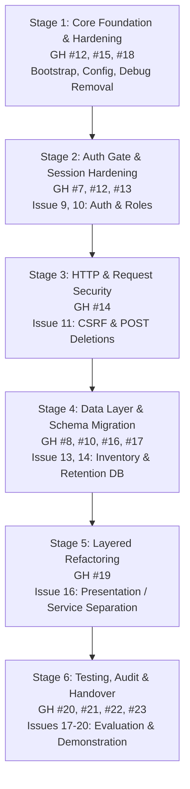

# Target Architecture Migration Plan

**Project:** Library Management System Reengineering  
**Repository:** `Abdullah-Ali2k4/library-management-reengineering`  
**GitHub Issue:** [#11 — Design Target Architecture and Migration Plan](https://github.com/Abdullah-Ali2k4/library-management-reengineering/issues/11) (Project Issue #8)  
**Date:** 2026-10-16  
**Status:** Draft — Proposal for Team Review  
**Auditor / Technical Lead:** Senior Software Reengineering Engineer  
**Related Artifacts:**
- [`docs/reengineering/baseline/legacy-baseline.md`](../baseline/legacy-baseline.md)
- [`docs/reengineering/baseline/regression-test-plan.md`](../baseline/regression-test-plan.md)
- [`docs/reengineering/design/target-architecture.md`](target-architecture.md)
- [`docs/reengineering/design/authentication-and-authorization.md`](authentication-and-authorization.md)
- [`docs/reengineering/design/inventory-consistency.md`](inventory-consistency.md)
- [`docs/reengineering/design/lending-history-retention.md`](lending-history-retention.md)

---

## 1. Executive Summary and Migration Strategy

### 1.1 Strategy: Incremental In-Place Refactoring (Strangler Fig Pattern)
To modernize the Library Management System while minimizing disruption and regression risks, the project will follow an **Incremental In-Place Migration Plan**. 

**Core Rules of the Migration:**
1. **No Big-Bang Rewrite:** The system will remain functional and runnable after every single backlog phase.
2. **Preserve Existing URLs and Routing:** Frontend file paths (`books/view.php`, `issue_return/issue.php`, etc.) will be retained so bookmarked URLs and form actions continue to work seamlessly.
3. **Continuous Verification:** Every migration phase must execute the corresponding test suites defined in [`docs/reengineering/baseline/regression-test-plan.md`](../baseline/regression-test-plan.md).
4. **Strict Phase Independence:** Refactoring tasks are mapped directly to GitHub Issues #9 through #20 in dependency order.

---

## 2. Migration Dependency Graph

---

## 3. Detailed Migration Stages

### Stage 1: Core Foundation, Bootstrap, and Security Hardening
- **Backlog Issues:**
  - Issue 12 (GH #15): Harden Application Configuration and Remove Debug Exposure.
  - Issue 15 (GH #18): Standardize Application Bootstrap and Session Handling.
- **Objectives:**
  1. Create `src/bootstrap.php` containing centralized session setup (`cookie_httponly`, `cookie_samesite=Lax`), path constants (`ROOT_PATH`, `BASE_URL`), and CSRF token generation helpers.
  2. Create `config/app.php` to externalize database credentials and environment modes (`APP_ENV`).
  3. Remove or restrict diagnostic scripts (`path.php`) to prevent sensitive server path leaks.
  4. Ensure error reporting in `config/db.php` suppresses raw database connection strings.
- **Verification Checkpoint:**
  - Verify `path.php` is non-accessible or sanitized.
  - Verify sessions initialize properly across root and subfolder entry points.
  - Regression tests: `REG-AUTH-04`, `REG-AUTH-05`.

---

### Stage 2: Centralized Authentication, Authorization, and Registration
- **Backlog Issues:**
  - Issue 9 (GH #12): Implement Centralized Authentication and Authorization.
  - Issue 10 (GH #13): Resolve Registration and Login Role Inconsistencies.
- **Dependencies:** Stage 1, Issue 5 (GH #7 policy document).
- **Objectives:**
  1. Implement `AuthService` with secure methods: `login()`, `logout()`, `requireLogin()`, `requireRole()`.
  2. Guard all 16 previously unprotected functional routes by including `requireLogin()` at the top of each handler.
  3. Restrict administrative routes (`delete.php`, user provisioning) to `role === 'admin'`.
  4. Secure `auth/register.php` (convert to Admin-only staff provisioning or restrict public self-registration).
- **Verification Checkpoint:**
  - Attempt unauthenticated access to all 18 routes; verify redirection to `auth/login.php`.
  - Verify staff cannot access admin-only endpoints.
  - Regression tests: `REG-AUTH-01`, `REG-AUTH-02`, `REG-AUTH-03`, `REG-AUTH-06`, `REG-AUTH-07`.

---

### Stage 3: HTTP Method Hardening and CSRF Protection
- **Backlog Issues:**
  - Issue 11 (GH #14): Replace GET-Based Deletions with CSRF-Protected POST Actions.
- **Dependencies:** Stage 1 (`src/bootstrap.php` CSRF helpers), Stage 2 (Auth Gate).
- **Objectives:**
  1. Convert all deletion triggers in `books/view.php`, `authors/view.php`, and `members/view.php` from `<a>` hyperlink GET requests to HTML forms submitting via `POST`.
  2. Embed `<input type="hidden" name="csrf_token" value="<?= csrf_token() ?>">` in all deletion forms.
  3. Update `books/delete.php`, `authors/delete.php`, and `members/delete.php` to reject `GET` requests and validate the CSRF token before executing deletions.
- **Verification Checkpoint:**
  - Submit `GET` request to `books/delete.php?id=1`; verify immediate 405 Method Not Allowed / 403 Forbidden rejection.
  - Submit `POST` without valid CSRF token; verify rejection.
  - Submit legitimate `POST` with CSRF token; verify successful execution.
  - Regression tests: `REG-SEC-01`, `REG-SEC-02`, `REG-SEC-03`.

---

### Stage 4: Database Schema Migration and Integrity Enforcement
- **Backlog Issues:**
  - Issue 13 (GH #16): Enforce Inventory Consistency Across Issue, Return, and Edit Operations.
  - Issue 14 (GH #17): Preserve Lending History During Deletion and Deactivation.
- **Dependencies:** Stage 3, Issue 6 (GH #8), Issue 7 (GH #10).
- **Objectives:**
  1. Apply database migration (`migrations/01_integrity_and_retention.sql`):
     - Replace `ON DELETE CASCADE` foreign keys on `issued_books` with `ON DELETE RESTRICT`.
     - Add `books.is_deleted` and `books.deleted_at` soft-deletion columns.
     - Add `members.is_active` deactivation column.
     - Add `users.is_active` deactivation column.
     - Add database `CHECK` constraints (`available_copies >= 0 AND available_copies <= total_copies`).
  2. Update `books/edit.php` to remove the manual `available_copies` input, enforce $T_{\text{new}} \ge L$, and auto-adjust available copies.
  3. Wrap circulation transactions in `issue_return/issue.php` and `return.php` with `SELECT ... FOR UPDATE` pessimistic row locking.
  4. Refactor `books/delete.php` and `members/delete.php` to perform soft deletion/deactivation when historical loans exist, blocking if active loans exist.
- **Verification Checkpoint:**
  - Verify deleting a book with completed loans preserves `issued_books` records and flags the book as deleted.
  - Verify concurrent issue requests cannot produce negative `available_copies`.
  - Regression tests: `REG-BOOK-03`, `REG-BOOK-04`, `REG-BOOK-05`, `REG-MEM-04`, `REG-CIRC-01`, `REG-CIRC-03`, `REG-CIRC-06`, `REG-CIRC-07`.

---

### Stage 5: Structural Decoupling (Separation of Concerns)
- **Backlog Issues:**
  - Issue 16 (GH #19): Separate Database Access, Business Logic, and Presentation.
- **Dependencies:** Stages 1 through 4.
- **Objectives:**
  1. Extract repeated data queries and transactions into dedicated service classes:
     - `src/Services/BookService.php`
     - `src/Services/MemberService.php`
     - `src/Services/AuthorService.php`
     - `src/Services/CirculationService.php`
  2. Refactor page controllers in `books/`, `members/`, `authors/`, and `issue_return/` to delegate all domain operations to the service layer.
  3. Clean view templates to contain only sanitized presentation rendering.
- **Verification Checkpoint:**
  - Ensure zero raw SQL queries remain in HTML view files.
  - Execute full end-to-end regression test suite to confirm zero regressions in existing user workflows.

---

### Stage 6: Testing, Quality Audit, and Final Handover
- **Backlog Issues:**
  - Issue 17 (GH #20): Implement Regression and Functional Tests.
  - Issue 18 (GH #21): Verify Security, Authorization, and Data Integrity.
  - Issue 19 (GH #22): Evaluate Legacy and Reengineered Systems.
  - Issue 20 (GH #23): Complete Technical Documentation and Final Demonstration.
- **Dependencies:** Stages 1 through 5.
- **Objectives:**
  1. Implement automated test scripts for the 22 regression test scenarios defined in `regression-test-plan.md`.
  2. Perform comprehensive static analysis, security evaluation (OWASP Top 10 check), and data integrity verification.
  3. Benchmark and evaluate performance, security, and maintainability metrics comparing the legacy system vs. the reengineered system.
  4. Finalize project documentation, presentation slides, and demonstration instructions.
- **Verification Checkpoint:**
  - 100% pass rate on automated regression tests.
  - Zero critical security or data integrity defects remaining.

---

## 4. Rollback and Risk Mitigation Strategies

| Risk | Impact | Mitigation / Rollback Protocol |
| :--- | :--- | :--- |
| **Schema Migration Failure** | Broken relational queries or FK errors during migration | Database migrations are scripted in reversible files (`up.sql` and `down.sql`). A full database backup is taken before running DDL changes. |
| **Route / Controller Breakage** | Broken links or forms for end users | Handlers keep existing file paths (`books/view.php`). Changes are made iteratively per module and tested against regression test cases before merging. |
| **Session Incompatibility** | Inability to log in across subfolders | `src/bootstrap.php` handles session cookies globally with path `/`. Tested on PHP 8.2 and Apache / PHP built-in server. |
| **Pessimistic Lock Deadlock** | Concurrent transactions hanging on row locks | Queries acquire row locks in strict primary key order; transactions maintain minimal execution time and include timeout / rollback error handling. |
