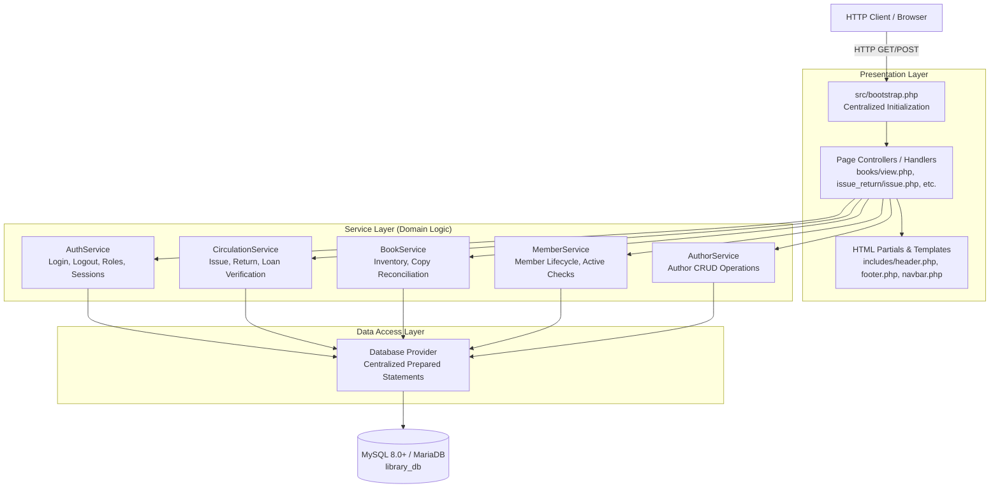

# Target Architecture Design

**Project:** Library Management System Reengineering  
**Repository:** `Abdullah-Ali2k4/library-management-reengineering`  
**GitHub Issue:** [#11 — Design Target Architecture and Migration Plan](https://github.com/Abdullah-Ali2k4/library-management-reengineering/issues/11) (Project Issue #8)  
**Date:** 2026-10-16  
**Status:** Draft — Proposal for Team Review  
**Auditor / Technical Lead:** Senior Software Reengineering Engineer  
**Related Artifacts:**
- [`docs/reengineering/baseline/legacy-baseline.md`](../baseline/legacy-baseline.md)
- [`docs/reengineering/baseline/regression-test-plan.md`](../baseline/regression-test-plan.md)
- [`docs/reengineering/design/authentication-and-authorization.md`](authentication-and-authorization.md)
- [`docs/reengineering/design/inventory-consistency.md`](inventory-consistency.md)
- [`docs/reengineering/design/lending-history-retention.md`](lending-history-retention.md)
- [`docs/reengineering/design/migration-plan.md`](migration-plan.md)
- [`docs/reverse-engineering/code/codebase-inventory.md`](../../reverse-engineering/code/codebase-inventory.md)
- [`docs/reverse-engineering/code/code-analysis.md`](../../reverse-engineering/code/code-analysis.md)

---

## 1. Executive Summary and Architectural Motivation

### 1.1 Structural Deficiencies of Legacy System
The reverse-engineering and baseline analysis revealed critical architectural flaws across the 27 PHP scripts of the legacy Library Management System:
1. **Pervasive Mixing of Concerns (Architectural Smell AS-1):**
   Database connections, raw SQL queries, transaction demarcations, business rule validations, session handling, and inline HTML output are tangled together in almost every file (e.g., [`books/add.php`](file:///home/abdullah/Desktop/Library-management-system/books/add.php), [`issue_return/issue.php`](file:///home/abdullah/Desktop/Library-management-system/issue_return/issue.php)).
2. **Duplicated CRUD and Circulation Logic (Architectural Smell AS-2):**
   Repetitive query construction, error formatting, and redirection sequences are duplicated across author, book, member, and circulation modules with subtle inconsistencies.
3. **Inconsistent and Fragile Initialization (Architectural Smell AS-3):**
   Page scripts use brittle relative include paths (`../config/db.php`, `../../includes/header.php`). There is no centralized bootstrap, resulting in inconsistent session lifecycles, missing auth enforcement on 16 of 18 functional routes, and path disclosure vulnerabilities (`path.php`).
4. **Lack of Automated Testing Foundation:**
   The absence of decoupling between business logic and HTML rendering made automated unit or integration testing virtually impossible without dynamic browser automation.

### 1.2 Target Architectural Strategy: Pragmatic Layered Refactoring
Rather than embarking on a high-risk, full rewrite with an external heavyweight framework (e.g., Laravel or Symfony)—which would discard working assets and exceed the university project scope—the target architecture implements a **Pragmatic Layered Architecture** in native PHP 8.2:
- **Presentation Layer (Thin Controllers & Views):** Handles HTTP request parsing, sanitization, flash messaging, and HTML view rendering. Zero direct database queries.
- **Service Layer (Domain Services):** Encapsulates business logic, domain invariants ($T = A + L$), validation, authorization, and transactional consistency.
- **Data Access Layer (Repository / Database Gateways):** Centralizes PDO/MySQLi connection management, prepared statement execution, and row mapping.
- **Unified Bootstrap (`src/bootstrap.php`):** Establishes a single authoritative application initialization point for session configuration, error handling, security headers, and path constants.

---

## 2. High-Level Target Architecture

---

## 3. Module Responsibilities and Layer Definitions

### 3.1 Unified Bootstrap and Infrastructure (`src/bootstrap.php`)
Every entry point in the application includes `require_once __DIR__ . '/../src/bootstrap.php';` (or equivalent root path) as its first line.

**Bootstrap Responsibilities:**
1. **Environment & Configuration:** Loads database credentials and environment mode (`development` vs `production`) from `config/app.php` or environment variables. Prevents hardcoded credentials.
2. **Session Security:** Enforces strict session settings before `session_start()`:
   - `session.cookie_httponly = 1` (prevents JavaScript cookie access).
   - `session.cookie_samesite = 'Lax'` (CSRF mitigation).
   - `session.use_strict_mode = 1` (prevents session fixation).
3. **Path Constants:** Defines immutable global path constants:
   - `ROOT_PATH`: Absolute filesystem path to project root.
   - `BASE_URL`: Authoritative base URL path for assets and route redirects.
4. **Error & Exception Handling:**
   - In production: suppresses display of raw SQL or stack traces, logging errors to a secure log file.
   - In development: formats descriptive error messages without exposing sensitive passwords.
5. **Security & CSRF Helpers:**
   - `csrf_token()`: Generates and returns a per-session cryptographic token.
   - `verify_csrf_token($token)`: Validates submitted token on all mutating POST requests.
   - `sanitize_string()`, `sanitize_int()`: Standardized input sanitation helpers.

### 3.2 Presentation Layer (Controllers & Views)
The existing folder structure (`books/`, `members/`, `authors/`, `issue_return/`, `auth/`) is retained to preserve route backwards compatibility:
- **Request Handlers (Action Handlers):**
  - Extract and validate HTTP parameters (`$_POST`, `$_GET`).
  - Enforce authentication and role permissions via `AuthService::requireRole()`.
  - Validate CSRF token on POST operations.
  - Invoke the appropriate Service method.
  - Set flash notifications (`$_SESSION['flash_message']`) and issue HTTP 302 redirects.
- **View Templates:**
  - Consume data arrays supplied by Service queries.
  - Render sanitized HTML using `htmlspecialchars()`.
  - Include shared UI components (`includes/header.php`, `includes/footer.php`).
  - Contain **no SQL queries or database connections**.

### 3.3 Domain / Service Layer (`src/Services/`)
The service layer contains pure business logic, invariants, and transaction management:

#### 1. `AuthService`
- `login($username, $password): User|false`: Verifies credentials via `password_verify()`, checks `is_active == 1`, initializes session.
- `logout()`: Clears `$_SESSION`, destroys session cookie, invokes `session_destroy()`.
- `currentUser(): ?array`: Returns session user profile.
- `requireLogin()`: Redirects unauthenticated requests to `auth/login.php`.
- `requireRole($role)`: Enforces role-based access control (Admin vs Staff).

#### 2. `CirculationService`
- `issueBook(int $bookId, int $memberId, string $dueDate): Result`:
  - Starts database transaction (`BEGIN`).
  - Verifies member is active (`is_active == 1`).
  - Locks book row with `SELECT ... FOR UPDATE` to prevent race conditions.
  - Validates `available_copies > 0`.
  - Inserts `issued_books` record.
  - Decrements `books.available_copies`.
  - Commits transaction (`COMMIT`).
- `returnBook(int $issueId): Result`:
  - Starts database transaction (`BEGIN`).
  - Locks and validates active loan record (`status = 'issued'`).
  - Updates loan status to `returned` with `return_date = CURDATE()`.
  - Locks and increments book `available_copies`.
  - Commits transaction (`COMMIT`).
- `getActiveIssues(): array`: Returns active circulation list.
- `getOverdueIssues(): array`: Returns loans where `due_date < CURDATE()`.

#### 3. `BookService`
- `createBook(array $data): int`: Validates ISBN uniqueness, sets `available_copies = total_copies`, persists book.
- `updateBook(int $bookId, array $data): bool`:
  - Calculates active loans $L = \text{COUNT}(\text{issued\_books WHERE book\_id} = B \text{ AND status} = \text{'issued'})$.
  - Rejects if submitted $T_{\text{new}} < L$.
  - Adjusts $A_{\text{new}} = A_{\text{old}} + (T_{\text{new}} - T_{\text{old}})$.
  - Strips manual input for available copies.
- `deleteBook(int $bookId): Result`:
  - Checks active loans. If $>0$, rejects deletion.
  - Checks completed loans. If $>0$, performs soft delete (`is_deleted = 1, deleted_at = NOW()`).
  - If zero total loans exist, performs physical hard delete.

#### 4. `MemberService`
- `createMember(array $data): int`: Enforces email uniqueness.
- `updateMember(int $memberId, array $data): bool`.
- `deactivateOrDeleteMember(int $memberId): Result`:
  - Blocks if member has active loans.
  - Deactivates (`is_active = 0`) if member has historical loans.
  - Hard-deletes only if member has zero loan history.

#### 5. `AuthorService`
- `getAllAuthors(): array`
- `createAuthor(array $data): int`
- `updateAuthor(int $authorId, array $data): bool`
- `deleteAuthor(int $authorId): Result`

### 3.4 Data Access Layer (`src/Database/`)
- **`Database` Class (`src/Database/Database.php`):**
  - Manages a singleton or pooled PDO / MySQLi instance.
  - Configures PDO attributes: `ERRMODE_EXCEPTION`, `DEFAULT_FETCH_MODE => FETCH_ASSOC`, `EMULATE_PREPARES => false`.
  - Provides helper methods:
    - `query(string $sql, array $params = []): array`
    - `execute(string $sql, array $params = []): int`
    - `beginTransaction()`, `commit()`, `rollback()`

---

## 4. Cross-Cutting Concerns

### 4.1 Authentication and Access Control Integration
- Replaces legacy ad-hoc auth with `AuthService` integration across all 18 functional routes.
- Access Matrix:
  - Public routes: `auth/login.php`, `auth/login_handler.php`, `auth/logout.php`.
  - Staff & Admin routes: `index.php`, `books/view.php`, `authors/view.php`, `members/view.php`, `issue_return/*`, `search.php`.
  - Admin-only routes: `books/delete.php`, `authors/delete.php`, `members/delete.php`, `auth/register.php` (if retained for admin user provisioning).

### 4.2 Security Hardening
- **CSRF Protection:** Added hidden `<input type="hidden" name="csrf_token" value="<?= csrf_token() ?>">` to every form. Verified in POST controllers.
- **GET-to-POST Conversion:** Deletion triggers converted from `<a>` hyperlink GET requests to `<form method="POST">` buttons.
- **XSS Prevention:** Output escaping helper `e($string)` standardized across all partials.

---

## 5. Architectural Quality Attributes & Evaluation

| Attribute | Legacy Architecture | Target Architecture |
| :--- | :--- | :--- |
| **Maintainability** | Low: 27 monolithic scripts with mixed concerns | High: Clean separation into Controllers, Services, and DB Layer |
| **Testability** | None: Cannot unit test without HTTP and DB coupling | High: Services can be tested via unit tests with mock DB |
| **Security** | Vulnerable: 16 unprotected routes, CSRF on deletes, path leak | Robust: Centralized auth gate, CSRF tokens, strict session security |
| **Data Integrity** | Vulnerable: Cascade deletes loan history, inventory race conditions | Guaranteed: Pessimistic locking, soft deletion, DB constraints |
| **Portability** | Hardcoded XAMPP credentials, fragile relative paths | Configurable via central config/bootstrap, standard PDO |
