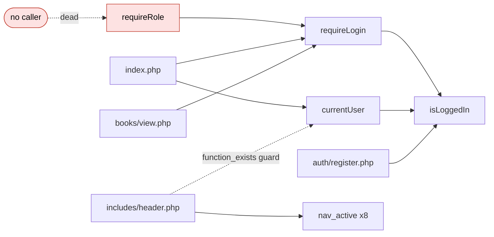

# CGA 00: Function Inventory and Call Relationships

Covers step 1: *important function calls and relationships between source files*.

## 1. User-defined PHP functions

The project defines only **5 functions** (everything else is top-level procedural script code).

| Function | Defined in | Called by (verified by `grep`) | Notes |
|----------|-----------|--------------------------------|-------|
| `isLoggedIn(): bool` | `includes/auth.php` L23 | `requireLogin` L28, `currentUser` L43, `auth/register.php` L11 | leaf |
| `requireLogin(): void` | `includes/auth.php` L27 | `index.php` L4, `books/view.php` L4, `requireRole` L35 | calls `isLoggedIn`, then `header()` + `exit` |
| `requireRole(string $role): void` | `includes/auth.php` L34 | **nobody** | dead function |
| `currentUser(): ?array` | `includes/auth.php` L42 | `index.php` L13, `includes/header.php` L25 (behind `function_exists`) | calls `isLoggedIn` |
| `nav_active($page, $folder = null)` | `includes/header.php` L17 | `includes/header.php` L67-88 (8 calls) | reads globals `$current_page`, `$current_folder` |

### Call relationships between the user-defined functions

## 2. Important built-in / library calls (project-wide counts)

| Group | Calls | Count |
|-------|-------|-------|
| Output escaping | `htmlspecialchars` | 63 |
| Input cleanup | `trim` | 36 |
| Validation | `isset` 26, `empty` 19, `is_numeric` 5, `filter_var` 3 | 53 |
| Control transfer | `header` 12, `die` 11 | 23 |
| Date/time | `date` 8, `strtotime` 3, `time` 1 | 12 |
| Session | `session_start` 4, `session_status`, `session_regenerate_id`, `session_get_cookie_params`, `session_name`, `session_id`, `session_destroy` | 10 |
| Credentials | `password_hash` 1, `password_verify` 1, `setcookie` 1 | 3 |
| Path computation (`config/paths.php`) | `realpath` 5, `stripos` 2, `substr` 2, `str_replace` 2, `define` 2, `basename` 2, `trim` | |

## 3. `mysqli` API usage (the database access layer is the raw driver)

| Call | Count | Meaning |
|------|-------|---------|
| `->prepare` / `->bind_param` / `->execute` | 28 / 28 / 28 | parameterized statements |
| `->query` | 16 | direct SQL (all constant strings, no interpolation) |
| `->get_result` / `->fetch_assoc` / `->store_result` | 9 / 24 / 5 | result handling |
| `->begin_transaction` / `->commit` / `->rollback` | 2 / 2 / 2 | only `issue.php` and `return.php` |
| `->close` | 48 | manual resource release in every script |
| `new mysqli`, `->set_charset` | 1, 1 | only in `config/db.php` |

## 4. Client-side (JavaScript) functions and their coupling to PHP markup

`assets/js/validate.js` is loaded by `includes/footer.php` L10 and binds to markup produced by PHP files.

| JS section / function | Binds to | Present in PHP markup? |
|-----------------------|----------|-----------------------|
| 1. form validation, `showError(field, message)` (L49) | `.validate-form`, `[required]`, `input[type=email]`, `input[type=number]` | **Yes**: 9 pages use `class="validate-form"` |
| 2. sidebar toggle | ids `sidebar`, `sidebarToggle`, `sidebarOverlay` | **Yes**: all three ids in `includes/header.php` |
| 3. user-menu dropdown, `setMenuOpen` (L96) | ids `userMenu`, `userMenuTrigger` | **No**: 0 occurrences in any `.php`/`.css` file |
| 4. password show/hide | class `.password-toggle` | **No**: 0 occurrences; `auth/index.php` L106-110 has its own inline script for id `togglePassword` |

## 5. Browser-level control transfers (redirects)

Raw `header("Location: ...")` statements found by `grep`:

- `auth/index.php` L6: `"Location: " . BASE_URL . "index.php"`
- `auth/login_handler.php` L9: `"Location: index.php"`
- `auth/login_handler.php` L20: `"Location: index.php"`
- `auth/login_handler.php` L34: `"Location: index.php"`
- `auth/login_handler.php` L81: `"Location: " . BASE_URL . "index.php"`
- `auth/login_handler.php` L89: `"Location: index.php"`
- `auth/logout.php` L5: `"Location: index.php"`
- `auth/register.php` L12: `"Location: " . BASE_URL . "index.php"`
- `authors/delete.php` L19: `"Location: view.php?deleted=1"`
- `books/delete.php` L34: `"Location: view.php?deleted=1"`
- `includes/auth.php` L29: `"Location: " . BASE_URL . "auth/index.php"`
- `members/delete.php` L34: `"Location: view.php?deleted=1"`
