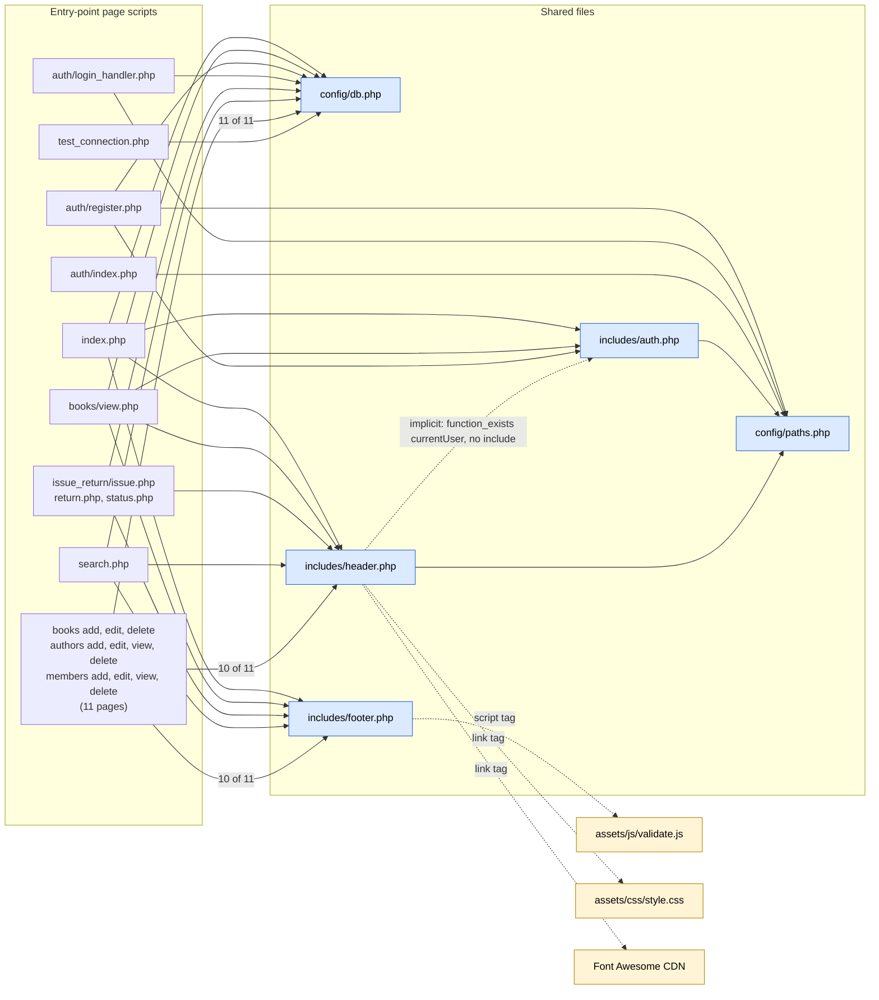

# CG 01: File-Level Include / Dependency Graph

**Scope:** every `require`/`include` between source files, plus implicit (non-include) dependencies.
Edge tables below are **generated by script from the uploaded source** (regex over `require_once|require|include_once|include` statements).

## 1. Dependency graph

Solid = `require`/`include` statement. Dashed = implicit or browser-level dependency.

## 2. Every include edge (generated)

**Cycle check (script):** 27 PHP files, 60 include edges, **acyclic: no circular include dependency**. Files that include `header.php` more than once: none.

| File | Line | Statement | Resolved target | Path style |
|------|------|-----------|-----------------|-----------|
| `auth/index.php` | 2 | `require_once __DIR__ . '/../config/paths.php';` | `config/paths.php` | `__DIR__` |
| `auth/login_handler.php` | 2 | `require_once __DIR__ . '/../config/paths.php';` | `config/paths.php` | `__DIR__` |
| `auth/login_handler.php` | 5 | `require_once __DIR__ . '/../config/db.php';` | `config/db.php` | `__DIR__` |
| `auth/register.php` | 7 | `require_once __DIR__ . '/../config/paths.php';` | `config/paths.php` | `__DIR__` |
| `auth/register.php` | 8 | `require_once '../config/db.php';` | `config/db.php` | relative |
| `auth/register.php` | 9 | `require_once '../includes/auth.php';` | `includes/auth.php` | relative |
| `authors/add.php` | 2 | `require_once '../config/db.php';` | `config/db.php` | relative |
| `authors/add.php` | 32 | `include '../includes/header.php';` | `includes/header.php` | relative |
| `authors/add.php` | 69 | `include '../includes/footer.php';` | `includes/footer.php` | relative |
| `authors/delete.php` | 2 | `require_once '../config/db.php';` | `config/db.php` | relative |
| `authors/edit.php` | 2 | `require_once '../config/db.php';` | `config/db.php` | relative |
| `authors/edit.php` | 53 | `include '../includes/header.php';` | `includes/header.php` | relative |
| `authors/edit.php` | 90 | `include '../includes/footer.php';` | `includes/footer.php` | relative |
| `authors/view.php` | 2 | `require_once '../config/db.php';` | `config/db.php` | relative |
| `authors/view.php` | 3 | `include '../includes/header.php';` | `includes/header.php` | relative |
| `authors/view.php` | 47 | `include '../includes/footer.php';` | `includes/footer.php` | relative |
| `books/add.php` | 2 | `require_once '../config/db.php';` | `config/db.php` | relative |
| `books/add.php` | 57 | `include '../includes/header.php';` | `includes/header.php` | relative |
| `books/add.php` | 110 | `include '../includes/footer.php';` | `includes/footer.php` | relative |
| `books/delete.php` | 2 | `require_once '../config/db.php';` | `config/db.php` | relative |
| `books/delete.php` | 19 | `include '../includes/header.php';` | `includes/header.php` | relative |
| `books/delete.php` | 22 | `include '../includes/footer.php';` | `includes/footer.php` | relative |
| `books/edit.php` | 2 | `require_once '../config/db.php';` | `config/db.php` | relative |
| `books/edit.php` | 88 | `include '../includes/header.php';` | `includes/header.php` | relative |
| `books/edit.php` | 144 | `include '../includes/footer.php';` | `includes/footer.php` | relative |
| `books/view.php` | 2 | `require_once '../config/db.php';` | `config/db.php` | relative |
| `books/view.php` | 3 | `require_once '../includes/auth.php';` | `includes/auth.php` | relative |
| `books/view.php` | 6 | `include '../includes/header.php';` | `includes/header.php` | relative |
| `books/view.php` | 53 | `include '../includes/footer.php';` | `includes/footer.php` | relative |
| `includes/auth.php` | 17 | `require_once __DIR__ . '/../config/paths.php';` | `config/paths.php` | `__DIR__` |
| `includes/header.php` | 12 | `require_once __DIR__ . '/../config/paths.php';` | `config/paths.php` | `__DIR__` |
| `index.php` | 2 | `require_once 'config/db.php';` | `config/db.php` | relative |
| `index.php` | 3 | `require_once 'includes/auth.php';` | `includes/auth.php` | relative |
| `index.php` | 5 | `include 'includes/header.php';` | `includes/header.php` | relative |
| `index.php` | 72 | `include 'includes/footer.php';` | `includes/footer.php` | relative |
| `issue_return/issue.php` | 2 | `require_once '../config/db.php';` | `config/db.php` | relative |
| `issue_return/issue.php` | 67 | `include '../includes/header.php';` | `includes/header.php` | relative |
| `issue_return/issue.php` | 118 | `include '../includes/footer.php';` | `includes/footer.php` | relative |
| `issue_return/return.php` | 2 | `require_once '../config/db.php';` | `config/db.php` | relative |
| `issue_return/return.php` | 73 | `include '../includes/header.php';` | `includes/header.php` | relative |
| `issue_return/return.php` | 111 | `include '../includes/footer.php';` | `includes/footer.php` | relative |
| `issue_return/status.php` | 2 | `require_once '../config/db.php';` | `config/db.php` | relative |
| `issue_return/status.php` | 3 | `include '../includes/header.php';` | `includes/header.php` | relative |
| `issue_return/status.php` | 59 | `include '../includes/footer.php';` | `includes/footer.php` | relative |
| `members/add.php` | 2 | `require_once '../config/db.php';` | `config/db.php` | relative |
| `members/add.php` | 44 | `include '../includes/header.php';` | `includes/header.php` | relative |
| `members/add.php` | 82 | `include '../includes/footer.php';` | `includes/footer.php` | relative |
| `members/delete.php` | 2 | `require_once '../config/db.php';` | `config/db.php` | relative |
| `members/delete.php` | 19 | `include '../includes/header.php';` | `includes/header.php` | relative |
| `members/delete.php` | 22 | `include '../includes/footer.php';` | `includes/footer.php` | relative |
| `members/edit.php` | 2 | `require_once '../config/db.php';` | `config/db.php` | relative |
| `members/edit.php` | 65 | `include '../includes/header.php';` | `includes/header.php` | relative |
| `members/edit.php` | 102 | `include '../includes/footer.php';` | `includes/footer.php` | relative |
| `members/view.php` | 2 | `require_once '../config/db.php';` | `config/db.php` | relative |
| `members/view.php` | 3 | `include '../includes/header.php';` | `includes/header.php` | relative |
| `members/view.php` | 50 | `include '../includes/footer.php';` | `includes/footer.php` | relative |
| `search.php` | 2 | `require_once 'config/db.php';` | `config/db.php` | relative |
| `search.php` | 3 | `include 'includes/header.php';` | `includes/header.php` | relative |
| `search.php` | 68 | `include 'includes/footer.php';` | `includes/footer.php` | relative |
| `test_connection.php` | 15 | `require_once 'config/db.php';` | `config/db.php` | relative |

## 3. Fan-in of shared files (how many files depend on each)

| Shared file | Directly included by | Count |
|-------------|---------------------|-------|
| `config/db.php` | `auth/login_handler.php`, `auth/register.php`, `authors/add.php`, `authors/delete.php`, `authors/edit.php`, `authors/view.php`, `books/add.php`, `books/delete.php`, `books/edit.php`, `books/view.php`, `index.php`, `issue_return/issue.php`, `issue_return/return.php`, `issue_return/status.php`, `members/add.php`, `members/delete.php`, `members/edit.php`, `members/view.php`, `search.php`, `test_connection.php` | 20 |
| `includes/header.php` | `authors/add.php`, `authors/edit.php`, `authors/view.php`, `books/add.php`, `books/delete.php`, `books/edit.php`, `books/view.php`, `index.php`, `issue_return/issue.php`, `issue_return/return.php`, `issue_return/status.php`, `members/add.php`, `members/delete.php`, `members/edit.php`, `members/view.php`, `search.php` | 16 |
| `includes/footer.php` | `authors/add.php`, `authors/edit.php`, `authors/view.php`, `books/add.php`, `books/delete.php`, `books/edit.php`, `books/view.php`, `index.php`, `issue_return/issue.php`, `issue_return/return.php`, `issue_return/status.php`, `members/add.php`, `members/delete.php`, `members/edit.php`, `members/view.php`, `search.php` | 16 |
| `includes/auth.php` | `auth/register.php`, `books/view.php`, `index.php` | 3 |
| `config/paths.php` | `auth/index.php`, `auth/login_handler.php`, `auth/register.php`, `includes/auth.php`, `includes/header.php` | 5 |

## 4. Include path styles

- `__DIR__`-anchored: **6** statements. Relative to the caller's working directory (`'../config/db.php'`): **54** statements.
- `auth/register.php` uses **both styles** (L7 `__DIR__`, L8-9 relative).

## 5. Findings

| Ref | Evidence | Status |
|-----|----------|--------|
| CG-01 | **No circular include dependency.** Script-checked: the include graph (27 files) is acyclic. `paths.php` and `db.php` include nothing; `auth.php` and `header.php` each include only `paths.php`. | **Confirmed** (positive) |
| CG-02 | **Hidden dependency.** `header.php` L25 calls `currentUser()` (defined in `auth.php`) behind `function_exists`, but never includes `auth.php`. Of the 16 pages that include `header.php`, only 2 (`index.php`, `books/view.php`) also include `auth.php`; 14 do not, so their sidebar falls back to "Guest". | **Confirmed** |
| CG-03 | **Documentation-level cycle.** `auth.php` docblock says it is "required by header.php"; `header.php` docblock says "Include this AFTER ... auth.php". Neither dependency is expressed in code. | **Confirmed** |
| CG-04 | **Inconsistent include style** (see section 4). Relative includes only work while every page sits exactly one folder deep and runs as the entry script. | **Confirmed** |
| CG-05 | `header.php` defines `nav_active()` at top level and is pulled in with `include` (not `include_once`). A second inclusion in one request would be a fatal "cannot redeclare". The script found no page that includes it twice today. | Likely (latent) |
