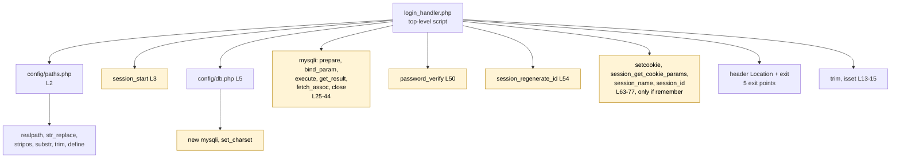
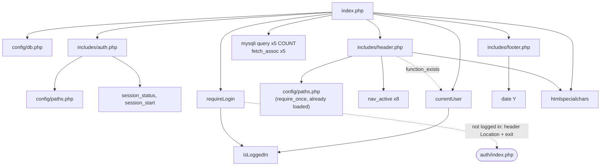

# CG 02: Login Workflow Call Graph (login → protected dashboard)

**Workflow:** two HTTP requests: `POST auth/login_handler.php`, then `GET index.php` after the redirect.

## 1. Call graph, request 1 (`auth/login_handler.php`)

## 2. Call graph, request 2 (`index.php`, the dashboard)

## 3. Relationships and observations

| Caller | Callee | Purpose |
|--------|--------|---------|
| `login_handler.php` | `paths.php`, `db.php` | defines `BASE_URL`; opens the global `$conn` |
| `login_handler.php` | `session_start()` (L3) | raw call; `auth.php` guards it with `session_status()` instead |
| `index.php` | `requireLogin()` → `isLoggedIn()` | the access guard |
| `header.php` | `currentUser()` → `isLoggedIn()` | display name |

| Ref | Evidence | Status |
|-----|----------|--------|
| CG-06 | Session start is done in **four** places by different styles: `login_handler.php` L3, `auth/index.php` L3, `auth/logout.php` L2 (all unconditional) and `auth.php` L19-21 (guarded). Session handling responsibility is not centralized. | **Confirmed** |
| CG-07 | `login_handler.php` never includes `auth.php`; it duplicates the session-key contract (`user_id`, `username`, `user_email`, `role`) that `auth.php` reads. The two files are coupled only by convention (documented in `auth.php` L10-15). | **Confirmed** |
