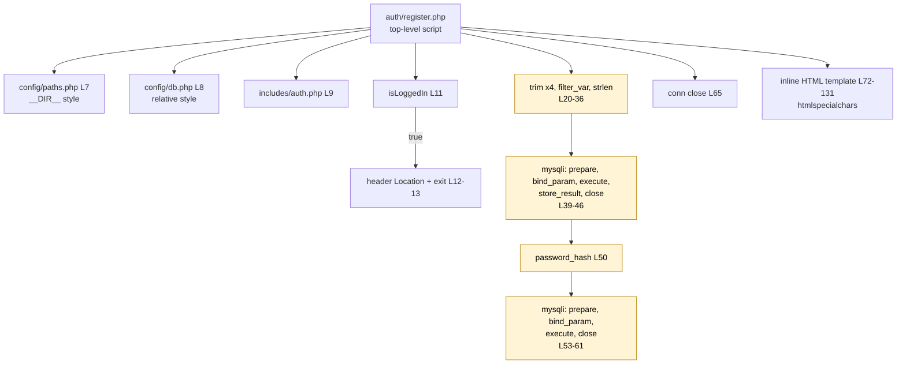

# CG 03: Registration Workflow Call Graph (`auth/register.php`)

## 1. Call graph

## 2. Observations

| Ref | Evidence | Status |
|-----|----------|--------|
| CG-08 | `register.php` does **not** use `header.php`/`footer.php`: it writes its own `<head>` (L72-81) and links Font Awesome + `style.css`. `auth/index.php` also hand-writes its head (links `style.css` and `auth.css`, **no** Font Awesome). Three layout paths exist for the same UI. | **Confirmed** |
| CG-09 | Because `footer.php` is not included, `validate.js` is **not loaded** on the registration page; its form has no `validate-form` class. Validation is server-side only here. | **Confirmed** |
| CG-10 | Business rule "new accounts get role `staff`" (L51) lives in a page script, while the rule "only `admin` may log in" lives in a different page script (`login_handler.php` L49). Related rules are split across two files with no shared definition (this causes finding F-03 in the CFG report). | **Confirmed** |
