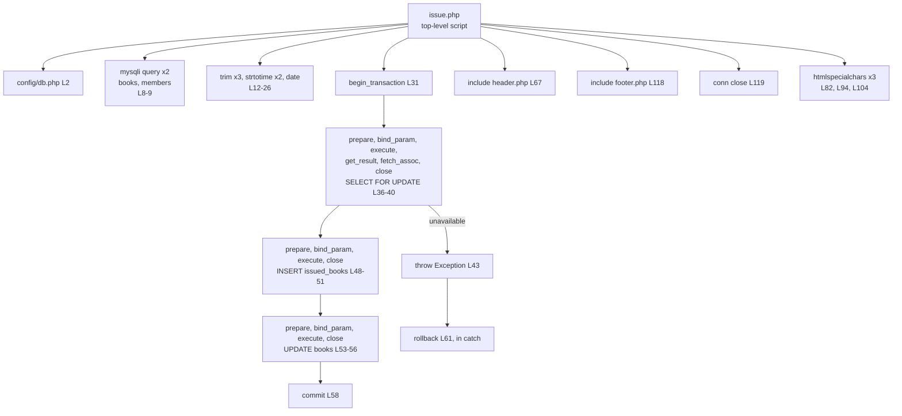
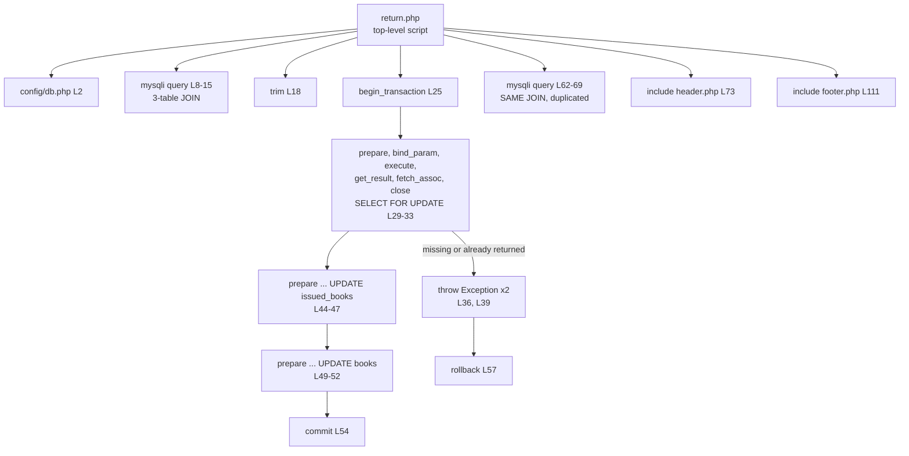

# CG 04: Issue and Return Workflow Call Graphs

## 1. `issue_return/issue.php`

## 2. `issue_return/return.php`

## 3. Shared shape and duplication

| Aspect | `issue.php` | `return.php` |
|--------|------------|--------------|
| Transaction boundary | L31-L58 | L25-L54 |
| Locking read | `books` row | `issued_books` row |
| Tables written | `issued_books` (INSERT), `books` (UPDATE) | `issued_books` (UPDATE), `books` (UPDATE) |
| Page assembly | `header.php` + `footer.php` | same |

| Ref | Evidence | Status |
|-----|----------|--------|
| CG-11 | The same transaction pattern (begin, locking SELECT, 2 writes, commit/rollback) is **copy-pasted** in two scripts; there is no shared function such as `issueBook()` / `returnBook()`. Business rules about `available_copies` therefore live inside two presentation scripts (plus `books/edit.php`). | **Confirmed** |
| CG-12 | `return.php` contains the identical JOIN query twice (L8-15 and L62-69). | **Confirmed** |
| CG-13 | `issue.php` and `return.php` call `header.php` without `auth.php`, so `header.php`'s `currentUser()` call is skipped (see CG-02). | **Confirmed** |
