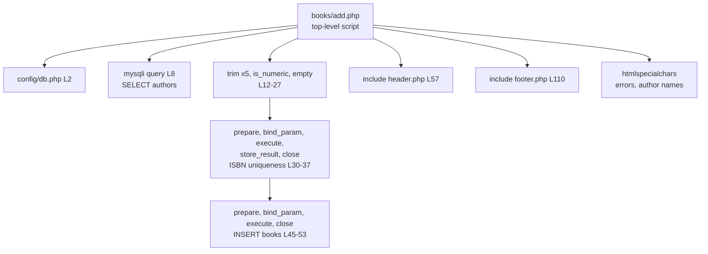
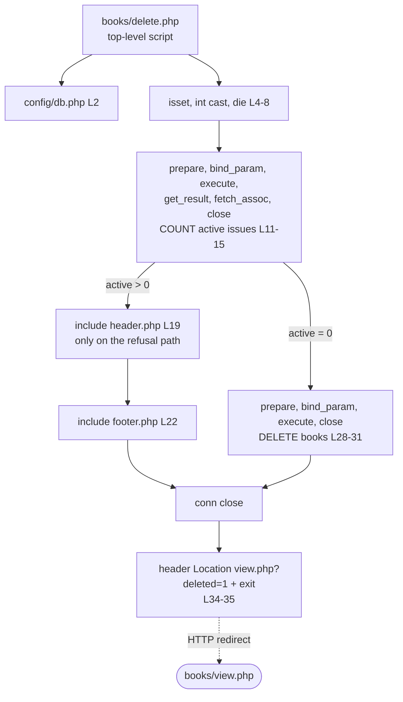

# CG 05: Catalog Operations Call Graphs (`books/add.php`, `books/delete.php`)

`members/*` and `authors/*` pages follow the same structure (shared include set and per-page SQL).

## 1. `books/add.php`

## 2. `books/delete.php`

## 3. Observations

| Ref | Evidence | Status |
|-----|----------|--------|
| CG-14 | **Dead hand-off.** `books/`, `authors/` and `members/` `delete.php` redirect to `view.php?deleted=1`, but no file reads `$_GET['deleted']` (`grep` finds none). The flag is produced and never consumed, so users get no deletion feedback. | **Confirmed** |
| CG-15 | The "does this record have active loans" check is implemented separately in `books/delete.php` and `members/delete.php` (same query shape, different column). `authors/delete.php` has no check (relies on `ON DELETE SET NULL`). | **Confirmed** |
| CG-16 | Layout is included **after** logic in every page, so header output depends on state set earlier (`$current_page` globals). On the refusal path of `delete.php` the page is assembled by `include` calls in the middle of an `if` block (L19-22), mixing control flow and layout. | **Confirmed** |
