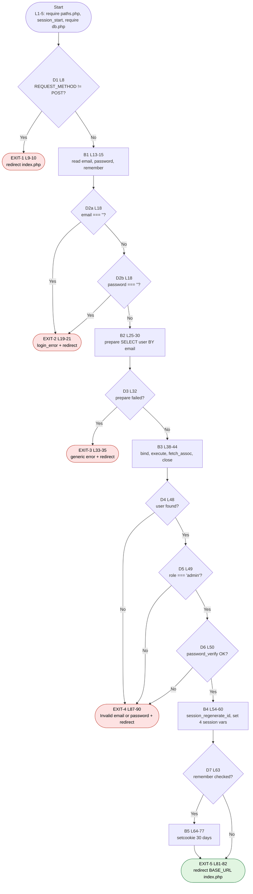

# CFG 01 — `auth/login_handler.php` (Login)

**Workflow:** Authentication  **Type:** Script (top-level, no functions)  **Lines:** 91
**Why selected:** Guard clauses, a short-circuit compound condition, an optional branch ("remember me") and five distinct exit points.

## 1. Control Flow Graph

## 2. Conditional branches

| ID | Line | Condition | True path | False path |
|----|------|-----------|-----------|------------|
| D1 | 8 | `$_SERVER['REQUEST_METHOD'] !== 'POST'` | EXIT-1 | B1 |
| D2a | 18 | `$email === ''` | EXIT-2 | D2b |
| D2b | 18 | `$password === ''` (evaluated only if D2a false) | EXIT-2 | B2 |
| D3 | 32 | `!$stmt` (prepare failed) | EXIT-3 | B3 |
| D4 | 48 | `$user` (row found) | D5 | EXIT-4 |
| D5 | 49 | `$user['role'] === 'admin'` | D6 | EXIT-4 |
| D6 | 50 | `password_verify(...)` | B4 | EXIT-4 |
| D7 | 63 | `$remember` | B5 | EXIT-5 |

D4-D6 are one `if (a && b && c)` statement; PHP short-circuits, so `password_verify` runs only for an existing admin.

## 3. Loops

None.

## 4. Return / exit paths

| Exit | Lines | Type | Outcome |
|------|-------|------|---------|
| EXIT-1 | 9-10 | `header()` + `exit` | Non-POST request bounced to login form |
| EXIT-2 | 19-21 | `header()` + `exit` | Empty email or password |
| EXIT-3 | 33-35 | `header()` + `exit` | Statement preparation failed |
| EXIT-4 | 87-90 | `header()` + `exit` | Bad credentials **or** non-admin role (same message) |
| EXIT-5 | 81-82 | `header()` + `exit` | Successful login to dashboard |

Every path ends in `exit`; the script never falls off the end (no implicit return).

## 5. Metrics

| Metric | Value |
|--------|-------|
| Decision predicates (each `&&`/`||` operand counted) | 8 (D1, D2a, D2b, D3, D4, D5, D6, D7) |
| Cyclomatic complexity V(G) = predicates + 1 | **9** |
| Exit points | 5 |
| Independent paths to test | 9 |

## 6. Suspicious code and observations

| Ref | Evidence | Status |
|-----|----------|--------|
| F-03 | D5 (L49) only admits `role === 'admin'`, but `register.php` L51 always creates `'staff'`. No staff account can ever pass D5, so the "staff logs in" path is effectively dead. | **Confirmed** |
| F-04 | L14 reads `$_POST['password']` **without** `trim()`; `register.php` L22 stores a **trimmed** password. A password with leading/trailing spaces is hashed trimmed, then verified untrimmed, which always fails. | **Confirmed** |
| F-12 | "Remember me" (B5, L64-77) only re-sends the *session* cookie with a 30-day expiry. The server-side session file is still governed by `session.gc_maxlifetime` (PHP default ~24 min), so persistence beyond that depends on server config. | Likely |
| F-13 | D4/D5/D6 short-circuit: an unknown email skips `password_verify`, so response time differs from a wrong password for an existing admin (timing-based user enumeration). Messages themselves are uniform (L87). | Likely (low) |
