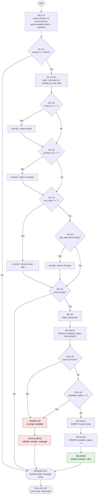

# CFG 02 — `issue_return/issue.php` (Issue a Book)

**Workflow:** Core business transaction  **Type:** Script (form handler + page template)  **Lines:** 120
**Why selected:** Validation chain with `if/elseif`, a database transaction with `try/catch/rollback`, and a `throw`-driven error path.

## 1. Control Flow Graph — request-handling logic (L1-65)

## 2. Conditional branches

| ID | Line | Condition | True path | False path |
|----|------|-----------|-----------|------------|
| D1 | 11 | `REQUEST_METHOD === 'POST'` | B1 | RENDER (blank form) |
| D2 | 16 | `$book_id === ''` | add error, → D3 | D3 |
| D3 | 19 | `$member_id === ''` | add error, → D4 | D4 |
| D4 | 22 | `$due_date === ''` | add error, → D6 | D5 (`elseif`) |
| D5 | 24 | `strtotime($due_date) < strtotime(today)` | add error, → D6 | D6 |
| D6 | 28 | `empty($errors)` | B2 (transaction) | RENDER with errors |
| D7a | 42 | `!$book` | THROW | D7b |
| D7b | 42 | `$book['available_copies'] < 1` | THROW | B4 |
| catch | 60 | any `Exception` raised in the `try` | rollback, add message | n/a |

Template decisions (L72-115):

| Line | Construct | Meaning |
|------|-----------|---------|
| 72 | `if ($success)` | show success banner |
| 78 | `if (!empty($errors))` | show error list |
| 81 | `foreach ($errors ...)` | **loop** — one `<li>` per error |
| 92 | `while ($book = fetch_assoc())` | **loop** — one `<option>` per available book |
| 102 | `while ($member = fetch_assoc())` | **loop** — one `<option>` per member |

## 3. Loops

| Line | Type | Iterates over | Exit condition |
|------|------|---------------|----------------|
| 81 | `foreach` | `$errors` | array exhausted |
| 92 | `while` | `$books_result` rows | `fetch_assoc()` returns null |
| 102 | `while` | `$members_result` rows | `fetch_assoc()` returns null |

## 4. Return / exit paths

The script has **no** `exit`, `die`, `return` or redirect. Every path converges on RENDER then the end of the script.

| Path | Route | Page shown |
|------|-------|-----------|
| P1 | D1 false | Empty form |
| P2 | D1 true, D6 false | Form + validation errors |
| P3 | D6 true, D7a or D7b true, THROW, CATCH | Form + "no longer available" |
| P4 | D6 true, all checks pass, B6 | Form + success banner |
| P5 | D6 true, DB exception in B3/B4/B5 (PHP ≥ 8.1 mysqli throws by default), CATCH | Form + raw DB error text |

## 5. Metrics

| Metric | Logic (L1-65) | Whole file (incl. template) |
|--------|---------------|-----------------------------|
| Decision predicates | 9 (D1-D6, D7a, D7b, catch) | 14 (+L72, L78, L81, L92, L102) |
| V(G) | **10** | **15** |
| Terminal outcomes | 4 (P1-P4) + P5 | same |

## 6. Suspicious code and observations

| Ref | Evidence | Status |
|-----|----------|--------|
| F-01 | No `requireLogin()` anywhere in the file and `auth.php` is not included. No auth node exists on any path from Start to the INSERT. Anyone with the URL can issue books. | **Confirmed** |
| F-05 | The available-books query (L8) runs **before** the transaction (L31-58). After a successful issue (P4) the dropdown is rendered from the pre-update result, so it shows the old copy count and may still list a book whose last copy was just issued. `return.php` re-queries after its update (L62), so the two pages are inconsistent. | **Confirmed** |
| F-06 | After success (B6) the page renders in the same POST request: no Post-Redirect-Get. A browser refresh re-submits the POST and **issues a duplicate copy**. `return.php` is protected against the same replay by its L38 check. | **Confirmed** |
| F-11 | D7a's `!$book` branch is reachable only for a book id that does not exist (crafted POST). `member_id` is never checked for existence in PHP; a bad id surfaces only as a foreign-key error from the INSERT, whose message is echoed at L62/L82 (information disclosure in P5). | Likely |
| F-15 | L92 `while ($book = ...)` overwrites `$book`, which L39 already used for the locked row. Harmless today because L39's value is not used after the transaction, but it is a shadowed variable. | **Confirmed** (low) |
