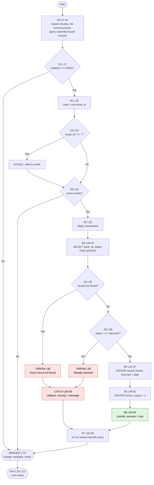

# CFG 03 — `issue_return/return.php` (Return a Book)

**Workflow:** Core business transaction  **Type:** Script  **Lines:** 113
**Why selected:** Mirror of the issue workflow with two different `throw` paths and a post-transaction refresh.

## 1. Control Flow Graph — request-handling logic (L1-71)

## 2. Conditional branches

| ID | Line | Condition | True path | False path |
|----|------|-----------|-----------|------------|
| D1 | 17 | `REQUEST_METHOD === 'POST'` | B1 | RENDER |
| D2 | 20 | `$issue_id === ''` | add error, → D3 | D3 |
| D3 | 24 | `empty($errors)` | B2 | RENDER with error |
| D4 | 35 | `!$record` | THROW "not found" | D5 |
| D5 | 38 | `$record['status'] === 'returned'` | THROW "already returned" | B4 |
| catch | 56 | `Exception` | rollback, add message, → B7 | n/a |

Template decisions (L78-108):

| Line | Construct | Meaning |
|------|-----------|---------|
| 78 | `if ($success)` | success banner |
| 82 | `if (!empty($errors))` | error list |
| 85 | `foreach ($errors ...)` | **loop** over errors |
| 92 | `if ($issued_result->num_rows > 0)` / `else` (L106) | show form or "No books are currently issued." |
| 97 | `while ($row = fetch_assoc())` | **loop** over issued records, builds the `<option>` list |

## 3. Loops

| Line | Type | Iterates over | Exit condition |
|------|------|---------------|----------------|
| 85 | `foreach` | `$errors` | array exhausted |
| 97 | `while` | `$issued_result` rows | `fetch_assoc()` returns null |

## 4. Return / exit paths

No `exit`, `die`, `return` or redirect. All paths end in RENDER then end of script.

| Path | Route | Page shown |
|------|-------|-----------|
| P1 | D1 false | Form (or "no books issued") |
| P2 | D2 true, D3 false | Form + "Please select a book" |
| P3 | D4 true, THROW, CATCH, B7 | Form + "Issue record not found" |
| P4 | D5 true, THROW, CATCH, B7 | Form + "already returned" |
| P5 | success: B4, B5, B6, B7 | Success banner + refreshed list |

## 5. Metrics

| Metric | Logic (L1-71) | Whole file |
|--------|---------------|-----------|
| Decision predicates | 6 (D1-D5, catch) | 11 (+L78, L82, L85, L92, L97) |
| V(G) | **7** | **12** |
| Terminal outcomes | 5 | 5 |

## 6. Suspicious code and observations

| Ref | Evidence | Status |
|-----|----------|--------|
| F-01 | No `requireLogin()`; `auth.php` not included. Any visitor can mark books returned. | **Confirmed** |
| F-07a | **Infeasible path combos.** `$errors` can only be filled by D2, so D3 (L24) is exactly the negation of D2. The combinations (D2 true and D3 true) and (D2 false and D3 false) can never occur, so only 2 of the 4 syntactic paths are executable. D3 is a redundant decision (the whole transaction could sit in D2's `else`). | **Confirmed** |
| F-07b | D4 (L35) and D5 (L38) are defensive: the dropdown (L8-15) lists only `status = 'issued'` rows that exist, so they trigger only from a stale tab, double-submit or crafted POST. The ENUM (`'issued'`,`'returned'`) means no third status can reach B4 through D5. They are reachable but not reachable from the normal UI. | Likely |
| F-08 | B7 (L62-69) is a verbatim copy of B0's query (L8-15). It also executes after a **failure** (P3/P4), where nothing changed. Candidate for extraction into one function. | **Confirmed** |
| F-06 | Same missing Post-Redirect-Get as `issue.php`, but the D5 guard makes a refresh harmless here (second submit yields P4). Inconsistent protection between the two sibling pages. | **Confirmed** |
