# CFG 04 — `auth/register.php` (Registration)

**Workflow:** Authentication / account creation  **Type:** Script  **Lines:** 131
**Why selected:** Long chain of sequential validations that accumulate errors, a duplicate check, and a final INSERT with success/failure branches.

## 1. Control Flow Graph — logic (L1-65)

```mermaid
flowchart TD
    S([Start<br/>L7-9 require paths, db, auth])
    D1{"D1 L11<br/>isLoggedIn()?"}
    X1([EXIT-1 L12-13<br/>redirect dashboard])
    B1["B1 L16-17<br/>errors = [], success = false"]
    D2{"D2 L19<br/>method === POST?"}
    B2["B2 L20-23<br/>read + trim 4 fields"]
    D3{"D3 L25<br/>username, email or password empty?<br/>(3 operands)"}
    D4{"D4 L28<br/>email invalid?"}
    D5{"D5 L31<br/>strlen(password) &lt; 6?"}
    D6{"D6 L34<br/>password != confirm?"}
    D7{"D7 L38<br/>errors empty?"}
    B3["B3 L39-42<br/>SELECT user BY username OR email"]
    D8{"D8 L43<br/>num_rows &gt; 0?"}
    B4["B4 L46<br/>close check stmt"]
    D9{"D9 L49<br/>errors empty?"}
    B5["B5 L50-54<br/>password_hash, role = 'staff', prepare INSERT"]
    D10{"D10 L56<br/>execute() true?"}
    OK["success = true"]
    ER["errors[] = Something went wrong"]
    B6["B6 L61<br/>close stmt"]
    B7["B7 L65<br/>conn close"]
    R(["RENDER L72+<br/>HTML template"])

    S --> D1
    D1 -- Yes --> X1
    D1 -- No --> B1 --> D2
    D2 -- No --> B7
    D2 -- Yes --> B2 --> D3
    D3 -- Yes --> A1["errors[] = All fields required"] --> D4
    D3 -- No --> D4
    D4 -- Yes --> A2["errors[] = invalid email"] --> D5
    D4 -- No --> D5
    D5 -- Yes --> A3["errors[] = min 6 chars"] --> D6
    D5 -- No --> D6
    D6 -- Yes --> A4["errors[] = do not match"] --> D7
    D6 -- No --> D7
    D7 -- No --> D9
    D7 -- Yes --> B3 --> D8
    D8 -- Yes --> A5["errors[] = already registered"] --> B4
    D8 -- No --> B4
    B4 --> D9
    D9 -- No --> B7
    D9 -- Yes --> B5 --> D10
    D10 -- Yes --> OK --> B6
    D10 -- No --> ER --> B6
    B6 --> B7 --> R

    classDef exit fill:#fde2e2,stroke:#c0392b,color:#000;
    classDef ok fill:#e1f5e1,stroke:#1f7a3d,color:#000;
    class X1,ER exit;
    class OK ok;
```

## 2. Conditional branches

| ID | Line | Condition | True | False |
|----|------|-----------|------|-------|
| D1 | 11 | `isLoggedIn()` | EXIT-1 | B1 |
| D2 | 19 | `REQUEST_METHOD === 'POST'` | B2 | B7 |
| D3 | 25 | `$username === '' \|\| $email === '' \|\| $password === ''` | add error | D4 |
| D4 | 28 | `!filter_var($email, FILTER_VALIDATE_EMAIL)` | add error | D5 |
| D5 | 31 | `strlen($password) < 6` | add error | D6 |
| D6 | 34 | `$password !== $confirm_password` | add error | D7 |
| D7 | 38 | `empty($errors)` | B3 | D9 |
| D8 | 43 | `$check->num_rows > 0` | add error | B4 |
| D9 | 49 | `empty($errors)` | B5 | B7 |
| D10 | 56 | `$stmt->execute()` | success | add error |

Template decisions (L89-123): `if ($success)` L89, `if (!empty($errors))` L95, `foreach` L99 (loop over errors), `if (!$success)` L105 (hide form), `isset($username)` ternary L109, `isset($email)` ternary L113.

## 3. Loops

| Line | Type | Iterates over | Exit |
|------|------|---------------|------|
| 99 | `foreach` | `$errors` | array exhausted |

## 4. Return / exit paths

| Exit | Lines | Type | Outcome |
|------|-------|------|---------|
| EXIT-1 | 12-13 | `header()` + `exit` | Logged-in user sent to dashboard |
| P-render | 65 → 72+ | fall-through | Page rendered. Variants: blank form (D2 false), validation errors, duplicate error, DB error (D10 false), success banner (D10 true) |

## 5. Metrics

| Metric | Logic (L1-65) | Whole file |
|--------|---------------|-----------|
| Decision predicates | 12 (D3 counts 3) | 18 (+6 template) |
| V(G) | **13** | **19** |

## 6. Suspicious code and observations

| Ref | Evidence | Status |
|-----|----------|--------|
| F-03 | L51 hard-codes `$role = 'staff'`; `login_handler.php` L49 admits only `'admin'`. Registration succeeds, then the "Log in now" link (L91) leads to a login that can never succeed. Open registration therefore produces only accounts that cannot sign in. | **Confirmed** |
| F-04 | L22-23 `trim()` the password and confirmation; login (L14) does not. Passwords with leading/trailing whitespace are stored trimmed and fail at login. | **Confirmed** |
| F-11 | D10's false branch (L59) is reachable only when `execute()` returns false (for example a UNIQUE race between D8 and the INSERT, since `users.username`/`email` are UNIQUE). On PHP ≥ 8.1 mysqli throws instead, so the branch becomes effectively unreachable and the error would be uncaught. | Likely (environment-dependent) |
| F-01 | The page is intentionally public, but nothing restricts *who* may create accounts (no admin check on L11 other than "not logged in"). | **Confirmed** (design note) |
| Dup. check | D7 (L38) duplicates D9 (L49): between them only B3/B4 run and they add to `$errors`, so the two tests differ only by D8's outcome. Needed, but could be merged into a single guard. | Observation |
