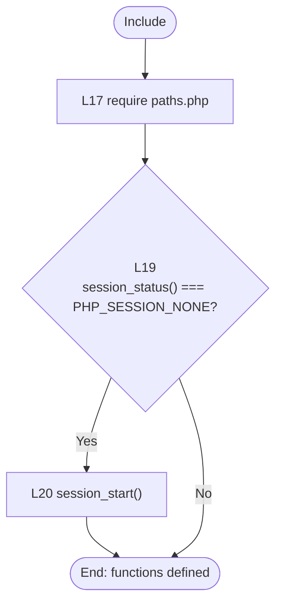
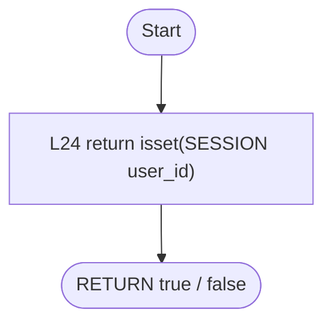
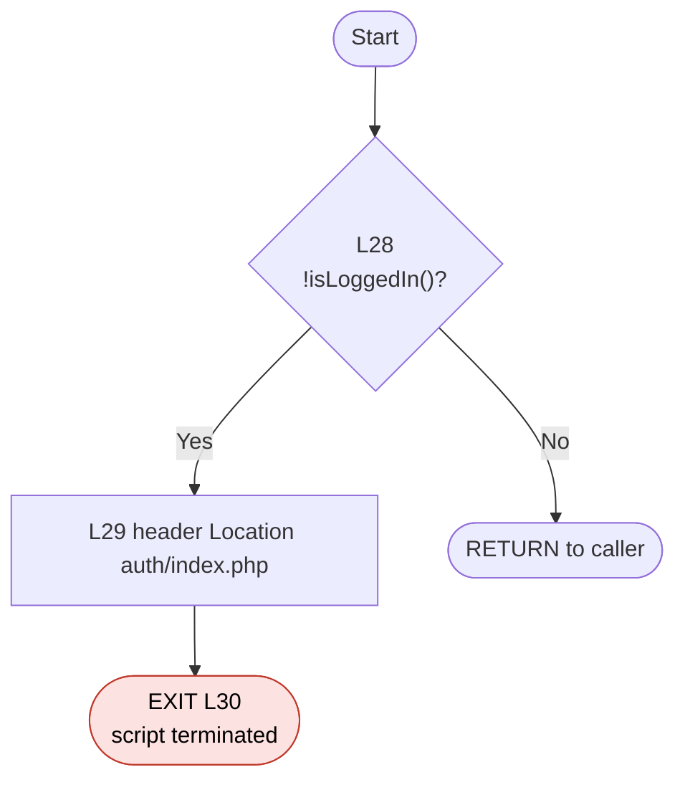
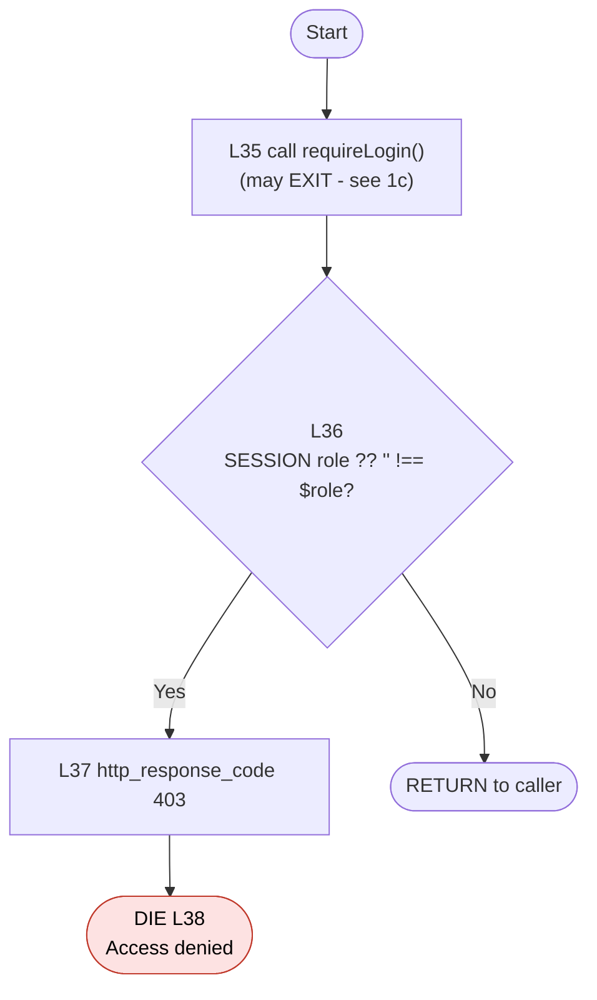
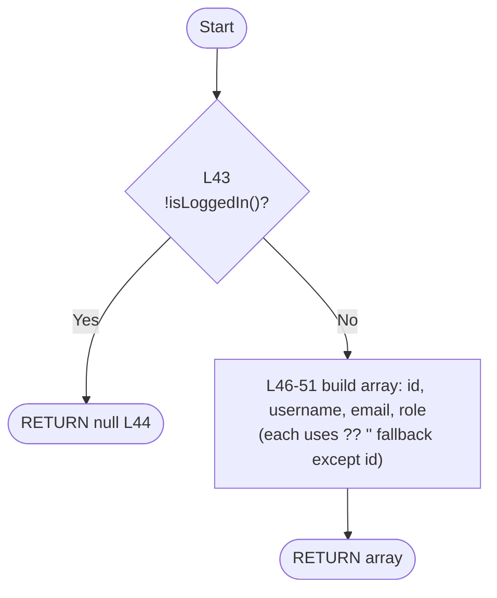

# CFG 05 — `includes/auth.php` (Access-control helpers)

**Workflow:** Authorization / session guard  **Type:** 4 functions + 1 top-level block  **Lines:** 53
**Why selected:** Small, central to security, and explains the access-control findings across the whole app.

## 1. Control Flow Graphs

### 1a. Top-level block (L17-21)

### 1b. `isLoggedIn(): bool` (L23-25)

### 1c. `requireLogin(): void` (L27-32)

### 1d. `requireRole(string $role): void` (L34-40)

### 1e. `currentUser(): ?array` (L42-52)

## 2. Conditional branches

| Function | Line | Condition | True | False |
|----------|------|-----------|------|-------|
| top-level | 19 | `session_status() === PHP_SESSION_NONE` | `session_start()` | skip |
| `requireLogin` | 28 | `!isLoggedIn()` | redirect + `exit` | return |
| `requireRole` | 36 | `($_SESSION['role'] ?? '') !== $role` | 403 + `die` | return |
| `currentUser` | 43 | `!isLoggedIn()` | `null` | build array |

## 3. Loops

None.

## 4. Return / exit paths

| Function | Exits |
|----------|-------|
| `isLoggedIn` | 1 return (bool) |
| `requireLogin` | `exit` L30 (redirect) or normal return |
| `requireRole` | inherits `requireLogin`'s `exit`; `die` L38 (403) or normal return |
| `currentUser` | return `null` (L44) or return array (L46) |

## 5. Metrics

| Unit | Predicates | V(G) |
|------|-----------|------|
| top-level block | 1 | 2 |
| `isLoggedIn` | 0 | 1 |
| `requireLogin` | 1 | 2 |
| `requireRole` | 1 (`??` not counted) | 2 |
| `currentUser` | 1 | 2 |

## 6. Suspicious code and observations

| Ref | Evidence | Status |
|-----|----------|--------|
| F-02 | `requireRole()` is **never called** anywhere in the project (`grep requireRole` finds only its definition L34 and a docblock mention L10). It is dead code, and its 403 path (L37-38) is unreachable from the application. | **Confirmed** |
| F-01 | `requireLogin()` is called by only `index.php` (L4) and `books/view.php` (L4). **16 pages never call it**: `authors/{add,delete,edit,view}`, `books/{add,delete,edit}`, `members/{add,delete,edit,view}`, `issue_return/{issue,return,status}`, `search.php`, `test_connection.php`. `header.php` L5 documents the convention ("Include AFTER ... requireLogin()") but those pages do not follow it. | **Confirmed** |
| F-14 | `header.php` L25 uses `function_exists('currentUser') ? currentUser() : null`. On pages that never include `auth.php` (the 16 above) the function is undefined, so the sidebar shows "Guest" even for a logged-in admin. | **Confirmed** |
| Role model | `requireRole` and the `staff` role exist, but no page restricts anything by role, and staff cannot log in (F-03). The role system is effectively unused. | **Confirmed** |
