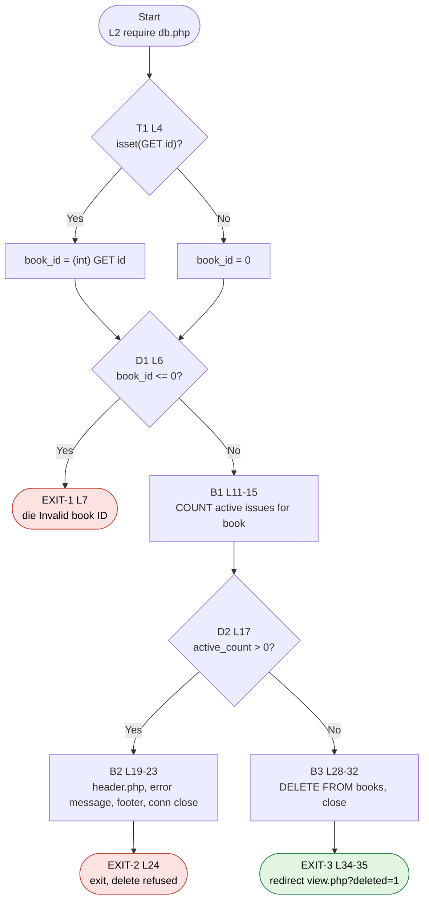

# CFG 06 — `books/delete.php` (Delete a Book)

**Workflow:** Catalog maintenance (CRUD delete)  **Type:** Script  **Lines:** 36
**Why selected:** Early `die`, a business-rule guard with an early `exit`, and a final redirect. `authors/delete.php` and `members/delete.php` follow the same pattern.

## 1. Control Flow Graph

## 2. Conditional branches

| ID | Line | Condition | True | False |
|----|------|-----------|------|-------|
| T1 | 4 | `isset($_GET['id'])` (ternary) | cast to int | 0 |
| D1 | 6 | `$book_id <= 0` | EXIT-1 | B1 |
| D2 | 17 | `$active_count > 0` | B2 → EXIT-2 | B3 |

## 3. Loops

None.

## 4. Return / exit paths

| Exit | Lines | Type | Outcome |
|------|-------|------|---------|
| EXIT-1 | 7 | `die()` | Invalid or missing id (plain text) |
| EXIT-2 | 24 | `exit` | Page shown: cannot delete, copies still issued |
| EXIT-3 | 34-35 | `header()` + `exit` | Redirect after delete |

## 5. Metrics

| Metric | Value |
|--------|-------|
| Decision predicates | 3 (T1, D1, D2) |
| V(G) | **4** |
| Exit points | 3 |

## 6. Suspicious code and observations

| Ref | Evidence | Status |
|-----|----------|--------|
| F-01 | No `requireLogin()` before B3's `DELETE`. Anyone can delete a book by visiting the URL. | **Confirmed** |
| F-09 | The destructive action is triggered by `GET` (L4 reads `$_GET['id']`, no method check, no CSRF token). A link, image tag or prefetch can delete records. Same in `authors/delete.php` L4 and `members/delete.php` L4. | **Confirmed** |
| F-10 | D2 only protects *active* issues (`status = 'issued'`). `library_db.sql` declares `issued_books.book_id ... ON DELETE CASCADE`, so deleting a book silently destroys that book's whole **returned** loan history. | **Confirmed** (code + schema) |
| F-11 | B3's `$stmt->execute()` result (L30) is never checked, so EXIT-3 (`deleted=1`) is taken even if the delete failed (PHP < 8.1). On PHP ≥ 8.1 a failure throws an uncaught exception and EXIT-3 is never reached. | Likely (environment-dependent) |
