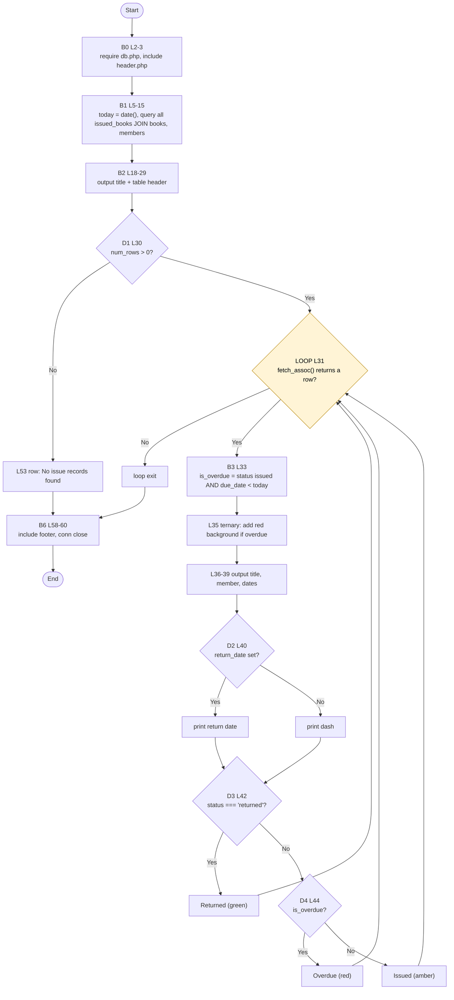

# CFG 07 — `issue_return/status.php` (Issued / Overdue list)

**Workflow:** Reporting / overdue tracking  **Type:** Script  **Lines:** 61
**Why selected:** The only selected unit whose main logic is a loop, with a three-way status branch inside it.

## 1. Control Flow Graph

## 2. Conditional branches

| ID | Line | Condition | True | False |
|----|------|-----------|------|-------|
| D1 | 30 | `$result->num_rows > 0` | enter loop | "No issue records" row |
| B3 | 33 | `status === 'issued' && due_date < $today` (assignment with `&&`) | `is_overdue = true` | `false` |
| T | 35 | `$is_overdue ? ' style=...' : ''` | red row | normal row |
| D2 | 40 | `$row['return_date']` truthy (ternary) | print date | print `—` |
| D3 | 42 | `status === 'returned'` | "Returned" | D4 |
| D4 | 44 | `elseif ($is_overdue)` | "Overdue" | else: "Issued" |

## 3. Loops

| Line | Type | Iterates over | Exit condition | Body |
|------|------|---------------|----------------|------|
| 31 | `while ($row = fetch_assoc())` | all joined issue rows, ordered issued-first then by due date | `fetch_assoc()` returns null | B3 to D4 (one table row per record) |

## 4. Return / exit paths

No `exit`/`die`/`return`. Two routes reach B6: through the loop (records exist) or directly (D1 false). Single normal end of script.

## 5. Metrics

| Metric | Value |
|--------|-------|
| Decision predicates | 7 (D1, loop, `&&` in B3, ternary L35, D2, D3, D4) |
| V(G) | **8** |

## 6. Suspicious code and observations

| Ref | Evidence | Status |
|-----|----------|--------|
| F-01 | No `requireLogin()` (the report of who borrowed what is public). | **Confirmed** |
| F-14 | `header.php` is included (L3) without `auth.php`, so the sidebar always shows "Guest" here. | **Confirmed** |
| Reachability | All three status outcomes are reachable: D3 needs `returned`, D4 needs `issued` and past due, the else needs `issued` and not past due. `status` is an ENUM of only those two values, so there is no fourth state. No unreachable branch found. | **Confirmed** |
| F-16 | "Overdue" is computed with PHP `date('Y-m-d')` here (L5), but the dashboard (`index.php` L11) counts overdue with MySQL `CURDATE()`. If PHP and MySQL time zones differ, the two pages can disagree about the same record around midnight. | Likely (low) |
