# DFG 01 — Login (`auth/login_handler.php` + `auth/index.php`)

**Workflow:** Authentication  **Entry:** `POST email, password, remember`  **Sinks:** `users` query, `$_SESSION`, `Set-Cookie`, redirect

## 1. Data Flow Graph

```mermaid
flowchart LR
    U(["Browser<br/>login form"])
    P1["P1 L13-15<br/>read + trim email<br/>read password raw<br/>remember = isset"]
    P2["P2 L18<br/>empty check"]
    P3["P3 L25-44<br/>prepared SELECT by email"]
    DB[("users table")]
    P4["P4 L48-50<br/>user found AND role admin<br/>AND password_verify"]
    P5["P5 L54-60<br/>session_regenerate_id<br/>store identity"]
    P6["P6 L63-77<br/>remember cookie<br/>30 days"]
    SS[("$_SESSION")]
    P7["P7 auth/index.php L10-11<br/>read then unset login_error"]
    OUT(["Browser<br/>redirect / HTML"])

    U -- "email, password, remember (strings)" --> P1
    P1 -- "email, password" --> P2
    P2 -- "empty: login_error constant" --> SS
    P2 -- "email" --> P3
    P3 -- "email bound to ?" --> DB
    DB -- "row: user_id, username, email, password_hash, role" --> P4
    P1 -- "password" --> P4
    P4 -- "success: user_id, username, email, role" --> P5
    P5 --> SS
    P1 -- "remember bool" --> P6
    P6 -- "Set-Cookie session id, expires +30d" --> OUT
    P4 -- "failure: login_error constant" --> SS
    SS -- "login_error, one-shot" --> P7
    P7 -- "escaped message" --> OUT
    P5 -- "Location BASE_URL index.php" --> OUT

    classDef input fill:#ffe8cc,stroke:#d9822b,color:#000;
    classDef store fill:#dbeafe,stroke:#2563eb,color:#000;
    classDef out fill:#e1f5e1,stroke:#1f7a3d,color:#000;
    class U input;
    class DB,SS store;
    class OUT out;
```

## 2. Def-use table

| Variable | DEF | MOD | USE-P | USE-C |
|----------|-----|-----|-------|-------|
| `$email` | L13 (`trim($_POST['email'])`) | | L18 | L38 `bind_param` |
| `$password` | L14 (`$_POST['password']`, **not trimmed**) | | L18 | L50 `password_verify` |
| `$remember` | L15 (`isset`) | | L63 | |
| `$stmt` | L25 | L38-39, L44 (bind, execute, close) | L32 | |
| `$result` | L41 | | | L42 |
| `$user` | L42 (`fetch_assoc`) | | L48, L49 | L50, L57-60 |
| `$params` | L64 | | | L66-77 |
| `$_SESSION['login_error']` | L19, L33, L87 | `unset` in `auth/index.php` L11 | `auth/index.php` L10 | rendered as `$error` |
| `$_SESSION['user_id' ... 'role']` | L57-60 | | `auth.php` L24 | `auth.php` L47-50 |

## 3. Data paths from input to database to output

| Path | Trace | Safe? |
|------|-------|-------|
| `email` → SQL | `$_POST['email']` → `trim` (L13) → empty check (L18) → `bind_param("s")` (L38) → `WHERE email = ?` | **Yes**, parameterized |
| `password` → check | `$_POST['password']` → `password_verify($password, $user['password_hash'])` (L50). Never sent to the database, never stored | **Yes** |
| DB row → session | `$user` (5 columns incl. `password_hash`) → only 4 fields copied to `$_SESSION` (L57-60); `password_hash` is **not** persisted in the session | **Yes** |
| error → page | Only constant strings are placed in `login_error`; no input is echoed back | **Yes** |

## 4. Findings

| Ref | Evidence | Status |
|-----|----------|--------|
| DF-14 | `password` is read untrimmed here (L14) but `register.php` trims it (L22). Same value is transformed differently on its two paths, so such passwords never verify. | **Confirmed** |
| DF-12 | `$_SESSION['user_email']` (L59) and `['role']` (L60) are defined but effectively never consumed: `currentUser()` copies them into `'email'`/`'role'` and no caller reads those keys; `requireRole` is never called. Only `username` is used (`header.php` L26, `index.php` L18). | **Confirmed** (`grep` of every consumer) |
| DF-13 | No data store tracks failed attempts (no session counter, no column in `users`). Unlimited password guesses are possible. | **Confirmed** (absence) |
| DF-05 | The login form (`auth/index.php` L63) has no CSRF token; `grep csrf` finds nothing in the project. | **Confirmed** |
| DF-11 | The seed admin (`admin@library.local` / `admin123`) is published in `README.md` and `user_schema.sql`. | **Confirmed** |
