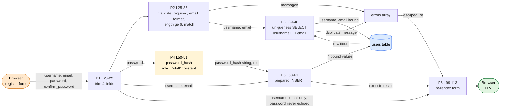

# DFG 02 — Registration (`auth/register.php`)

**Workflow:** Account creation  **Entry:** `POST username, email, password, confirm_password`  **Sink:** `INSERT INTO users`

## 1. Data Flow Graph

## 2. Def-use table

| Variable | DEF | MOD | USE-P | USE-C |
|----------|-----|-----|-------|-------|
| `$username` | L20 | | L25 | L40 `bind`, L54 `bind`, L109 (form value, escaped) |
| `$email` | L21 | | L25, L28 | L40, L54, L113 (escaped) |
| `$password` | L22 (**trimmed**) | | L25, L31, L34 | L50 `password_hash` |
| `$confirm_password` | L23 (trimmed) | | L34 | |
| `$errors` | L16 | L26, 29, 32, 35, 44, 59 | L38, L49, L95 | L99-103 (escaped output) |
| `$password_hash` | L50 | | | L54 `bind` |
| `$role` | L51 (constant `'staff'`) | | | L54 `bind` |
| `$success` | L17 | L57 | L89, L105 | |

## 3. Data paths

| Path | Trace | Safe? |
|------|-------|-------|
| input → DB | `username`/`email` → `trim` → validation (email only) → prepared statements at L40 and L54 | SQL-injection safe |
| password | `trim` → `password_hash(PASSWORD_DEFAULT)` → column `password_hash`. Plain text never stored or echoed | **Yes** |
| role | **Hard-coded** `'staff'` (L51); no input field reaches `role`, so privilege escalation by form tampering is impossible | **Yes** |
| echo-back | Only `username` and `email` are re-displayed, via `htmlspecialchars` (L109, L113) | **Yes** |

## 4. Findings

| Ref | Evidence | Status |
|-----|----------|--------|
| DF-14 | Password is trimmed at registration (L22-23), untrimmed at login (`login_handler.php` L14). | **Confirmed** |
| F-03 | Role constant `'staff'` (L51) meets login's `role === 'admin'` check: the registered account can never sign in. | **Confirmed** |
| DF-01 | `username` (DB limit 50) and `email` (limit 100) are never length-checked; the only `strlen` is the password minimum (L31). Over-long values either fail the INSERT (strict mode, branch L59) or are silently truncated (non-strict). | **Confirmed** (no check) / Likely (effect) |
| DF-05 | No CSRF token on the registration form. | **Confirmed** |
| Check-then-act | Uniqueness is checked at L39-45 and written at L53-56 without a lock; the `UNIQUE` index is the only real guard (race window). | Likely |
