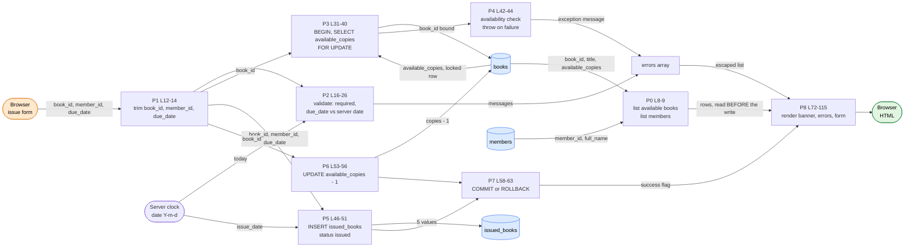

# DFG 03 — Issue a Book (`issue_return/issue.php`)

**Workflow:** Core business transaction  **Entry:** `POST book_id, member_id, due_date`  **Sinks:** `issued_books` INSERT, `books.available_copies` UPDATE

## 1. Data Flow Graph

## 2. Def-use table

| Variable | DEF | MOD | USE-P | USE-C |
|----------|-----|-----|-------|-------|
| `$errors` | L4 | L17, 20, 23, 25, 26, 62 | L28, L78 | L81-83 (escaped) |
| `$success` | L5 | L59 | L72 | |
| `$books_result` | L8 | | | L92 (loop, builds `<option>`) |
| `$members_result` | L9 | | | L102 |
| `$book_id` | L12 (string) | | L16 | L37, L49, L54 (`bind "i"`) |
| `$member_id` | L13 | | L19 | L49 (`bind "i"`) |
| `$due_date` | L14 | | L22, L24 | L24 (`strtotime`), L49 (`bind "s"`) |
| `$check` | L36 | | | L37-40 |
| `$book` (locked row) | L39 | | L42 | **not used after L42**; re-assigned as loop variable at L92 |
| `$issue_date` | L46 (`date()`) | | | L49 |
| `$e` | L60 | | | L62 (`getMessage()` → `$errors`) |

## 3. Data paths from input to database to output

| Path | Trace | Safe? |
|------|-------|-------|
| `book_id` → locked read | `$_POST` → `trim` → `bind "i"` → `SELECT ... FOR UPDATE` → `available_copies` → check L42 | SQL-safe; race-safe (row lock) |
| `book_id`, `member_id`, `due_date` → INSERT | validated only for non-empty / date not in the past → `bind "iiss"` → `issued_books` | SQL-safe. **`book_id` and `member_id` are never validated as numeric or as existing members** |
| counter | `available_copies - 1` is computed **in SQL** (L53), not in PHP, so it uses the locked row's current value | **Yes** (atomic) |
| DB error → page | `$e->getMessage()` → `$errors` → `htmlspecialchars` (L82) | XSS-safe; may expose DB text |
| DB → dropdown | `title` → `htmlspecialchars` (L94); `book_id` printed raw (L93), `available_copies` cast `(int)` | Safe (ints from DB) |

## 4. Findings

| Ref | Evidence | Status |
|-----|----------|--------|
| DF-09 | **Stale def-use.** `$books_result` is defined at L8 and consumed at L92, but the write (L53) happens between them. After a successful issue the dropdown shows pre-update counts. `return.php` refreshes its list (L62), so the two pages differ. | **Confirmed** |
| DF-02 | `available_copies` is decremented here and incremented in `return.php`, but also set freely by `books/edit.php`; nothing reconciles it with `COUNT(issued_books WHERE status='issued')`. | **Confirmed** |
| DF-04 | `member_id` reaches the INSERT with no existence check (only the foreign key). A forged id yields a DB error, echoed through L62 on PHP ≥ 8.1. | Likely |
| DF-06 | No `requireLogin()`: unauthenticated input reaches two tables. | **Confirmed** |
| DF-10 | Raw `Exception::getMessage()` from MySQL can reach the browser (L62 → L82). | Likely |
| F-06 | No redirect after success: a browser refresh replays the POST and re-runs P5/P6. | **Confirmed** |
