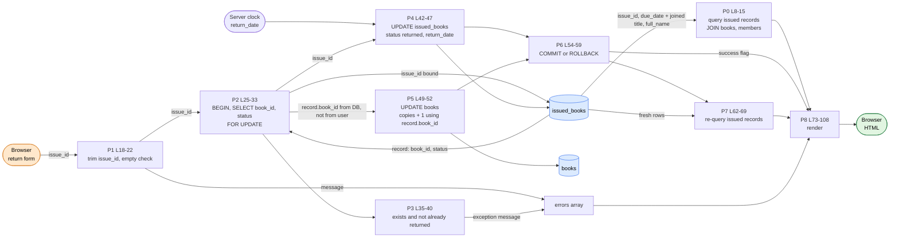

# DFG 04 — Return a Book (`issue_return/return.php`)

**Workflow:** Core business transaction  **Entry:** `POST issue_id`  **Sinks:** `issued_books` UPDATE, `books.available_copies` UPDATE

## 1. Data Flow Graph

## 2. Def-use table

| Variable | DEF | MOD | USE-P | USE-C |
|----------|-----|-----|-------|-------|
| `$issued_result` | L8 | **redefined L62** | L92 (`num_rows`) | L97 (loop) |
| `$issue_id` | L18 | | L20 | L30, L45 (`bind "i"`) |
| `$errors` | L4 | L21, L58 | L24, L82 | L85-87 |
| `$success` | L5 | L55 | L78 | |
| `$record` | L32 (`book_id`, `status`) | | L35, L38 | **L50** (`book_id` → `books` UPDATE) |
| `$return_date` | L42 (`date()`) | | | L45 |

## 3. Data paths

| Path | Trace | Safe? |
|------|-------|-------|
| `issue_id` → lookup | `$_POST` → `trim` → `bind "i"` → locked SELECT | SQL-safe |
| **`book_id` for the counter** | Comes from the **DB row** (`$record['book_id']`, L50), **not** from user input. A client cannot choose which book's counter is incremented | **Better than `issue.php`**, where `book_id` is user-supplied |
| double return | Status read under row lock (L29), rejected at L38 | **Yes** (idempotent) |
| DB → dropdown | `title`, `full_name`, `due_date` through `htmlspecialchars` (L99); `issue_id` raw (L98, an int from DB) | Safe |

## 4. Findings

| Ref | Evidence | Status |
|-----|----------|--------|
| DF-09 | L62-69 re-defines `$issued_result` with the identical query from L8-15 even when the return failed. Duplicate def with no change in meaning. | **Confirmed** |
| F-07a | `$errors` can only be filled by L21, so L24 always equals the negation of L20: two of four data-dependent paths cannot occur. | **Confirmed** |
| DF-06 | No `requireLogin()`: unauthenticated users can alter `issued_books` and `books`. | **Confirmed** |
| DF-02 | `+ 1` has no upper bound against `total_copies`; if `books/edit.php` ever lowered `total_copies` or set `available_copies` independently, returns can push `available_copies` above `total_copies`. | Likely (derived from the writers listed in `00_data_inventory.md`) |
