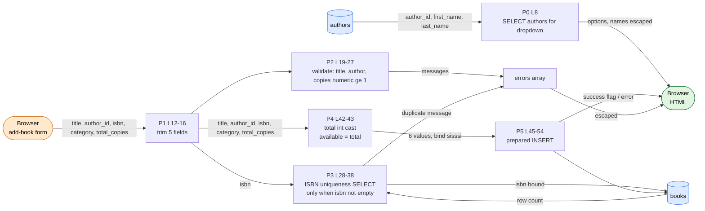

# DFG 05 — Book Create / Update (`books/add.php`, `books/edit.php`)

**Workflow:** Catalog maintenance  **Entry:** `POST title, author_id, isbn, category, total_copies [, available_copies]`  **Sink:** `books` INSERT / UPDATE
`members/add.php` follows the same pattern (trim → validate → uniqueness SELECT → prepared INSERT).

## 1. Data Flow Graph — create (`books/add.php`)

## 2. Data Flow Graph — update (`books/edit.php`)

## 3. Def-use table (`add.php`)

| Variable | DEF | MOD | USE-P | USE-C |
|----------|-----|-----|-------|-------|
| `$title` | L12 | | L19 | L46 |
| `$author_id` | L13 (string) | | L22 | L46 (`bind "i"`), L88 (selected option) |
| `$isbn` | L14 | | L28 | L31, L46 (**`''` is bound as a real value**) |
| `$category` | L15 | | | L46 |
| `$total_copies` | L16 (string) | L42 `(int)` | L25 | L46 (bound as `"s"`) |
| `$available_copies` | L43 (= total) | | | L46 |
| `$errors` | L4 | L20, 23, 26, 35, 51 | L41, L68 | L71-73 |

## 4. Data paths

| Path | Trace | Safe? |
|------|-------|-------|
| all text → SQL | `trim` → prepared `INSERT` / `UPDATE` | SQL-safe |
| all text → HTML | `htmlspecialchars` on every echo (edit L113-138) | XSS-safe |
| `book_id` (edit) | `(int)` cast at L8 before any use, so L109-110 print an int | **Yes** |
| `available_copies` (edit) | user value, only checked `0 ≤ x ≤ total` (L35-38) | **Not tied to real loans** |

## 5. Findings

| Ref | Evidence | Status |
|-----|----------|--------|
| DF-03 | **Empty ISBN.** L28 skips the uniqueness check when `$isbn === ''`, but L46 still inserts `''` into `books.isbn`, which is `UNIQUE`. `''` is not NULL, so the **second** book without an ISBN fails with the generic message at L51. Same in `edit.php` L41/L58. | **Confirmed** (code + schema) |
| DF-02 | `edit.php` L55-58 writes any `available_copies` between 0 and `total_copies`, independent of active loans in `issued_books`. `total_copies` can also be lowered below the number of copies currently out. Four writers of this field exist. | **Confirmed** |
| DF-16 | `edit.php` L70-73 re-reads the book into `$book`, but L81-86 immediately prefer `$_POST[...]` for all six form fields. On a POST, the fresh DB read is never used (dead definition except for the L76 existence check), and the form shows the **untrimmed** submitted text even though the **trimmed** text was stored. | **Confirmed** |
| DF-04 | `author_id` is only checked for non-empty (add L22). A non-numeric value is bound as `"i"` (becomes 0) and fails the foreign key at INSERT time. | Likely |
| DF-01 | No server-side or HTML length limits (`title` 150, `category` 50, `isbn` 20). `grep` finds no `strlen`/`maxlength` for these. | **Confirmed** (absence) |
| Minor | `total_copies` is bound with type `"s"` (add L46, edit L58) although it was cast to int. MySQL coerces it, so it works but is inconsistent. `edit.php` L8 accepts `book_id` from both URL and hidden field; the URL wins, so the hidden field is redundant. | **Confirmed** (low) |
| DF-06 / DF-05 | Both scripts lack `requireLogin()` and CSRF tokens. | **Confirmed** |
