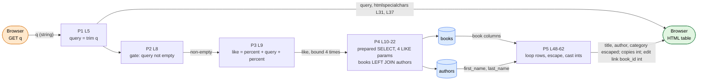

# DFG 06 — Book Search (`search.php`)

**Workflow:** Read-only query from user input  **Entry:** `GET q`  **Sink:** prepared `LIKE` query, HTML table

## 1. Data Flow Graph

## 2. Def-use table

| Variable | DEF | MOD | USE-P | USE-C |
|----------|-----|-----|-------|-------|
| `$query` | L5 | | L8, L36 | L9, L31, L37 (escaped) |
| `$like` | L9 | | | L20 (`bind "ssss"`) |
| `$stmt` | L10 | | | L20-22 |
| `$results` | L6 (null) | L22 | L48 | L49 (loop) |
| `$row` | L49 (per iteration) | | | L51-56 |

## 3. Data paths

| Path | Trace | Safe? |
|------|-------|-------|
| `q` → SQL | `trim` → `"%".$q."%"` → `bind_param` ×4 | SQL-injection safe |
| `q` → HTML | `htmlspecialchars` at L31 (attribute) and L37 (heading) | XSS safe |
| DB → HTML | `title`, author, `category` escaped; `total/available_copies` and `book_id` cast `(int)` | XSS safe |

## 4. Findings

| Ref | Evidence | Status |
|-----|----------|--------|
| DF-07/08 | Taint analysis finds **no** injection or XSS path: one untrusted source (`q`), one parameterized sink, every output escaped or int-cast. | **Confirmed** (positive) |
| DF-09 | `%` and `_` typed by the user are not escaped before L9, so they act as wildcards (`%` lists the whole catalog). Low impact. | **Confirmed** (low) |
| DF-06 | No `requireLogin()`, and L56 emits an **Edit** link per result to `books/edit.php`, which is also unguarded. | **Confirmed** |
