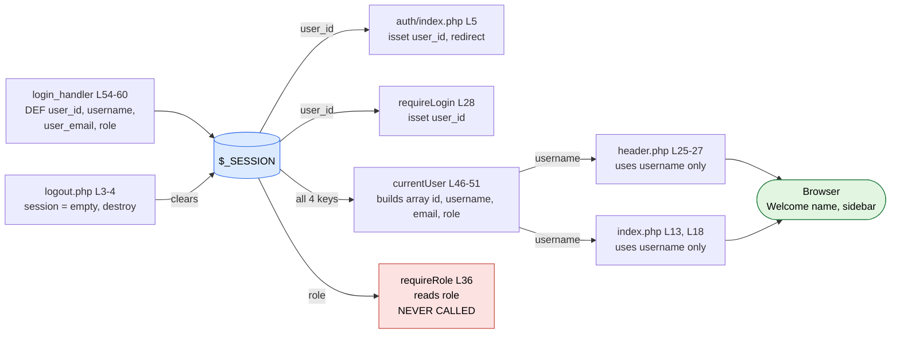
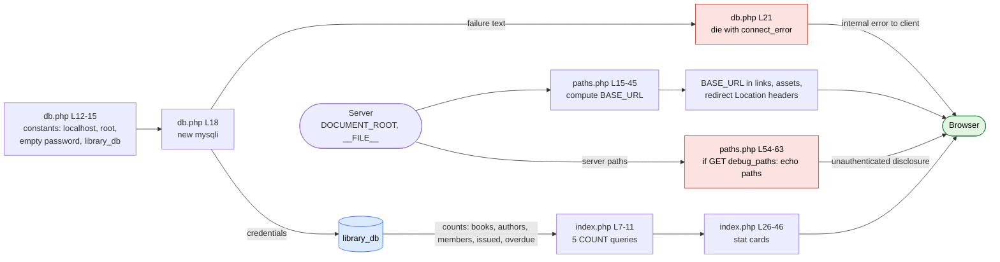

# DFG 07 — Session, Configuration and Dashboard Data

**Workflow:** Cross-cutting data (identity, connection, URL base, dashboard counts)  **Files:** `auth/login_handler.php`, `includes/auth.php`, `includes/header.php`, `index.php`, `auth/logout.php`, `config/db.php`, `config/paths.php`

## 1. Data Flow Graph — session lifecycle

## 2. Data Flow Graph — configuration and dashboard

## 3. Def-use table

| Variable | DEF | MOD | USE-P | USE-C |
|----------|-----|-----|-------|-------|
| `$_SESSION['user_id']` | `login_handler.php` L57 | | `auth/index.php` L5, `auth.php` L24 | `auth.php` L47 |
| `$_SESSION['username']` | L58 | | | `auth.php` L48 → `header.php` L26, `index.php` L18 |
| `$_SESSION['user_email']` | L59 | | | `auth.php` L49 only (**dead**) |
| `$_SESSION['role']` | L60 | | `auth.php` L36 (dead function) | `auth.php` L50 (**dead**) |
| `$loggedInUser` | `header.php` L25 | | | L26 |
| `$displayName` / `$initial` | L26-27 | | | L96, L99 (escaped) |
| `BASE_URL` | `paths.php` L25/L44 (constant) | | | all links and `Location:` headers |
| `$total_books ... $total_overdue` | `index.php` L7-11 | | | L26-46 (ints) |

## 4. Data paths

| Path | Trace | Safe? |
|------|-------|-------|
| session identity | DB row → 4 session keys → `currentUser()` → name in HTML via `htmlspecialchars` | Safe |
| `BASE_URL` | Derived from filesystem paths, **not** from user input, so it is not tainted when used in `Location:` or HTML attributes | **Yes** |
| `PHP_SELF` | `basename()` → compared with constants in `nav_active` (header L14-22), never echoed | **Yes** |
| dashboard counts | SQL `COUNT(*)` ints → echoed unescaped (L26-46) | Safe (integers) |

## 5. Findings

| Ref | Evidence | Status |
|-----|----------|--------|
| DF-10a | `paths.php` L54-63: any page loading it with `?debug_paths=1` echoes `__FILE__`, `DOCUMENT_ROOT` and the project root **to anyone**, logged in or not. The comment calls it "TEMPORARY". | **Confirmed** |
| DF-10b | `db.php` L21 sends `connect_error` text to the browser on failure. | **Confirmed** |
| DF-10c | `test_connection.php` is public and prints all book titles; its own header says to delete it. | **Confirmed** |
| DF-11 | DB credentials are literal constants: `root` with an **empty password** (`db.php` L12-15). | **Confirmed** |
| DF-12 | `user_email` and `role` flow into the session and `currentUser()` but no consumer reads them; `requireRole()` is never called. Only `username` is consumed. | **Confirmed** |
| DF-14b | `header.php` L25 shows "Guest" on every page that does not include `auth.php` (the 16 unguarded pages), even when logged in. | **Confirmed** |
| Minor | `logout.php` clears `$_SESSION` and calls `session_destroy()` but does not expire the session cookie. | **Confirmed** (low) |
