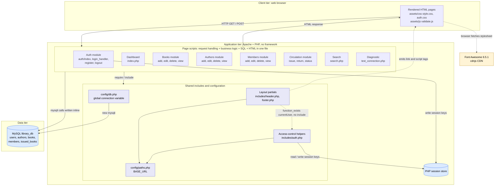

# Architecture Recovery: Library Management System

**Evidence base:** static inspection of the uploaded project (27 PHP files, 2 SQL scripts, 2 CSS files, 1 JS file, `README.md`). Nothing was executed. Statements are tied to files and line numbers; items that depend on server configuration are marked **Likely**.
Companion analyses: control flow (`../code/cfg/`), data flow (`../code/dfg/`), call graphs (`../code/call-graphs/`).

## 1. System summary

A server-rendered, **page-oriented PHP monolith** for a small library: staff manage books, authors and members, issue and return books, and see a dashboard and an issue-status report. It runs as a classic LAMP-style stack on one host (the README targets XAMPP, WAMP and MAMP) and talks directly to one MySQL database, `library_db`.

| Aspect | Verified fact | Evidence |
|--------|---------------|----------|
| Language / style | Procedural PHP. **No classes, interfaces, traits or namespaces** (`grep` finds none) | all `.php` files |
| Framework / package manager | None. No `composer.json`, no autoloader | file listing |
| Database driver | `mysqli`, used directly in page scripts (28 `prepare` + 16 `query` call sites) | `config/db.php` L17 and 20 scripts |
| Database | MySQL/MariaDB `library_db`, 5 tables; connection charset `utf8mb4` | `database/*.sql`, `db.php` L25 |
| UI rendering | HTML mixed with PHP in the same file as the logic | e.g. `issue_return/issue.php` L67-118 |
| Front-end assets | Hand-written CSS (`style.css`, `auth.css`) and vanilla JS (`validate.js`); Font Awesome 6.5.1 from a CDN | `includes/header.php` L35-36, `footer.php` L10 |
| Session / auth | PHP sessions; role stored in session; only `admin` may log in | `login_handler.php` L49-60 |
| Routing | **File-based**: the URL path is the script path; no router, no `.htaccess` | file listing |
| Tests | None. No `tests/` folder, no `phpunit.xml`; `test_connection.php` is a manual diagnostic | file listing |
| Size | 27 PHP files, 1937 PHP lines; 904 CSS lines; 137 JS lines (physical lines). | `wc`-style physical line count |

## 2. Architecture diagram

Source: [`architecture-diagram.mmd`](architecture-diagram.mmd). Rendered: [`architecture-diagram.svg`](architecture-diagram.svg), [`architecture-diagram.png`](architecture-diagram.png).

## 3. Components and modules

Modules follow the folder layout; each module is a set of independent page scripts.

| Module | Files | Responsibility (as implemented) | Lines |
|--------|-------|---------------------------------|------:|
| `auth/` | index.php, login_handler.php, logout.php, register.php | Authentication: login form, login handler, registration, logout | 342 |
| `books/` | add.php, delete.php, edit.php, view.php | Book catalog CRUD | 349 |
| `authors/` | add.php, delete.php, edit.php, view.php | Author CRUD | 233 |
| `members/` | add.php, delete.php, edit.php, view.php | Member CRUD | 276 |
| `issue_return/` | issue.php, return.php, status.php | Circulation: issue, return, status report | 294 |
| `includes/` | auth.php, footer.php, header.php | Shared layout and access-control helpers | 176 |
| `config/` | db.php, paths.php | Connection and URL-base configuration | 90 |
| project root | index.php, search.php, test_connection.php | Dashboard, search, connection diagnostic | 177 |

| Shared component | Role | Used by |
|------------------|------|---------|
| `config/db.php` | Opens the global `$conn` (`new mysqli`, L17) with hard-coded settings (L11-14) | 20 scripts |
| `config/paths.php` | Computes `BASE_URL` from the filesystem (L15-44); also contains a "TEMPORARY DEBUG TOOL" (L49-63) | 5 files directly, all layout pages transitively |
| `includes/auth.php` | Session bootstrap and 4 helpers (`isLoggedIn`, `requireLogin`, `requireRole`, `currentUser`) | `index.php`, `books/view.php`, `auth/register.php` |
| `includes/header.php` / `footer.php` | Page chrome: sidebar, top bar, `nav_active()` helper, script tag for `validate.js` | 16 pages each |
| `assets/js/validate.js` | Client-side form validation, sidebar toggle (+ two sections that match no markup) | loaded by `footer.php` |

## 4. Layers: what exists and what does not

| Conventional layer | Present as a separable layer? | Where the work actually happens |
|--------------------|-------------------------------|---------------------------------|
| Presentation (views) | **Partly**: layout is shared (`header.php`, `footer.php`) but each page writes its own body markup, and 2 auth pages write their own `<head>` | page scripts, lower half of each file |
| Controller / request handling | **No** dedicated layer. Each script reads `$_POST`/`$_GET` itself | top of each page script |
| Business logic | **No** dedicated layer. Rules (availability, due date, active-loan guards, role assignment) are inline in the pages | `issue.php`, `return.php`, `*/delete.php`, `register.php` |
| Data access | **No**. SQL is written inline against raw `mysqli`; only the connection is shared | 20 scripts |
| Persistence | **Yes**: MySQL with PK/FK/UNIQUE constraints | `database/*.sql` |

Result: **18 of 27 PHP files contain both SQL and HTML markup.** The architecture is a two-tier design (PHP application + database) with the application tier built as independent page scripts.

## 5. How UI, business logic and data access interact

A typical request follows the same script shape (verified in `books/add.php`, `members/add.php`, `issue.php`, `return.php`, `register.php`):

1. `require_once` the connection (`db.php`) and, on 2 pages, `auth.php` + `requireLogin()`.
2. Read input (`$_POST`/`$_GET`), `trim`.
3. Validate in place; append messages to an `$errors` array.
4. If valid: run SQL through `mysqli` (optionally in a transaction) in the same script.
5. `include header.php`, print HTML with embedded PHP loops/conditions over the result set, `include footer.php`.
6. Close the connection and end.

Variants:

| Request type | Examples | Flow |
|--------------|----------|------|
| List / view | `books/view.php`, `members/view.php`, `status.php`, `index.php` | query then render |
| Form (GET shows, POST saves) | `*/add.php`, `*/edit.php`, `register.php`, `issue.php`, `return.php` | validate, write, **re-render the same page** (no redirect, except where noted) |
| Action then redirect | `*/delete.php`, `login_handler.php`, `logout.php` | check, write, `header("Location: ...")`, `exit` |
| Transaction | `issue.php`, `return.php` | `begin_transaction`, locking `SELECT ... FOR UPDATE`, two writes, `commit`/`rollback` |

Sequence diagrams for the main flows: [`uml/`](uml/README.md).

## 6. Cross-cutting concerns

| Concern | Implementation | Observed gap |
|---------|---------------|--------------|
| Authentication | Login form, `password_verify`, session id regenerated (`login_handler.php` L54) | no failed-attempt limit, no CSRF token |
| Authorization | `requireLogin()` per page; `requireRole()` exists | **16 pages never call it**; `requireRole()` has no callers; effectively one role |
| Input validation | Server-side in each page (`trim`, `filter_var`, numeric checks); client-side `validate.js` | no length checks; rules duplicated between add and edit |
| Output encoding | `htmlspecialchars` on every dynamic string (63 calls) | none found (strength) |
| SQL safety | prepared statements for all user data; no interpolated `query()` | none found (strength) |
| Configuration | variables in `db.php` L11-14, `define('BASE_URL')` in `paths.php` | hard-coded, no environment separation |
| Error handling | mixture of `die()`, `$errors` arrays, and `Exception` (2 files only) | raw DB messages can reach the page; no logging |
| Layout / navigation | `header.php` sidebar with 8 links; `nav_active()` | 3 different page-head variants (header.php, `auth/index.php`, `register.php`) |

## 7. Dependencies

**Internal:** 60 include edges, **no circular include dependency**. Fan-in: `db.php` 20, `header.php` 16, `footer.php` 16, `paths.php` 5 (direct), `auth.php` 3. Details: [`../code/call-graphs/01_include_dependency_graph.md`](../code/call-graphs/01_include_dependency_graph.md).

**External:** PHP runtime with `mysqli` and sessions; MySQL server; Apache (or equivalent) with a document root; Font Awesome 6.5.1 via CDN (no integrity attribute); no PHP or JS libraries. Details: [`../code/call-graphs/06_external_dependencies_and_db_access.md`](../code/call-graphs/06_external_dependencies_and_db_access.md).

**Implicit dependency:** `header.php` calls `currentUser()` from `auth.php` behind `function_exists` without including it; 14 of 16 layout pages therefore show "Guest".

## 8. Deployment view

| Item | Fact | Evidence |
|------|------|----------|
| Topology | Single host: web server + PHP + MySQL | README prerequisites |
| URL base | Computed at runtime from `DOCUMENT_ROOT` and the project root | `paths.php` L15-44 |
| Database setup | Manual: import `library_db.sql`, then `user_schema.sql` (README steps 5-6). `library_db.sql` **drops and recreates** 4 tables (L10-13) | README, SQL |
| Credentials | `root` / empty password, edited by hand in `db.php` | `db.php` L11-14 |
| Default account | `admin` / `admin123` published in README and SQL comments | `user_schema.sql` L19, README |

## 9. Significant architectural limitations

| ID | Limitation | Evidence | Impact | Status |
|----|-----------|----------|--------|--------|
| AL-1 | **No layer separation**: UI, logic and data access share one file | 18 of 27 files mix SQL and HTML | hard to change one concern without touching others; no unit-test seam | Confirmed |
| AL-2 | **No central entry point / middleware**, so cross-cutting rules are opt-in per page | `requireLogin()` called in 2 of 18 non-auth pages (CFG F-01) | access control, layout and error handling cannot be enforced uniformly | Confirmed |
| AL-3 | **Business rules live in presentation scripts and are duplicated** | `available_copies` written by 4 scripts (add, issue, return, edit); delete guards copied in `books/` and `members/` | rule changes require multi-file edits (shotgun surgery) | Confirmed |
| AL-4 | **Global state and no dependency injection** | global `$conn` (`db.php` L17), `global $current_page` (`header.php` L18), `$_SESSION` key contract by convention | code cannot run without a live database; no tests exist | Confirmed |
| AL-5 | **Configuration is hard-coded; a debug tool ships in shared config** | `db.php` L11-14; `paths.php` L49-63 `?debug_paths=1` | credentials in source; information disclosure | Confirmed |
| AL-6 | **Schema lifecycle is manual and destructive** | two separate scripts, no migrations/versioning; `library_db.sql` L10-13 drops tables; `users` is not in the main script | re-running the setup erases circulation data; partial setups break login | Confirmed |
| AL-7 | **Inconsistent error handling and no logging** | `die()` strings, `$errors` arrays, exceptions in 2 files, DB error text echoed (`issue.php` L62 on PHP ≥ 8.1) | hard to diagnose; possible information leakage | Confirmed / Likely |
| AL-8 | **Role model is incomplete** | `register.php` L51 creates `staff`; `login_handler.php` L49 admits only `admin`; `requireRole()` unused | the "staff" role cannot be used | Confirmed |
| AL-9 | **Front-end coupling and external CDN** | `validate.js` binds to ids that exist only if `header.php` provides them (2 of 4 sections match nothing); Font Awesome from CDN | silent breakage when markup changes; offline degradation | Confirmed |
