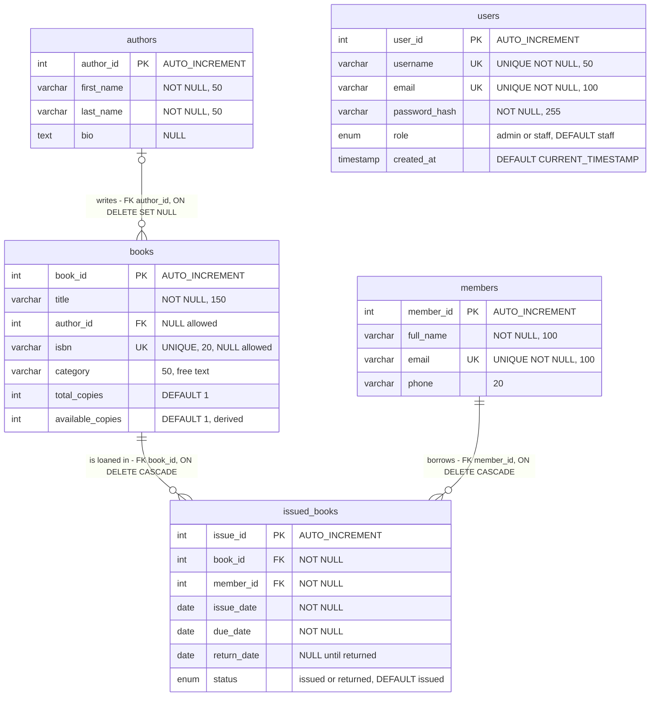

# Database Design Recovery: ERD

**Sources:** `database/library_db.sql` (4 tables, seed data), `database/user_schema.sql` (`users` table, seed admin), and every SQL statement in the PHP code (see [`../code/dfg/00_data_inventory.md`](../code/dfg/00_data_inventory.md), script × table matrix).
Diagram files: [`erd.mmd`](erd.mmd) (source), [`erd.svg`](erd.svg), [`erd.png`](erd.png).

## 1. Entity-Relationship Diagram

Notation: `|o` zero-or-one, `||` exactly one, `o{` zero-or-many. `users` is a standalone entity with no relationships.

## 2. Data dictionary

### `authors` (`library_db.sql` L16-21)

| Column | Type | Null | Key / constraint | Used by |
|--------|------|------|------------------|---------|
| `author_id` | INT AUTO_INCREMENT | no | PK | all author pages, `books` |
| `first_name` | VARCHAR(50) | no | | authors add/edit/view, books pages, search |
| `last_name` | VARCHAR(50) | no | | same |
| `bio` | TEXT | yes | | authors add/edit/view |

### `books` (L24-33)

| Column | Type | Null | Key / constraint | Used by |
|--------|------|------|------------------|---------|
| `book_id` | INT AUTO_INCREMENT | no | PK | all book pages, `issued_books` |
| `title` | VARCHAR(150) | no | | books, search, issue/return lists |
| `author_id` | INT | **yes** | FK → `authors.author_id` ON DELETE SET NULL | books add/edit/view, search |
| `isbn` | VARCHAR(20) | yes | UNIQUE | books add/edit/view, search |
| `category` | VARCHAR(50) | yes | free text | books add/edit/view, search (4 files) |
| `total_copies` | INT | yes | DEFAULT 1 | books add/edit |
| `available_copies` | INT | yes | DEFAULT 1 | books add/edit/view, issue, return, dashboard (6 files) |

### `members` (L36-41)

| Column | Type | Null | Key / constraint | Used by |
|--------|------|------|------------------|---------|
| `member_id` | INT AUTO_INCREMENT | no | PK | member pages, `issued_books` |
| `full_name` | VARCHAR(100) | no | | members pages, issue/return/status |
| `email` | VARCHAR(100) | no | UNIQUE | members add/edit |
| `phone` | VARCHAR(20) | yes | | members add/edit/view |

### `issued_books` (L44-54)

| Column | Type | Null | Key / constraint | Used by |
|--------|------|------|------------------|---------|
| `issue_id` | INT AUTO_INCREMENT | no | PK | `return.php` |
| `book_id` | INT | no | FK → `books.book_id` ON DELETE CASCADE | issue, return, status, delete guard |
| `member_id` | INT | no | FK → `members.member_id` ON DELETE CASCADE | same |
| `issue_date` | DATE | no | | issue, status |
| `due_date` | DATE | no | | issue, status, dashboard overdue count |
| `return_date` | DATE | yes | NULL until returned | return, status |
| `status` | ENUM('issued','returned') | yes | DEFAULT 'issued' | issue, return, status, delete guards, dashboard |

### `users` (`user_schema.sql` L8-15)

| Column | Type | Null | Key / constraint | Used by |
|--------|------|------|------------------|---------|
| `user_id` | INT AUTO_INCREMENT | no | PK | login (session) |
| `username` | VARCHAR(50) | no | UNIQUE | register, session |
| `email` | VARCHAR(100) | no | UNIQUE | login, register |
| `password_hash` | VARCHAR(255) | no | | login, register |
| `role` | ENUM('admin','staff') | yes | DEFAULT 'staff' | login, session |
| `created_at` | TIMESTAMP | yes | DEFAULT CURRENT_TIMESTAMP | **no PHP file** |

## 3. Relationships and cardinalities

| ID | Relationship | Cardinality | FK and action | Application behaviour |
|----|--------------|-------------|---------------|----------------------|
| R1 | `authors` → `books` | one author has 0..many books; a book has **0..1** author | `books.author_id` → `authors.author_id`, ON DELETE SET NULL | `authors/delete.php` L10-13 relies on SET NULL; `books/add.php` L22 requires choosing an author |
| R2 | `books` → `issued_books` | one book has 0..many loans; a loan has exactly 1 book | `issued_books.book_id`, ON DELETE CASCADE | `books/delete.php` blocks only when active loans exist |
| R3 | `members` → `issued_books` | one member has 0..many loans; a loan has exactly 1 member | `issued_books.member_id`, ON DELETE CASCADE | `members/delete.php` blocks only when active loans exist |
| R4 | `books` ↔ `members` | **many-to-many**, resolved by the associative entity `issued_books` (carries dates and status) | via R2 + R3 | the same member may hold the same book more than once; no uniqueness is enforced anywhere |
| R5 | `users` | **no relationship** to any other table | none | no `issued_by`; circulation actions cannot be attributed to a user |

## 4. Inconsistencies between schema and application logic

| ID | Inconsistency | Evidence | Status |
|----|---------------|----------|--------|
| SC-1 | **`available_copies` is derived data with no schema guard.** It equals `total_copies` minus active loans, but is stored separately, written by 4 scripts (`books/add.php` initial = total; `issue.php` L53 -1; `return.php` L49 +1; `books/edit.php` any value 0..total). No `CHECK (available_copies BETWEEN 0 AND total_copies)`; `return.php` has no upper bound; `edit.php` can lower `total_copies` below copies on loan | schema L30-31; scripts cited | **Confirmed** |
| SC-2 | **Two encodings of "returned".** `status='returned'` and `return_date IS NOT NULL` must agree but nothing enforces it; `return.php` L44-47 updates both together. "Overdue" is not in the ENUM and is computed at read time, in PHP (`status.php` L5) and with SQL `CURDATE()` (dashboard) | schema L50-51 | **Confirmed** (code) / Likely (time-zone skew) |
| SC-3 | **Empty ISBN breaks `UNIQUE`.** The column is nullable and unique, but `books/add.php` and `edit.php` insert `''` when the field is blank. Only the first blank-ISBN book can be saved (DFA DF-03) | schema L28; `books/add.php` L28-46 | **Confirmed** |
| SC-4 | **Nullable author vs UI.** The schema allows `author_id = NULL` (and SET NULL creates such rows), but `books/add.php` L22 requires an author. Authorless books are displayed correctly (`LEFT JOIN` in `books/view.php` L11 and `search.php` L13) but cannot be created through the UI | schema L27, L32 | **Confirmed** |
| SC-5 | **Cascade vs guard.** The application treats deletion of a book or member as safe when no *active* loan exists, but `ON DELETE CASCADE` also deletes all *returned* history rows (CFG F-10) | schema L52-53; `books/delete.php` L11-25 | **Confirmed** |
| SC-6 | **No length/format rules in code for bounded columns** (`title` 150, `category` 50, `isbn` 20, `phone` 20, `username` 50, `email` 100); server code checks only password length | `grep strlen` | **Confirmed** (absence) |
| SC-7 | **Unused column:** `users.created_at` is referenced by no PHP file. **Unusable value:** `users.role='staff'` (default and what `register.php` L51 assigns) can never log in (`login_handler.php` L49) | schema; code | **Confirmed** |
| SC-8 | **No audit link:** `issued_books` has no user column, so the system cannot say which staff member issued or returned a book | schema L44-54 | **Confirmed** (design gap) |
| SC-9 | **Character set:** the connection is set to `utf8mb4` (`db.php` L25) but the SQL creates the database and tables without a charset or collation (L6, L16-54), so the effective charset depends on the server default or on how phpMyAdmin created `library_db` (README step 3) | `db.php`, SQL | Likely (environment-dependent) |
| SC-10 | **Setup scripts disagree:** `library_db.sql` drops 4 tables (L10-13) but not `users`; `users` lives in a separate script, so a partial setup yields a working catalog with no login | SQL, README steps 5-6 | **Confirmed** |
| SC-11 | **Search without index support:** `LIKE '%q%'` on title, ISBN, category and author names cannot use an index, and no FULLTEXT index exists. Dashboard overdue counting (`status='issued' AND due_date < CURDATE()`) has no index on those columns | `search.php`; schema | **Confirmed** (low impact at this size) |
| SC-12 | **Undefined business rule:** nothing prevents the same member from borrowing the same title repeatedly or without limit; neither schema nor `issue.php` checks | `issue.php` L16-58 | **Confirmed** (absence) |
| SC-13 | **Seed hash note:** `user_schema.sql` L21-22 says the hash comes from PHP's `password_hash`, but its prefix is `$2b$`; PHP's own output normally starts with `$2y$`. Not tested here | `user_schema.sql` L30 | Likely (low) |
| SC-14 | **Positive:** the seed data is consistent with the derived-counter rule (`UPDATE books ... available_copies - 1` for the one issued row, L84) and all foreign keys have explicit actions | `library_db.sql` L79-84 | **Confirmed** |

## 5. Normalization notes

The tables are in roughly third normal form except for (a) the derived `available_copies` (SC-1) and (b) `books.category`, a free-text attribute repeated on each row rather than a lookup table. Both are design observations, not defects that stop the application.
