# Activity Diagram: Library Management System (whole system)

End-to-end behaviour of the application: registration and login, the dashboard, then each function area (books, authors, members, circulation, search) and log out. Mermaid has no native activity notation, so this is a flowchart in UML activity style: black dot = initial node, ringed dot = final node, diamonds = decisions, boxes = actions, red = refusals and errors.

```mermaid
flowchart TD
    S((" ")) --> A0["User opens the application"]
    A0 --> D0{"Logged in? session has user_id"}
    D0 -- "yes" --> DASH
    D0 -- "no" --> AUTHP["Login page"]

    AUTHP --> D1{"Choose"}
    D1 -- "Register" --> R1["Enter username, email, password"]
    R1 --> R2{"Valid and not already registered?"}
    R2 -- "no" --> R3["Show errors"] --> AUTHP
    R2 -- "yes" --> R4["Create account with role staff, cannot log in"] --> AUTHP
    D1 -- "Log in" --> L1["Enter email and password"]
    L1 --> L2{"Account exists, role is admin, password correct?"}
    L2 -- "no" --> L3["Show: Invalid email or password"] --> AUTHP
    L2 -- "yes" --> L4["Regenerate session id and store user in session"]
    L4 --> DASH["Dashboard: counts of books, authors, members, issued, overdue"]

    DASH --> M{"Choose a function"}

    subgraph BOOKS["Books"]
        B0{"Books action"}
        B1["View book list"]
        B2["Add: validate fields, check ISBN unique if given"] --> B2b["Insert book, available copies = total"]
        B3["Edit: validate, available at most total"] --> B3b["Update book"]
        B4{"Any copy currently issued?"}
        B4 -- "yes" --> B4a["Refuse delete"]
        B4 -- "no" --> B4b["Delete book and its loan history"]
        B0 -- "view" --> B1
        B0 -- "add" --> B2
        B0 -- "edit" --> B3
        B0 -- "delete" --> B4
    end

    subgraph AUTHORS["Authors"]
        U0{"Authors action"}
        U1["View authors"]
        U2["Add: validate names"] --> U2b["Insert author"]
        U3["Edit: validate names"] --> U3b["Update author"]
        U4["Delete author, books keep existing with no author"]
        U0 -- "view" --> U1
        U0 -- "add" --> U2
        U0 -- "edit" --> U3
        U0 -- "delete" --> U4
    end

    subgraph MEMBERS["Members"]
        E0{"Members action"}
        E1["View members"]
        E2["Add: validate name, valid unique email"] --> E2b["Insert member"]
        E3["Edit: validate"] --> E3b["Update member"]
        E4{"Any book currently on loan?"}
        E4 -- "yes" --> E4a["Refuse delete"]
        E4 -- "no" --> E4b["Delete member and loan history"]
        E0 -- "view" --> E1
        E0 -- "add" --> E2
        E0 -- "edit" --> E3
        E0 -- "delete" --> E4
    end

    subgraph CIRC["Circulation"]
        C0{"Circulation action"}
        C0 -- "issue" --> I1["Choose book, member, due date"]
        I1 --> I2{"Valid? due date not in the past"}
        I2 -- "no" --> I2e["Show errors"]
        I2 -- "yes" --> I3["BEGIN, lock book row"]
        I3 --> I4{"Copy available?"}
        I4 -- "no" --> I4e["ROLLBACK, show error"]
        I4 -- "yes" --> I5["Insert loan, copies minus 1, COMMIT"]
        C0 -- "return" --> T1["Choose an issued loan"]
        T1 --> T2["BEGIN, lock loan row"]
        T2 --> T3{"Already returned or missing?"}
        T3 -- "yes" --> T3e["ROLLBACK, show error"]
        T3 -- "no" --> T4["Mark returned, copies plus 1, COMMIT"]
        C0 -- "status" --> ST1["List all loans, highlight overdue"]
    end

    subgraph SRCH["Search"]
        Q1["Enter search text"] --> Q2["Match title, ISBN, category, author name"] --> Q3["Show results"]
    end

    M -- "Books" --> B0
    M -- "Authors" --> U0
    M -- "Members" --> E0
    M -- "Circulation" --> C0
    M -- "Search" --> Q1
    M -- "Log out" --> X1["Destroy session"] --> AUTHP2["Show login page"] --> FIN((" "))

    B1 --> RET
    B2b --> RET
    B3b --> RET
    B4a --> RET
    B4b --> RET
    U1 --> RET
    U2b --> RET
    U3b --> RET
    U4 --> RET
    E1 --> RET
    E2b --> RET
    E3b --> RET
    E4a --> RET
    E4b --> RET
    I2e --> RET
    I4e --> RET
    I5 --> RET
    T3e --> RET
    T4 --> RET
    ST1 --> RET
    Q3 --> RET
    RET["Return to menu"] --> M

    classDef start fill:#000,stroke:#000;
    classDef fin fill:#fff,stroke:#000,stroke-width:4px;
    classDef fail fill:#fde2e2,stroke:#c0392b,color:#000;
    class S start;
    class FIN fin;
    class L3,R3,B4a,E4a,I2e,I4e,T3e fail;
```

## Notes (verified against the source)

- The login accepts only accounts with role `admin`; accounts created by registration get role `staff` and are always rejected (`login_handler.php` L49, `register.php` L51).
- Issue and return run inside a database transaction with a row lock (`SELECT ... FOR UPDATE`), so a failed check ends in ROLLBACK (`issue.php` L31-62, `return.php` L25-59).
- Deleting a book or member is refused only while a loan is active; otherwise the database cascade also removes the returned-loan history.
- Deleting an author has no guard; the author's books remain with no author.
- Only the dashboard and the book list check login. The other pages shown in the diagram can be opened without logging in.
