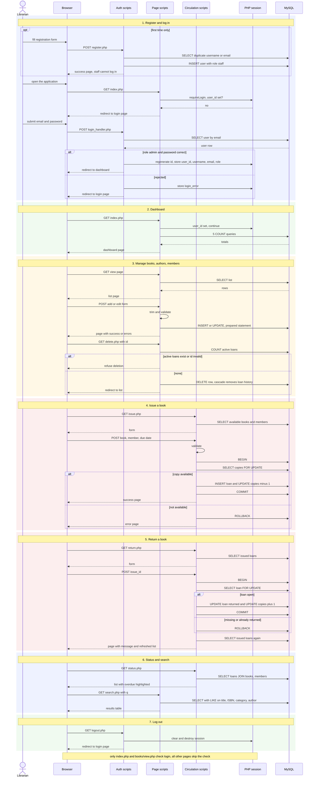

# Sequence Diagram: Library Management System (whole system)

One session from first visit to log out, in 7 phases: register and log in, dashboard, manage books/authors/members, issue, return, status and search, log out. Each phase is a coloured block.

## Participants and source files

| Participant | Stands for | Files |
|-------------|-----------|-------|
| Browser | the user's web browser | n/a |
| Auth scripts | login, registration, logout | `auth/index.php`, `auth/login_handler.php`, `auth/register.php`, `auth/logout.php` |
| Page scripts | dashboard, books, authors, members, search | `index.php`, `books/*.php`, `authors/*.php`, `members/*.php`, `search.php` |
| Circulation scripts | issue, return, status | `issue_return/issue.php`, `return.php`, `status.php` |
| PHP session | server-side session data | `includes/auth.php` |
| MySQL | database `library_db` | tables `users`, `authors`, `books`, `members`, `issued_books` |

## Notes (verified against the source)

- Every script talks to MySQL directly through `mysqli`; there is no separate data-access layer.
- Issue and return use `BEGIN`, a locking read, two writes and `COMMIT` or `ROLLBACK`.
- After a successful issue the same page is shown again with no redirect, so a browser refresh would submit it a second time.
- Only `index.php` and `books/view.php` check login (`requireLogin()`).
