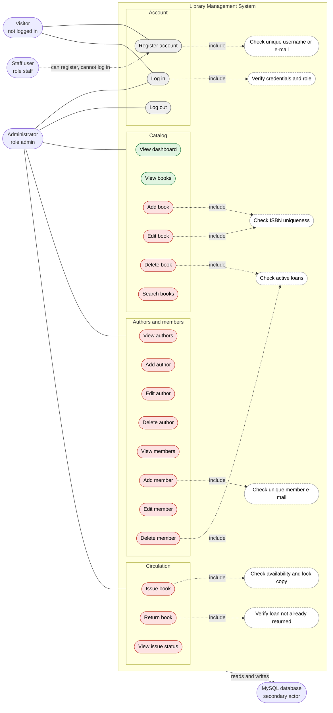

# Use Case Diagram: Library Management System (whole system)

Recovered from the 27 PHP scripts of the uploaded project. Drawn with Mermaid in UML use-case style (actors outside the system boundary, ovals for use cases, dashed arrows for `include`).

**Colour key:** green = page enforces login, red = page enforces **no** login (any visitor who knows the URL can use it), grey = public by design (register, log in, log out).

## Actors

| Actor | Meaning | Evidence |
|-------|---------|----------|
| Visitor | Not logged in; can register and log in | `auth/register.php`, `auth/index.php` |
| Administrator | The only role that can log in; performs all management use cases | `auth/login_handler.php` L49 |
| Staff user | Account created by registration; **cannot log in** | `register.php` L51 vs `login_handler.php` L49 |
| MySQL database | Secondary actor: stores and returns all data | `config/db.php` |

## Use cases (20) and their source files

| Group | Use cases | Source |
|-------|-----------|--------|
| Account | Register account, Log in, Log out | `auth/register.php`, `auth/login_handler.php`, `auth/logout.php` |
| Catalog | View dashboard, View books, Add book, Edit book, Delete book, Search books | `index.php`, `books/*.php`, `search.php` |
| Authors | View, Add, Edit, Delete author | `authors/*.php` |
| Members | View, Add, Edit, Delete member | `members/*.php` |
| Circulation | Issue book, Return book, View issue status | `issue_return/*.php` |

Included behaviours: verify credentials and role (log in), unique username or e-mail (register), ISBN uniqueness (add and edit book), active-loan check (delete book and member), availability check with row lock (issue), already-returned check (return), unique member e-mail (add member).

## Observations

- Only 2 of the 17 management and reporting use cases (dashboard, view books) enforce login; the other 15 do not.
- A registered **Staff user** has no usable use case because log in always rejects that role.
- There is no use case for managing users, changing a password, renewing or reserving a book, or fines.
